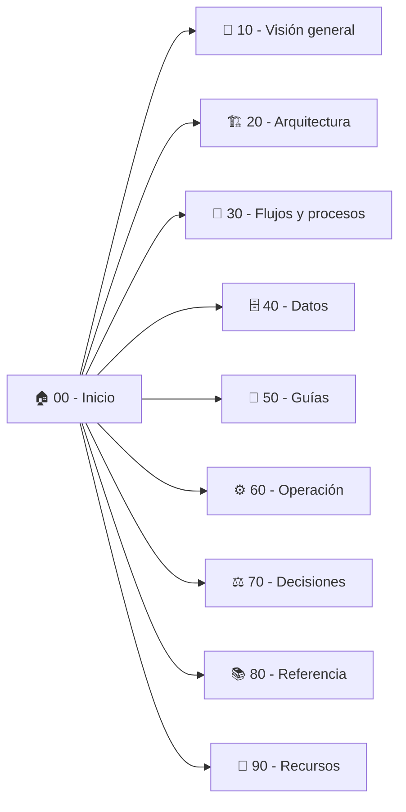

# 🏠 OpusClip Dashboard (`clip.opus.pro/dashboard`) — ClippersIppers

> [!abstract] En pocas palabras
> Esta base de conocimiento documenta de punta a punta la arquitectura, lógica de negocio, estado reactivo, contratos de API y motores internos de **OpusClip Web (`https://clip.opus.pro/dashboard`)**, reconstruidos mediante ingeniería inversa estática y dinámica con **REA (Reverse Engineer Anything)**. Está diseñada tanto para lectores de producto/negocio como para ingenieros de software y auditores técnicos.

El diagrama superior muestra la organización del vault en nueve áreas temáticas numeradas (`10` a `90`), permitiendo llegar a cualquier componente, flujo o contrato técnico en un máximo de dos clics.

> [!example] Ejemplo real: Qué ocurre al abrir `https://clip.opus.pro/dashboard`
> Cuando un creador entra a `https://clip.opus.pro/dashboard`, la aplicación carga el módulo raíz `575013` del [[Glosario#Chunk de Turbopack|Chunk de Turbopack]] `2pdyo3gbgw8ji.js`, valida la sesión contra `POST https://api.opus.pro/api/auth/session-profile`, consulta el [[Glosario#Feature Gate|Feature Gate]] `enable_workflow_revamp` en Statsig y decide en tiempo real si renderizar el nuevo **OpusClip 4.0 (`DashboardRevampEntry`)** o el **Dashboard Clásico (`SubmitCard` + `QuickStartPanel`)**, mientras ejecuta en segundo plano un benchmark de CPU en un Web Worker (`01sklqt0kl3nd.js`).

---

## 🧭 ¿Por dónde empezar según tu rol?

| Si eres… | Empieza por… | Y luego consulta… |
|---|---|---|
| **Producto / Negocio / Operaciones** | [[Resumen ejecutivo]] → [[Alcance y objetivos]] | [[Flujos y procesos]], [[Indicadores y métricas]] y [[FAQ]] |
| **Arquitecto / Tech Lead** | [[Arquitectura general]] → [[Componentes]] | [[Decisiones]], [[Integraciones]] y [[Mapa del proyecto.canvas]] |
| **Desarrollador Frontend / Reverser** | [[Módulo Dashboard y Enrutamiento de Workflows]] → [[Modelo de datos y Estado Global Jotai]] | [[Catálogo de Rutas y Chunks de Turbopack]], [[Referencia de Endpoints API Backend]] y [[Cómo reproducir y auditar el bundle con REA]] |
| **Auditor QA / Seguridad** | [[Registro de Evidencia REA]] → [[Monitoreo Feature Flags y Telemetría]] | [[Catálogo de Feature Gates y Experimentos Statsig]] y [[Despliegue y CDN]] |

---

## 🗺️ Mapa completo del proyecto (Índice general)

### 🎯 10 — [[Visión general]]
- [[Resumen ejecutivo]] — Qué hace OpusClip Dashboard, qué problema resuelve y cómo convierte videos largos en cortos virales.
- [[Alcance y objetivos]] — Límites de la auditoría REA, capacidades analizadas y cobertura de los 550+ chunks JS.
- [[Actores y responsables]] — Perfiles de usuario (Creador individual, Agencia, Clipper de campañas, Administrador Enterprise) y sistemas externos.
- [[Glosario]] — Diccionario de términos de negocio y técnicos (`ClipAnything`, `ClipBasic`, `Brand Kit`, `Frozen Credits`, `Cohort`, `Atoms`).

### 🏗️ 20 — [[Arquitectura]]
- [[Arquitectura general]] — Stack Next.js + Turbopack, hidratación híbrida, capa reactiva Jotai + TanStack Query y comunicación con `api.opus.pro`.
- [[Integraciones]] — Mapa de 15 servicios externos (Google Cloud Storage, Google Drive, YouTube OAuth, Statsig, Cloudflare Turnstile, Intercom, Brevo, Tolt, Sentry, Stripe/dLocal).
- **[[Componentes]] (10 subsistemas internos analizados al detalle)**:
  1. [[Módulo Dashboard y Enrutamiento de Workflows]] — Módulo `575013`, conmutación Clásico vs. OpusClip 4.0, título dinámico de pestaña y carruseles (`What's New`, `Demo Projects`, `Master OpusClip`).
  2. [[Motor de Ingesta y Subida de Medios]] — Validación de dominios por plan, subida multiparte concurrente a GCS (`MultipartUploader`) y preflight de metadatos.
  3. [[Motor de Curación IA y Configuración de Clips]] — Modelos `ClipBasic` vs. `ClipAnything`, rangos de duración, géneros dinámicos y persistencia de `SubmitSettings`.
  4. [[Sistema de Auto-Importación de YouTube]] — Vinculación OAuth de canales/playlists, verificación de propiedad y modos `email` vs. `auto_create`.
  5. [[Motor de Plantillas de Marca y Subtítulos]] — Esquemas Zod de `BrandKit`, motor Canvas de subtítulos animados, fuentes personalizadas y `Auto-Hook`.
  6. [[Gestor de Proyectos Colecciones y Búsqueda]] — Paginación, agrupación por fecha, máquina de estados de progreso (`generatingProgressStore`), acciones en lote y búsqueda semántica.
  7. [[Editor Multipista y Renderizado]] — Arquitectura de `editorCoreStore`, `editorEngineStore`, `renderMainEngineStore`, corte por transcripción y mejoras IA (`Eye Contact`, `Auto Zoom`, `Speech Enhancement`).
  8. [[Sistema de Créditos Planes y Facturación]] — Planes (`FreeTrial`, `Essential`, `Pro`, `Max`, `Enterprise`), billetera de créditos, fórmula de costos y recargas (`Top-up`).
  9. [[Publicación Social Calendario y Analíticas]] — Programación de posts (`publish-schedules`), OAuth social (TikTok, YouTube, Instagram, LinkedIn) y generación de copy social.
  10. [[Campañas y Marketplace de Clippers]] — Flujo de campañas para agencias/marcas (`/campaigns/[campaignId]`), plantillas obligatorias y envío de clips.

### 🔄 30 — [[Flujos y procesos]]
- [[Flujo de Autenticación y Bootstrap de Sesión]] — `session-profile`, redirección OAuth, intercambio de tokens de organización y encuesta de onboarding con disparo de correos Brevo.
- [[Flujo de Subida y Creación de Proyecto de Clipping]] — Preflight, verificación de créditos, subida local en segundo plano o por URL y creación en `POST /api/clip-projects`.
- [[Flujo de Auto-Importación y Creación Automática]] — Detección de nuevos videos en canales de YouTube y creación desatendida de proyectos.
- [[Flujo de Edición Renderizado y Exportación NLE]] — Refinamiento en `/editor-ux`, renderizado de segmentos y exportación a Premiere Pro / DaVinci Resolve / XML.
- [[Flujo de Consumo Congelamiento y Reembolso de Créditos]] — Reserva (`wallet_frozen_credits`), liquidación (`consumption-settlements`), elegibilidad de reembolso (`check-refund-eligibility`) y devolución automática ante fallos (`STALLED`).

### 🗄️ 40 — [[Datos]]
- [[Modelo de datos y Estado Global Jotai]] — Catálogo de las 161 tiendas reactivas (`*Store`), persistencia en `localStorage` / `localForage` y esquemas de entidades principales.
- [[Indicadores y métricas]] — Fórmulas exactas del código: conversión de tiempo a créditos (`timeToCredit`), costo de escalado (`upscaleCredits`), cálculo de progreso y benchmark de CPU.

### 📘 50 — [[Guías]]
- [[Primeros pasos]] — Cómo recorrer esta documentación y localizar cualquier función del código original de OpusClip.
- [[Cómo reproducir y auditar el bundle con REA]] — Paso a paso reproducible con comandos MCP de REA (`capture_browser_scenario`, `inspect_web_page`, `export_web_scripts`, `analyze_javascript_application`).
- [[Cómo ejecutar y usar la réplica local ClippersIppers]] — Cómo levantar y usar la réplica funcional local (`D:\rea-projects\ClippersIppers`) en `http://localhost:3040`.

### ⚙️ 60 — [[Operación]]
- [[Despliegue y CDN]] — Topología de dominios (`clip.opus.pro`, `api.opus.pro`, `public.cdn.opus.pro`, `stg-api.opus.pro`), caché de chunks y seguridad en cabeceras.
- [[Monitoreo Feature Flags y Telemetría]] — Integración con Statsig (`featureassets.org`), Sentry, GTM, Mixpanel (`MP`), Statsig Events (`SS`), Intercom e Instatus.

### ⚖️ 70 — [[Decisiones]]
- [[ADR-001 Arquitectura Híbrida Next.js con Turbopack y Jotai]] — Por qué OpusClip combina Next.js Pages Router + Turbopack con estado atómico distribuido en Jotai.
- [[ADR-002 Convivencia de Dashboard Clásico y Workflow Revamp OpusClip 4]] — Estrategia de migración progresiva mediante `enable_workflow_revamp` y `workflowRevamp.classic`.
- [[ADR-003 Modelo de Billetera con Créditos Congelados]] — Diseño financiero de créditos de plan, recargas y congelamiento temporal durante trabajos asíncronos.

### 📚 80 — [[Referencia]]
- [[Catálogo de Rutas y Chunks de Turbopack]] — Mapa de las 119 rutas de la aplicación y los chunks principales del `/dashboard/[...workflowType]`.
- [[Referencia de Endpoints API Backend]] — Diccionario clasificado de los endpoints de `https://api.opus.pro/api` descubiertos en el código cliente.
- [[Catálogo de Feature Gates y Experimentos Statsig]] — Tabla completa de Feature Gates, Dynamic Configs y Experimentos A/B que gobiernan el comportamiento del dashboard.
- [[Registro de Evidencia REA]] — Hashes SHA-256 e identificadores `ev_...` verificables generados durante la sesión de ingeniería inversa.

### 🧰 90 — [[Recursos]]
- [[FAQ]] — Preguntas frecuentes sobre el funcionamiento interno, límites ocultos, fallos y reglas de negocio de OpusClip.
- [[Historial de cambios]] — Registro de versiones de la investigación REA y de este vault.

---

> [!info]- Detalle técnico (para desarrolladores)
> - **URL auditada**: `https://clip.opus.pro/dashboard`
> - **Build ID de Next.js / Turbopack**: `tw0-OiEO15o4q3nmL5clA`
> - **Módulo raíz del Dashboard**: `575013` en `2pdyo3gbgw8ji.js` (cargado desde `355ie-8lu8k-s.js`)
> - **Módulo de entrada de OpusClip 4.0 (Revamp)**: `561806` / `22917` en `2wgzebltzq0s_.js` y `3956_sfin5yo1.js`
> - **Evidencia principal REA**: `ev_0cf2e7273815b78501f62b085468996da6c7a4f1e6a0a0e5864a393004bb28b1` (análisis estático AST completo) y `ev_2db3203af160dbbbb47fdbe1a9d4c20597a8474a3db98d8b689eaff36f252f09` (inspección CDP en vivo).

## 🔗 Relacionado
- [[Mapa del proyecto.canvas]] — Vista espacial interactiva de toda la arquitectura y las notas del vault.
- [[Visión general]] — Punto de partida conceptual para entender el producto y su modelo de negocio.
- [[Arquitectura]] — Mapa técnico de componentes, tiendas de estado e integraciones.
