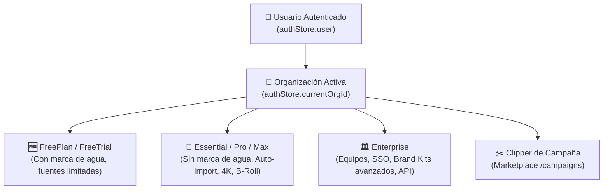

# 👥 Actores y responsables

> [!abstract] En pocas palabras
> En **OpusClip Dashboard** interactúan cinco tipos de usuarios humanos (segmentados por su plan de suscripción y rol dentro de una organización) y cuatro sistemas automatizados que ejecutan tareas en segundo plano.



El diagrama muestra cómo cada usuario opera siempre bajo el contexto de una **Organización (`orgId`)**, cuyo nivel de plan (`assetStore.currentOrgAsset`) y permisos RBAC (`useRolePermission`) determinan qué funciones del dashboard están habilitadas o bloqueadas con modales de *upsell*.

> [!example] Ejemplo real: Control de permisos por rol en OpusClip 4.0
> En `DashboardRevampEntry` (`2wgzebltzq0s_.js`, línea 177), antes de permitir que un usuario pegue un enlace o suba un video, el componente ejecuta `const z = useRolePermission("project:create")`. Si el usuario es un miembro invitado a una organización con rol de solo lectura (`!z`), el selector de fuentes (`WorkflowSourcePicker`) y todas las píldoras de workflows quedan deshabilitados (`disabled: $ || !z`).

---

## 👤 Actores humanos (Según Plan y Rol)

| Actor / Perfil | Identificador en código (`assetStore`) | Capacidades y restricciones en el Dashboard |
|---|---|---|
| **Usuario Gratuito / Prueba (`FreePlan` / `FreeTrial`)** | `plan === "FreePlan"` o `"FreeTrial"`, `payStatus === "freeplan"` o `"trial"` | Recibe créditos iniciales de prueba; exporta clips con marca de agua (`enableWatermark`); tiene bloqueadas funciones premium desde el QuickStart (`voiceover`, `enhance_speech`, `broll` disparan `openUpsellWindow` cuando `plan === "FreePlan"`). |
| **Creador Individual (`Starter` / `Essential`)** | `plan === "Essential"` (`STARTER` / `ESSENTIAL` en banners) | Crea proyectos sin marca de agua, accede a plantillas de marca estándar y recarga créditos adicionales (`Top-up`). |
| **Creador Profesional / Agencia (`Pro` / `Max`)** | `plan === "Pro"` o `"Max"`, `isProOrEnterprisePlan(plan) === true` | Acceso completo a `ClipAnything`, Auto-Importación de canales de YouTube, descarga y escalado en **4K** (`useCanUse4KDownload`), doblaje de voz con IA (`video_dubbing`), B-Roll generativo y programación social multi-cuenta. |
| **Organización Corporativa (`Enterprise`)** | `isEnterprise === true`, `plan === "Enterprise"` | Espacio de trabajo compartido en equipo (`org-members`), inicio de sesión único (`sso-admins`), acceso programático (`hasApiAccess`, `/api-keys`), fuentes y animaciones Lottie personalizadas (`custom-lottie-animations`). |
| **Clipper de Campañas (`Campaign Participant`)** | Rutas `/campaigns` y `/campaigns/[campaignId]` | Usuario que se une a campañas patrocinadas de marcas o creadores (`joinCampaign`), importa videos desde las fuentes oficiales de la campaña (`campaign-sources`) aplicando obligatoriamente el `campaignBrandTemplateId`. |
| **Empleado Interno de OpusClip (`Opus Staff`)** | `authStore.isOpusEmail === true` (`@opus.pro` / `.opus.pro`) | Tiene acceso al panel de depuración (`debugStore.debugMode`), pudiendo forzar vistas de usuario nuevo/existente (`debugDashboardUiMode`), cambiar orígenes de API (`debugTabMap`) y activar funciones QRR experimentales (`workflowQrrOverridesAtom`). |

---

## 🤖 Actores y procesos automatizados

1. **Poller de Auto-Importación de YouTube (`/api/auto-import`)**:
   - Monitorea periódicamente los canales o listas de reproducción de YouTube conectados por el usuario y, según la configuración (`notify_me_via_email` vs. `auto_create_pr`), envía un correo de aviso o crea automáticamente un nuevo proyecto de clipping descontando créditos de la organización.
2. **Coordinador de Progreso en Tiempo Real (`generatingProgressStore`)**:
   - Mantiene en el navegador una cohorte (`clippingCohort`) de proyectos en ejecución (`RUNNING`, `DONE`, `FAILED`), consulta el estado cada `5,000 ms` (`PROGRESS_POLL_INTERVAL_MS`) o `15,000 ms` (`usePollDashboardFirstPage`), detecta trabajos estancados tras 2 horas (`MAX_PROGRESS_POLL_AGE_MS = 7,200,000 ms`) y actualiza el título de la pestaña del navegador.
3. **Motor de Encuesta y Automatización CRM (`UserSurveyDialog` + Brevo)**:
   - Durante el procesamiento del primer proyecto de un usuario nuevo (`SHOW_ONBOARDING_SURVEY`), captura su perfil (tamaño de empresa, número de seguidores, tipo de contenido) y sincroniza los atributos `PERSONA_*` con Brevo, disparando automáticamente un correo con un caso de estudio personalizado (`case-study-agency`, `case-study-marketer` o `case-study-podcaster`).
4. **Agente IA Copiloto / Agent Opus (`/api/agent-sessions` y `/api/curate/chats`)**:
   - Asistente conversacional integrado que permite buscar momentos por prompt, ajustar preferencias de curación y ejecutar acciones sobre el proyecto mediante sesiones de streaming (`agent-session-streams`).

---

> [!info]- Detalle técnico (para desarrolladores)
> - **Detección de correo interno (`847027` en `0p9u92dpxgm13.js`)**:
>   ```javascript
>   let isOpusEmail = loadable(atom(async get => {
>     let email = (await get(userRaw))?.email;
>     return !!email && (email.endsWith("@opus.pro") || email.endsWith(".opus.pro"));
>   }));
>   ```
> - **Cabeceras de identidad multi-organización (`642390` en `0v5vcdwkoo-9r.js`)**:
>   Todas las peticiones de proyectos de una organización adjuntan la cabecera `"x-associated-org-id": cachedIdHeaders.orgId` y `"x-opus-clip-project-toggle": "clip-api"`.

## 🔗 Relacionado
- [[Resumen ejecutivo]] — Visión general del funcionamiento del dashboard para estos actores.
- [[Flujo de Autenticación y Bootstrap de Sesión]] — Cómo se cargan el usuario, sus organizaciones (`userOrgs`) y sus permisos.
- [[Sistema de Créditos Planes y Facturación]] — Detalle de los planes y permisos asociados a cada actor.
- [[Campañas y Marketplace de Clippers]] — Funcionamiento detallado del actor Clipper de Campañas.
