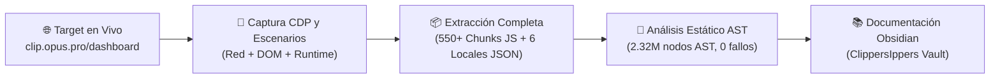

# 🎯 Alcance y objetivos

> [!abstract] En pocas palabras
> Define los objetivos, la metodología y los límites verificables de la investigación de ingeniería inversa realizada con **REA (Reverse Engineer Anything)** sobre la aplicación web de producción `https://clip.opus.pro/dashboard`.

El diagrama ilustra la cadena de custodia técnica seguida durante la auditoría: desde la captura del navegador en ejecución hasta la deconstrucción estática de los paquetes JavaScript y su documentación estructurada.

> [!example] Ejemplo real: Magnitud del código analizado
> A partir del manifiesto de compilación `_next/static/tw0-OiEO15o4q3nmL5clA/_buildManifest.js`, se identificaron **119 rutas** de la aplicación Next.js, se descargaron **más de 550 archivos chunk de Turbopack** y los **6 diccionarios de internacionalización (`common`, `auth`, `subscription`, `plansocial`, `clip`, `editor`)**, totalizando más de **2.32 millones de nodos AST** analizados sin errores de sintaxis (`parseFailureCount: 0`).

---

## 🎯 Objetivos cumplidos

1. **Deconstrucción funcional completa del Dashboard (`/dashboard/[...workflowType]`)**:
   - Identificación y análisis del módulo de entrada `575013` (`2pdyo3gbgw8ji.js`) y del módulo lazy-loaded de OpusClip 4.0 `561806`/`22917` (`2wgzebltzq0s_.js` y `3956_sfin5yo1.js`).
   - Documentación de todos los flujos de trabajo (`normal`, `caption`, `reframe`, `broll`, `voiceover`, `enhance_speech`, `quick_editor`, `upscale`, `video_dubbing`, `clip-anything`, `auto-import`).
2. **Mapeo del Estado Reactivo Global**:
   - Extracción de las **161 tiendas Jotai (`*Store`)** distribuidas en el bundle, detallando sus átomos en memoria y átomos persistidos en `localStorage` y `IndexedDB/localForage`.
3. **Reconstrucción de Contratos de API Backend**:
   - Extracción de **505 rutas y plantillas de URL** hacia `https://api.opus.pro/api`, incluyendo cabeceras personalizadas (`x-opus-clip-project-toggle: clip-api`, `x-associated-org-id`), métodos HTTP y estructuras de carga útil (payloads).
4. **Descubrimiento de Reglas de Negocio, Precios y Experimentos**:
   - Extracción de las fórmulas matemáticas exactas para el consumo de créditos, límites de duración por plan, validación de dominios, sanitización de configuraciones remotas de Statsig y telemetría de hardware (`CPU Benchmark Worker`).

---

## 🚧 Límites del alcance (Frontend vs. Backend Privado)

Siguiendo el principio de rigor empírico de REA, esta documentación distingue estrictamente entre:

| Ámbito | Estado de visibilidad | Evidencia disponible |
|---|---|---|
| **Aplicación Cliente Web (`clip.opus.pro`)** | **100% Verificado** | Código fuente empaquetado (Turbopack chunks), árboles AST, esquemas Zod, tiendas Jotai, diccionarios i18n y capturas de red CDP. |
| **Contratos HTTP/REST con `api.opus.pro`** | **100% Verificado en frontera** | Rutas, parámetros query, cuerpos JSON enviados por el cliente, cabeceras de autenticación y transformadores de respuesta (`transferBackendClipProject`). |
| **Implementación interna de microservicios en `api.opus.pro` y clusters GPU** | **Caja negra (Inferido por contrato)** | Se conocen los nombres de los trabajos (`/cluster-jobs/{id}/progress`, modelos `ClipBasic`/`ClipAnything`, `whisperModel`), pero el código Python/Go/C++ de los servidores de inferencia no se distribuye al navegador. |

> [!question] Pendiente de confirmar (Backend Interno)
> Los pesos exactos del modelo LLM/VLM propietario detrás de `ClipAnything` y la ponderación interna del `Virality score` se calculan en los servidores de `api.opus.pro` (y se sirven ya precalculados en los objetos `curated-clips` y `exportable-clips`). Si en el futuro se captura tráfico autenticado con sesiones activas de edición (`HAR`/`PCAP`), se podrán documentar ejemplos adicionales de payloads de respuesta de `exportable-clips`.

---

> [!info]- Detalle técnico (para desarrolladores)
> - **Artefactos locales en el workspace REA (`d:\rea-projects\projects\02-clippers-ippers\`)**:
>   - `session-evidence.json`: Bundle exportado con los registros de evidencia REA.
>   - `inspect-web-page.json`: Snapshot completo del DOM, scripts y estado de red vía Chrome DevTools Protocol (`ev_2db3203af160dbbbb47fdbe1a9d4c20597a8474a3db98d8b689eaff36f252f09`).
>   - `dashboard-complete/_next/static/chunks/`: Los 550+ chunks JS descargados de producción.
>   - `dashboard-complete/locales/en/`: Los 6 archivos JSON de traducción en inglés.
>   - `route_chunks_map.json`: Mapa completo de las 119 rutas de Next.js y sus chunks asociados.

## 🔗 Relacionado
- [[Resumen ejecutivo]] — Síntesis del funcionamiento general del sistema.
- [[Registro de Evidencia REA]] — Hashes y registros exactos de cada herramienta REA ejecutada.
- [[Cómo reproducir y auditar el bundle con REA]] — Guía práctica para repetir o ampliar esta auditoría.
