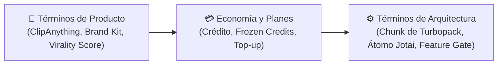

# 📖 Glosario

> [!abstract] En pocas palabras
> Este glosario define en lenguaje claro cada concepto de producto, algoritmo y arquitectura interna descubierto en **OpusClip Dashboard (`clip.opus.pro/dashboard`)**. Todas las demás notas del vault enlazan aquí en su primera mención.

El diagrama agrupa el vocabulario en tres dominios: conceptos de creación de video con IA, conceptos de monetización/billetera y conceptos técnicos del frontend.

> [!example] Ejemplo real: Cómo se conectan estos términos en una sola petición
> Cuando el usuario envía un video con el modelo **[[#ClipAnything]]**, la tienda de **[[#Átomo Jotai|Átomos Jotai]]** `submitStore` lee los metadatos del **[[#Preflight]]**, reserva **[[#Frozen Credits]]** proporcionales a la duración, adjunta el **[[#Brand Kit]]** seleccionado y añade el nuevo `projectId` a la **[[#Clipping Cohort]]** para actualizar el porcentaje en la pestaña del navegador.

---

## 🔤 Definiciones (A – Z)

### Átomo Jotai
Unidad mínima de estado reactivo en la librería **Jotai** (`atom`, `atomFamily`, `atomWithPersistence`). En OpusClip existen 161 módulos `*Store` que almacenan en átomos desde el token del usuario (`authStore.userToken`) hasta el progreso de cada clip (`clipStore.clipProcess`).

### Auto-Hook
Función de IA (controlada por el [[#Feature Gate]] `enable_auto_hook` y configurada en `0o27-pc3qcfe4.js`) que inserta automáticamente un titular visual superpuesto (*Headline*) o un gancho narrativo al inicio del clip para maximizar la retención en los primeros 3 segundos.

### Atoms Config (`atomsConfig`)
Estructura declarativa de configuración introducida en **OpusClip 4.0** (módulo `265539` y `411369`) donde cada capacidad de edición es un "átomo de workflow" conmutable independientemente: `output`, `captions`, `autoHeadline`, `aiEmoji`, `removeFillerWords`, `removePauses`, `aiImageBRoll`, `aiVideoBRoll`, `autoZoom`, `autoMotionGraphics`, `autoSfx`, `autoTransitions`, `eyeContact`, `autoColor`, `enhanceAudio`, `translation` y `dubbing`.

### Brand Kit
Evolución de las **Brand Templates** en OpusClip 4.0 (`/brand-kit-canary`, validado con esquemas Zod `brandKitDefinitionSchema` en `38s3ojsu7_uko.js`). Agrupa tipografías personalizadas, colores de subtítulos por palabra (relleno, trazo, fondo), estilos de titulares (`HeadlineStyle`), logos/marcas de agua, pantallas de *Intro/Outro* y vocabulario de marca (`proper-nouns`).

### Chunk de Turbopack
Archivo JavaScript estático generado por el empaquetador **Turbopack** de Next.js bajo `/_next/static/chunks/*.js`. Cada chunk registra uno o más módulos identificados numéricamente (por ejemplo, `575013` en `2pdyo3gbgw8ji.js`) dentro del arreglo global `globalThis.TURBOPACK`.

### ClipAnything
Modelo multimodal avanzado de curación de video de OpusClip (`preferenceModel = "ClipAnything"`). A diferencia de [[#ClipBasic]], analiza tanto señales visuales como de audio y escena para extraer clips de cualquier género (deportes, vlogs, gaming, comedia, acción sin diálogo) utilizando prompts en lenguaje natural (`preferencePrompt`).

### ClipBasic
Modelo clásico de curación de OpusClip (`preferenceModel = "ClipBasic"` o `"Auto"` en videos hablados) optimizado para podcasts, entrevistas, discursos y contenido educativo guiado por transcripción.

### Clipping Cohort
Mapa reactivo (`generatingProgressStore.clippingCohort` en el módulo `524235`) que rastrea el conjunto de proyectos que están generándose o escalándose durante la sesión actual (`RUNNING`, `DONE`, `FAILED`), persistido en `localStorage` bajo `dashboard.generatingProgressSnapshot` con una vigencia máxima de 24 horas (`86,400,000 ms`).

### Crédito
Unidad monetaria de consumo de cómputo en OpusClip (`creditStore`, `org-credits`). En clipping estándar, **1 crédito equivale a 1 minuto de video fuente procesado**, calculado con precisión de segundos mediante la función `timeToCredit(seconds)`.

### Dynamic Config
Objeto JSON administrado remotamente en **Statsig** (`useDynamicConfig`) que alimenta contenido dinámico sin redesplegar código, como el carrusel de banners `dashboard_whats_new_banner`, los videos tutoriales `dashboard_videos` y la lista de géneros `curation_api_config`.

### Feature Gate
Interruptor booleano evaluado en tiempo real mediante el SDK de **Statsig** (`useFeatureGate`) que activa o desactiva funcionalidades por usuario u organización (por ejemplo, `enable_workflow_revamp`, `enable_upscaling`, `clip_anything_ban`, `dashboard_recent_projects_enabled`).

### Frozen Credits
Créditos de la billetera de la organización (`wallet_frozen_credits`) que quedan retenidos temporalmente mientras un proyecto de clipping o escalado está en estado `RUNNING`. Si el trabajo concluye con éxito, se liquidan (`consumption-settlements`); si falla (`STALLED`), se liberan o reembolsan.

### MultipartUploader
Clase de subida concurrente por fragmentos (`module 737381` en `2sx5shs8nlm61.js`) que divide archivos de video locales en partes (`partSizeBytes`), las sube mediante URLs firmadas (`uploadFileWithSignedUrl`) a Google Cloud Storage con reintentos de alta tolerancia (`withHighToleranceRetry`, hasta 100 reintentos) y escala dinámicamente la concurrencia de `2` a `4` y hasta `8` hilos (`rampConcurrency`).

### Preflight
Etapa previa a la creación de un proyecto (`POST /api/source-videos` o `useLocalPreflightPure`) en la que OpusClip inspecciona el enlace o archivo local para obtener su duración (`duration` / `durationMs`), resolución (`resolution`), miniatura (`thumbnailUrl`), idioma detectado (`videoLanguage`) y plataforma de origen (`sourcePlatform`), guardando el resultado en `submitStore.preflightData`.

### QuickStartPanel
Componente del Dashboard Clásico (módulo `536571` en `3nthk87c1t44i.js`) que presenta accesos directos de un clic a flujos especializados: *Long to shorts (`quick_normal`)*, *Video editor (`quick_editor`)*, *AI captions (`caption`)*, *AI B-roll (`broll`)*, *AI sound effect (`sound_effect`)*, *AI reframe (`reframe`)*, *Enhance speech (`enhance_speech`)*, *Voiceover hook (`voiceover`)*, *Upscale (`upscale`)*, *Video dubbing (`video_dubbing`)*, *AI Producer (`ai_producer`)* y *Script to Video (`script_to_video`)*.

### Top-up
Compra puntual de paquetes adicionales de créditos (`credit-topup-skus`, `credit-topups`, almacenados en `wallet_topup_credits`) cuando el usuario agota los créditos incluidos en su plan (`InsufficientCreditError`).

### Virality Score
Puntaje numérico calculado por la IA de OpusClip para cada clip generado (`sort_btn_value = "Virality score"` en `clipStore.sortBtnValue`), acompañado de una explicación de por qué ese fragmento tiene potencial viral en redes sociales.

### Wedged Project
Proyecto en estado `RUNNING` que lleva más de **2 horas (`7,200,000 ms`, constante `MAX_PROGRESS_POLL_AGE_MS`)** sin concluir. El sistema lo marca en `generatingProgressStore.wedgedIds` y detiene el *polling* infinito para proteger el navegador y el backend.

---

> [!info]- Detalle técnico (para desarrolladores)
> - **Módulos donde se definen estas primitivas**:
>   - `submitStore`: módulo `311846` (`0t5v9hztvwr7u.js`)
>   - `clipProjectStore`: módulo `184098` (`00ycdg_js-ita.js`)
>   - `clipStore`: módulo `943249` (`0_hne8424faiu.js`)
>   - `generatingProgressStore`: módulo `524235` (`2sx5shs8nlm61.js`)
>   - `MultipartUploader`: módulo `737381` (`2sx5shs8nlm61.js`)
>   - `createBuiltinWorkflows`: módulo `265539` (`0-cw8uppghurd.js`)

## 🔗 Relacionado
- [[Visión general]] — Índice de la sección conceptual.
- [[Modelo de datos y Estado Global Jotai]] — Detalle técnico de cada átomo mencionado en este glosario.
- [[Indicadores y métricas]] — Fórmulas matemáticas detrás de Créditos, Upscale y Progreso.
