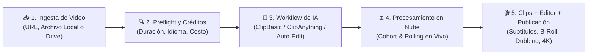

# 📄 Resumen ejecutivo

> [!abstract] En pocas palabras
> **OpusClip Dashboard (`https://clip.opus.pro/dashboard`)** es el centro de mando de una plataforma SaaS de inteligencia artificial que transforma videos largos (podcasts, entrevistas, transmisiones en vivo, clases) en múltiples clips cortos optimizados para TikTok, YouTube Shorts, Instagram Reels y LinkedIn.



El diagrama resume el ciclo de vida completo que orquesta el dashboard: desde que el usuario entrega una fuente de video hasta que obtiene clips editados, escalados y programados en redes sociales.

> [!example] Ejemplo real: Cómo decide el Dashboard qué interfaz mostrarle a cada usuario
> Al cargar la página, el componente raíz `tA` (módulo `575013` en `2pdyo3gbgw8ji.js`) consulta simultáneamente el conteo de proyectos del usuario (`POST /api/clip-projects/count`) y el [[Glosario#Feature Gate|Feature Gate]] `enable_workflow_revamp`. Si el usuario tiene `0` proyectos creados, el dashboard activa el modo `"new-user"`, oculta las listas vacías, posiciona el carrusel de proyectos de demostración (`DEMO_PROJECTS`) en primer plano y mueve el banner de novedades (`What's New`) debajo de los proyectos para reducir la fricción del primer uso.

---

## 🧠 La lógica detrás del Dashboard

El análisis de ingeniería inversa revela que el Dashboard no es una simple pantalla estática de subida de archivos, sino un **orquestador adaptativo** gobernado por cuatro principios de diseño:

### 1. Adaptación dinámica según la madurez del usuario (`Audience Mode`)
El dashboard clasifica en tiempo real al visitante en uno de tres estados (`V` en el módulo `575013`):
- **`new-user` (`counts.all === 0`)**: Muestra enlaces de muestra interactivos (`sampleLinkNewUserStyle`), el carrusel *"Start from a demo project"* (`demo-danny`, `demo-basketball`, `demo-podcast`), los tutoriales de *"Master OpusClip"* y traslada los anuncios de nuevas funciones al final de la página (`below-projects`). Cuando envía su primer proyecto, lanza automáticamente la encuesta de perfilamiento (`UserSurveyDialog`) que muestra el progreso del primer proyecto en vivo dentro del propio modal y dispara un correo automatizado de caso de éxito vía Brevo según su perfil (`agency`, `marketer` o `podcaster`).
- **`existing-user` (`counts.all > 0`)**: Prioriza la productividad inmediata mostrando la barra de proyectos recientes (`ProjectListPanel`), el indicador de progreso en la pestaña del navegador (`composeClipTabTitle`) y el carrusel *"What's New"* arriba de los proyectos (`above-projects`).
- **`legacy` (`counts.all === undefined`)**: Modo de respaldo tolerante a fallos mientras responde el endpoint `/api/clip-projects/count` (con un temporizador de gracia de `2500 ms`).

### 2. Convivencia de dos generaciones de producto (Clásico vs. OpusClip 4.0)
El código mantiene activas dos experiencias completas de creación de proyectos, conmutadas por el hook `useWorkflowRevampEnabled()` (módulo `889399`):
1. **Dashboard Clásico (`SubmitCard` + `QuickStartPanel`)**: Presenta una tarjeta central para pegar enlaces o subir archivos junto con una fila de botones rápidos (*Long to shorts*, *Video editor*, *AI captions*, *AI B-roll*, *AI sound effect*, *AI reframe*, *Enhance speech*, *Voiceover hook*, *Upscale*, *Video dubbing*, *AI Producer* y *Script to Video*).
2. **OpusClip 4.0 / Workflow Revamp (`DashboardRevampEntry` en `2wgzebltzq0s_.js`)**: Introduce un selector superior de dos modos principales (**Long to shorts** `builtin:long-to-shorts` vs. **Auto Edits** `builtin:auto-edits`), acceso directo a **Open editor** (`/editor-start`), y píldoras de **Workflows personalizables** (`builtin` y `custom`) que redirigen a `/workflow-canary` preservando la configuración atómica (`atomsConfig`) y el `BrandKit`. Incluso si el usuario está en la versión nueva, puede volver al modo clásico mediante un interruptor persistido en `localStorage` (`workflowRevamp.classic`).

### 3. Monetización unificada por tiempo de cómputo (Economía de Créditos)
Toda acción intensiva en GPU dentro del dashboard se traduce a una unidad común: el **[[Glosario#Crédito|Crédito]]**:
- **Clipping estándar y doblaje**: 1 crédito equivale a 1 minuto de video procesado (calculado al segundo mediante `timeToCredit`).
- **Escalado de video con IA (`AI Upscale` a HD o 4K)**: Se cobra en bloques de 10 segundos mediante la fórmula `Math.round((70 / 6) * Math.ceil(durationSeconds / 10))`.
- **Protección financiera (`Frozen Credits`)**: Al iniciar un trabajo, los créditos no se descuentan definitivamente de inmediato; pasan a estado congelado (`wallet_frozen_credits`) y, si el trabajo falla (`stage === "STALLED"`), el usuario puede verificar elegibilidad y ejecutar el reembolso automático (`POST /api/clip-projects/{id}/refund`).

### 4. Telemetría de hardware y experimentación continua
Apenas termina de pintarse el contenido principal (`largest-contentful-paint`), el dashboard lanza silenciosamente un Web Worker (`01sklqt0kl3nd.js`) que mide el rendimiento de enteros, punto flotante, memoria y ramificación del navegador del usuario (`debugCpuBenchmark`), permitiendo correlacionar la capacidad del dispositivo con el motor de edición WebCodecs/Canvas. Al mismo tiempo, más de 60 [[Glosario#Feature Gate|Feature Gates]] y experimentos de Statsig ajustan la interfaz, los precios y los modelos disponibles por organización.

---

> [!info]- Detalle técnico (para desarrolladores)
> - **Archivo y módulo principal**: `2pdyo3gbgw8ji.js` → módulo `575013` (`function tA()`).
> - **Cálculo de estado de audiencia (`V`)**:
>   ```javascript
>   let B = debugMode ? debugDashboardUiMode : "real";
>   let V = B === "new-user" ? "new-user"
>         : B === "existing-user" ? "existing-user"
>         : counts.all === undefined ? "legacy"
>         : counts.all === 0 ? "new-user" : "existing-user";
>   ```
> - **Mapeo de presets en OpusClip 4.0 (`tk` e `tI`)**:
>   - `caption` → `"builtin:ai-captions"`
>   - `reframe` → `"builtin:ai-reframe"`
>   - `broll` → `"builtin:ai-broll"`
>   - Redirige a `{ pathname: "/workflow-canary", query: { from: "dashboard", preset: e, workflowId: e, upload: "1" } }`.

## 🔗 Relacionado
- [[Alcance y objetivos]] — Qué artefactos y evidencias respaldan este análisis.
- [[Módulo Dashboard y Enrutamiento de Workflows]] — Desglose línea por línea del módulo `575013` y `DashboardRevampEntry`.
- [[Sistema de Créditos Planes y Facturación]] — Reglas exactas de cobro, cuotas gratuitas y planes de suscripción.
