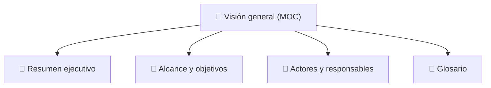

# 🎯 Visión general

> [!abstract] En pocas palabras
> Esta sección explica qué es **OpusClip (`clip.opus.pro/dashboard`)**, cómo funciona su modelo de negocio basado en IA generativa para creación de videos cortos, quiénes son los actores que interactúan con la plataforma y cuál es el vocabulario fundamental del sistema.

El diagrama muestra las cuatro notas que componen la visión general del proyecto: desde la explicación ejecutiva hasta el glosario de términos técnicos y de producto.

> [!example] Ejemplo real: De un podcast de 2 horas a 25 cortos listos para publicar
> Un creador pega en el dashboard el enlace del episodio #408 del podcast de Lex Fridman (`6608` segundos / 110 minutos, incluido como proyecto de demostración `demo-podcast` en el módulo `383241`). El sistema analiza el video, detecta los momentos de mayor impacto viral, reencuadra automáticamente el video de horizontal (`16:9`) a vertical (`9:16`), aplica subtítulos dinámicos con la plantilla de marca del usuario y entrega `25` clips ordenados por puntaje de viralidad.

---

## 📑 Notas de esta sección

| Nota | Qué encontrarás ahí | Audiencia ideal |
|---|---|---|
| [[Resumen ejecutivo]] | Qué es OpusClip Dashboard, su propuesta de valor, sus dos paradigmas de interfaz (Clásico vs. OpusClip 4.0) y su economía de créditos. | Todos |
| [[Alcance y objetivos]] | Qué abarca esta ingeniería inversa con REA, qué artefactos fueron extraídos y qué queda en el backend privado. | Todos / Técnico |
| [[Actores y responsables]] | Perfiles de usuario (`FreeTrial`, `Essential`, `Pro`, `Enterprise`, Clippers de campañas) y sistemas automatizados. | Negocio / Producto |
| [[Glosario]] | Definiciones claras de todos los conceptos técnicos y de dominio usados en el vault. | Todos |

---

> [!info]- Detalle técnico (para desarrolladores)
> Los proyectos de demostración para nuevos usuarios están codificados estáticamente en el módulo `383241` (`0my09scm440pt.js` y `40f7nxhbahq2_.js`) bajo la constante `DEMO_PROJECTS`:
> - `demo-danny`: *"24 Hours with Danny Duncan"* (`819,000 ms`, 18 clips).
> - `demo-basketball`: *"Curry Drills 12 Threes"* (`7,357,000 ms`, 12 clips).
> - `demo-podcast`: *"Tal Wilkenfeld | Lex Fridman Podcast #408"* (`6,608,000 ms`, 25 clips).

## 🔗 Relacionado
- [[00 - Inicio]] — Portada general del vault.
- [[Arquitectura]] — Cómo están construidos internamente los subsistemas que hacen posible esta visión.
- [[Flujos y procesos]] — Paso a paso operativo de cada acción del usuario en el dashboard.
