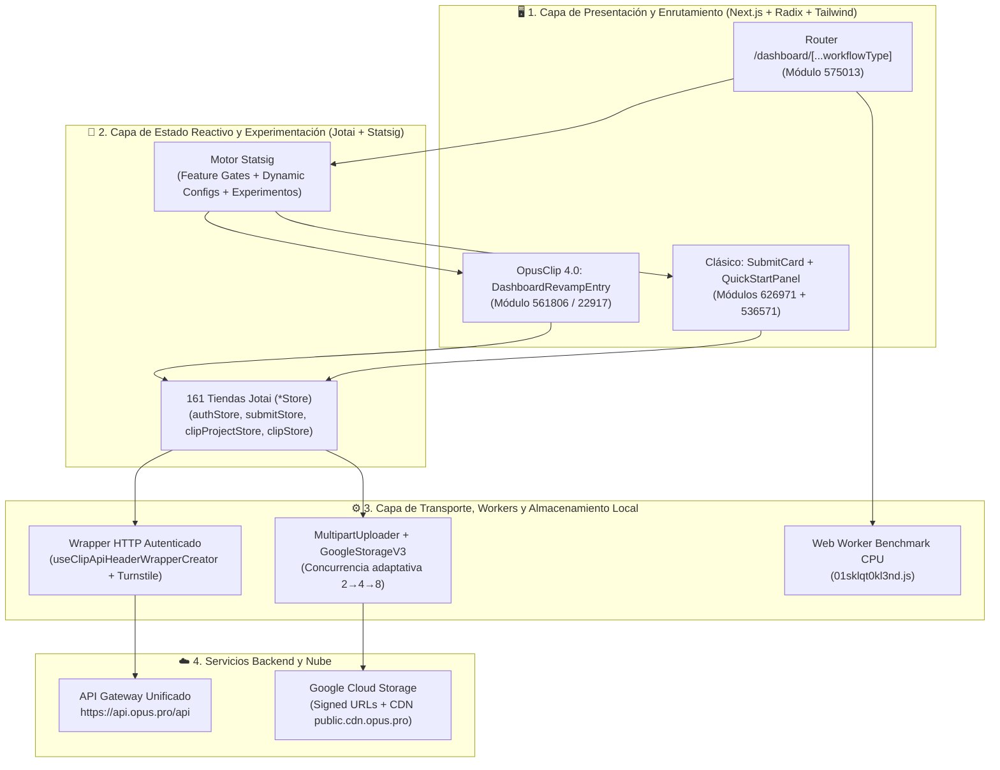

# 📐 Arquitectura general

> [!abstract] En pocas palabras
> **OpusClip Web (`clip.opus.pro`)** es una aplicación **Next.js (Pages Router híbrido compilado con Turbopack)** organizada en cuatro capas desacopladas: una capa visual adaptativa gobernada por **Statsig**, un bus de estado atómico con **161 tiendas Jotai**, una capa de sincronización y subida paralela (**TanStack Query + MultipartUploader + Web Workers**), y una frontera de microservicios unificada tras `https://api.opus.pro/api`.

El diagrama muestra cómo fluye el control desde el enrutador de `/dashboard/[...workflowType]` a través del motor de decisión de Statsig hacia las dos variantes de interfaz, apoyándose en el bus de átomos Jotai y en los motores de transporte hacia `api.opus.pro` y Google Cloud Storage.

> [!example] Ejemplo real: Cómo conviven tres backends lógicos detrás de un mismo dominio API
> Aunque todas las llamadas en producción apuntan a `https://api.opus.pro/api`, el módulo `apiStore` (`986231`) mantiene tres átomos de prefijo separados (`apiPrefix`, `nestApiPrefix`, `planSocialApiPrefix`) y el hook `useClipProjectApi` (`642390`) inyecta la cabecera `"x-opus-clip-project-toggle": "clip-api"`. Esto demuestra que el gateway de `api.opus.pro` enruta internamente hacia al menos tres microservicios distintos: el **API legado (`apiPrefix`, ej. `/cluster-jobs`)**, el **servicio core en NestJS (`nestApiPrefix`, ej. `/clip-projects`, `/source-videos`)** y el **servicio de automatización social y auto-importación (`planSocialApiPrefix`, ej. `/auto-import`, `/publish-schedules`)**.

---

## 🧱 Las 4 capas de la arquitectura

### 1. Capa de Presentación y Empaquetado (`Next.js` + `Turbopack`)
- **Sistema de módulos**: Compilado con **Turbopack** (`buildId: tw0-OiEO15o4q3nmL5clA`). El código se divide en más de 550 [[Glosario#Chunk de Turbopack|Chunks de Turbopack]] cargados bajo demanda mediante `__turbopack_load_page_chunks__` y `e.A(<loaderModuleId>)`.
- **Internacionalización (`i18next` / `react-i18next`)**: Soporta múltiples idiomas (`I18N_SUPPORTED_LANGS`, módulo `696386`) organizados en 6 espacios de nombres JSON (`common`, `auth`, `subscription`, `plansocial`, `clip`, `editor`).
- **Sistema de Diseño (`omni-ui`)**: Construido sobre primitivas accesibles de **Radix UI** (`Dialog`, `Popover`, `Tooltip`, `ToggleGroup`, `ScrollArea`), estilizado con **Tailwind CSS** (`clsx` + `twMerge` en el módulo `541578`), animaciones vectoriales **Rive** y **Lottie**, y notificaciones **Sonner** (`toast`).

### 2. Capa de Estado Reactivo Híbrido (`Jotai` + `TanStack React Query`)
OpusClip separa el estado del cliente en dos mecanismos complementarios:
- **Jotai (161 tiendas `*Store`)**: Gestiona el estado compartido de interfaz, sesión, borradores de envío, progreso de generación y el motor del editor multipista. Utiliza tres patrones de átomos:
  1. `atom(...)`: Estado efímero en memoria RAM.
  2. `atomFamily(...)`: Mapas indexados por ID de proyecto o ID de clip (`clipProjectDashboard(id)`, `clipItem(id)`, `videoDownload(id)`) para evitar re-renderizados globales cuando cambia un solo proyecto o clip.
  3. `atomWithPersistence(key, defaultValue, options)` (módulo `357054`) y `localStorageBoolAtom` (`851881`): Sincroniza automáticamente preferencias y snapshots con `window.localStorage` o `sessionStorage`. Para datos pesados de dispositivo utiliza **IndexedDB** mediante `localForage` (`getLocalForage("device")` en el módulo `725468`).
- **TanStack React Query (`useQuery`, `useMutation`, `useQueryClient`)**: Gestiona la caché declarativa de peticiones con tiempo de frescura (`staleTime: 30000` en `useWorkflowSource`), invalidación automática y deduplicación de consultas en vuelo.

### 3. Capa de Validación, Seguridad y Cómputo en Cliente
- **Validación estricta de esquemas**: Utiliza **Zod** (`zodResolver`) tanto para formularios de usuario (`userSurveyFormSchema`) como para validar estructuras complejas de plantillas (`brandKitDefinitionSchema`) y sanitizar configuraciones remotas de Statsig (`dashboard_whats_new_banner`).
- **Protección Anti-Bot y Control de Riesgo IP**: Integra **Cloudflare Turnstile** (`callWithTurnstile`) y endpoints de control de acceso (`/api/client-access-control?q=ipRisk` y `?q=project`) para bloquear abuso automatizado de GPU.
- **Benchmarking en Web Worker**: Ejecuta un hilo dedicado (`turbopack-worker-2ru9m5gbh1na6.js` + `01sklqt0kl3nd.js`) tras el evento `largest-contentful-paint` para perfilar la CPU y RAM del navegador sin bloquear el hilo principal de React.

### 4. Capa de Transporte y Almacenamiento Cloud
- **Wrapper HTTP Centralizado (`useClipApiHeaderWrapperCreator`, módulo `693320`)**: Envuelve `fetch` en tres variantes (`clipApiHeaderWrapper`, `clipApiHeaderWrapperWithData`, `clipApiHeaderWrapperWithoutAuth`), gestionando tokens JWT, cabeceras de organización (`x-associated-org-id`), manejo automático de errores con toasts (`noErrorToast`) y trazabilidad.
- **Ingesta Directa a Google Cloud Storage (`GoogleStorageV3` + `MultipartUploader`)**: Los archivos de video locales nunca pasan por el servidor de aplicación Node/NestJS; el cliente solicita URLs firmadas (`/api/signed-urls` / `/api/upload-links`) y sube directamente los fragmentos binarios al bucket de GCS verificando el header `ETag` de cada parte.

---

> [!info]- Detalle técnico (para desarrolladores)
> - **Detección de entorno y WebViews (`541578` en `0trevvm9vo2gc.js`)**:
>   El módulo de utilidades exporta `cn` (`twMerge(clsx(...))`), `isInIframe()` (`window.self !== window.top`) e `isWebView()`, que detecta navegadores embebidos de Instagram, Facebook (`FBAN|FBAV`), Line, Twitter, Android WebView (`wv`) y puentes nativos (`window.AndroidBridge`, `window.webkit.messageHandlers`) para adaptar el flujo OAuth y la reproducción de video.
> - **Conmutador de entorno por pestaña (`debugStore.debugTabMap`, módulo `422720`)**:
>   Permite redirigir individualmente los subsistemas (`ARC_CHAT`, `AUTH`, `BRAND_TEMPLATE`, `BRAND_KIT`, `CAMPAIGN_LANDING`, `CLIP`, `CLIP_EDIT`, `DASHBOARD`, `WORKFLOW`, `FREE_TOOL`, `SUBSCRIPTION`, `SEARCH`, `CALENDAR`, `OMNI`) hacia orígenes de API personalizados durante pruebas internas.

## 🔗 Relacionado
- [[Integraciones]] — Detalle de los servicios externos conectados a esta arquitectura.
- [[Componentes]] — Exploración profunda de los 10 subsistemas construidos sobre estas capas.
- [[ADR-001 Arquitectura Híbrida Next.js con Turbopack y Jotai]] — Justificación arquitectónica de las decisiones de diseño observadas.
