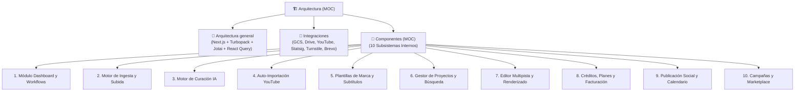

# 🏗️ Arquitectura

> [!abstract] En pocas palabras
> Esta sección documenta la arquitectura técnica completa de **OpusClip Dashboard (`clip.opus.pro/dashboard`)**: cómo está empaquetada la aplicación web, con qué servicios externos se comunica y cómo funcionan por dentro cada uno de sus diez subsistemas principales.

El diagrama muestra la estructura jerárquica de la sección de Arquitectura: desde el diseño global y las integraciones externas hasta el catálogo de los diez componentes funcionales que conforman la plataforma.

> [!example] Ejemplo real: Desacoplamiento entre Interfaz, Estado y Red
> Ningún componente visual del dashboard llama a `fetch` directamente. Toda petición pasa por el creador de cabeceras `useClipApiHeaderWrapperCreator` (módulo `693320`), que lee los prefijos de API desde `apiStore` (`986231`), inyecta automáticamente el token de organización desde `authStore` (`847027`), aplica los encabezados de enrutamiento (`x-opus-clip-project-toggle: clip-api`, `x-associated-org-id`) y deposita los resultados normalizados en tiendas [[Glosario#Átomo Jotai|Jotai]] (`clipProjectStore`, `clipStore`, `assetStore`).

---

## 📑 Notas de esta sección

| Nota | Propósito |
|---|---|
| [[Arquitectura general]] | Visión global de las 4 capas del cliente web: Presentación (Next.js/Radix/Tailwind), Estado Reactivo (161 tiendas Jotai + TanStack Query), Servicios/Transporte (`apiStore` + Web Workers) y Backend/Cloud (`api.opus.pro` + GCS). |
| [[Integraciones]] | Detalle técnico de los 15 proveedores externos conectados al dashboard (autenticación, almacenamiento en nube, feature flags, antifraude, pagos, CRM y analítica). |
| [[Componentes]] | Índice detallado de los **10 subsistemas internos** de OpusClip analizados a nivel de módulo y función. |

---

> [!info]- Detalle técnico (para desarrolladores)
> - **Prefijos de API configurados en `apiStore` (módulo `986231` en `0bk_j0ng_-uy_.js` y `1_shcqomv7f9c.js`)**:
>   - `apiPrefix` (`global.api.apiPrefixV2`): `"https://api.opus.pro/api"`
>   - `nestApiPrefix` (`global.api.nestApiPrefixV2`): `"https://api.opus.pro/api"`
>   - `planSocialApiPrefix` (`global.api.planSocialApiPrefix`): `"https://api.opus.pro/api"`
>   - Entorno de staging detectado por `isWorkflowStagingApi` (`404898`): `"https://stg-api.opus.pro"`.

## 🔗 Relacionado
- [[00 - Inicio]] — Portada principal del vault.
- [[Flujos y procesos]] — Cómo colaboran estos componentes en escenarios de ejecución reales.
- [[Modelo de datos y Estado Global Jotai]] — Esquema de las tiendas de estado que conectan la arquitectura.
