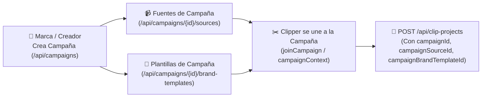

# 🏆 Campañas y Marketplace de Clippers

> [!abstract] En pocas palabras
> El subsistema de **Campañas** (módulos `371553`, `704849`, `907748`, `277388` en `2pdyo3gbgw8ji.js` y chunks `0s0vy_x90gdf1.js` / `3nthk87c1t44i.js`) conecta a marcas o grandes creadores con una comunidad de *clippers*: la marca publica videos fuente oficiales y plantillas obligatorias en una campaña (`/campaigns/[campaignId]`), y los clippers generan y envían cortos desde el dashboard bajo el contexto de esa campaña.



El diagrama muestra cómo una campaña define sus videos fuente y sus plantillas de marca autorizadas, y cómo el clipper envía proyectos vinculados a esos tres identificadores.

> [!example] Ejemplo real: Prioridad absoluta de `campaignBrandTemplateId` al crear un proyecto
> En `useClipProjectApi.startClipProject` (módulo `642390`, línea 1992 de `extracted_core_modules.txt`), cuando se construye el cuerpo JSON para `POST /api/clip-projects`, el código ejecuta:
> ```javascript
> brandTemplateId: campaignBrandTemplateId ? undefined : brandTemplateId,
> campaignId: g,
> campaignSourceId: O,
> campaignBrandTemplateId: w
> ```
> Esto garantiza por regla de negocio que si el proyecto pertenece a una campaña con plantilla asignada (`campaignBrandTemplateId`), se anula cualquier plantilla personal (`brandTemplateId`) del clipper para preservar la identidad visual exigida por la marca.

---

## ⚙️ Funcionamiento interno del subsistema

### 1. Contexto de Campaña en el Dashboard (`submitStore.campaignContext`)
En el Dashboard Clásico, el componente `SubmitCard` (`626971`, línea 523 de `extracted_core_modules.txt`) se monta con la propiedad **`showCampaignSource: true`**.
- El átomo `submitStore.campaignContext` (`debugLabel: "submit.source.campaignContext"` en `311846`) almacena la campaña activa, la fuente seleccionada y la plantilla asociada.
- Permite al clipper seleccionar directamente uno de los videos oficiales de la campaña sin tener que buscar enlaces externos.

### 2. Contadores de Disponibilidad (`clippableCount` y `duplicableCount`)
Los módulos `371553`, `704849`, `907748` y `277388` (`2pdyo3gbgw8ji.js`) gestionan el estado de las fuentes de una campaña:
- **`clippableCount`**: Cantidad de videos fuente de la campaña que pueden ser procesados como nuevos proyectos de clipping.
- **`duplicableCount`**: Cantidad de proyectos ya procesados que el clipper puede duplicar instantáneamente a su espacio de trabajo (`POST /api/campaign-sources/{id}/imports` o `/duplicate`) sin volver a correr todo el pipeline de IA desde cero.

---

## 🔌 Contratos de API de Campañas (`extracted_core_modules.txt`, líneas 171–181)

| Endpoint en `https://api.opus.pro/api` | Propósito |
|---|---|
| `/api/campaigns` y `/api/campaigns/{id}` | Listado general y detalle de una campaña específica (con soporte de query `?addVideos=1`). |
| `POST /api/campaigns/{id}/close` | Cierra una campaña impidiendo nuevas participaciones o envíos. |
| `/api/campaigns/{id}/sources` y `/api/campaign-sources/{id}` | Gestión de los videos fuente autorizados dentro de la campaña. |
| `/api/campaign-sources/{id}/external-source-url` | Resuelve la URL externa del video fuente de la campaña. |
| `/api/campaign-sources/{id}/imports` y `/api/campaign-imports/{id}` | Registra y consulta las importaciones de fuentes realizadas por los clippers. |
| `/api/campaigns/{id}/brand-templates` y `/api/campaign-brand-templates/{id}` | Plantillas de marca oficiales asociadas a la campaña. |

---

> [!info]- Detalle técnico (para desarrolladores)
> - **Rutas de Next.js asociadas** (verificadas en `route_chunks_map.json`):
>   - `/campaigns`
>   - `/campaigns/[campaignId]`
> - **Clave de depuración en `debugStore.debugTabMap`**: `CAMPAIGN_LANDING`.

## 🔗 Relacionado
- [[Actores y responsables]] — Rol del Clipper de Campaña dentro del ecosistema de usuarios.
- [[Motor de Ingesta y Subida de Medios]] — Cómo se inyectan las fuentes de campaña en `SubmitCard`.
- [[Motor de Plantillas de Marca y Subtítulos]] — Cómo funcionan las plantillas que la campaña fuerza mediante `campaignBrandTemplateId`.
