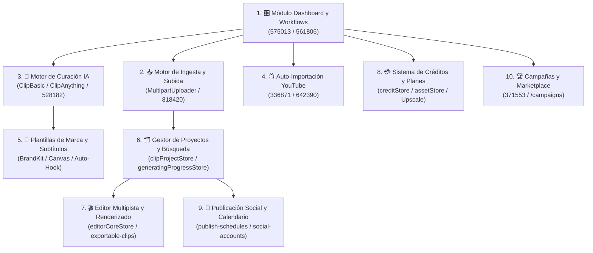

# 🧩 Componentes

> [!abstract] En pocas palabras
> El código cliente de **OpusClip Dashboard (`clip.opus.pro/dashboard`)** se divide funcionalmente en **diez subsistemas especializados**. Cada uno tiene su propia nota en esta carpeta con diagramas, ejemplos reales, reglas de negocio y referencias exactas a los [[Glosario#Chunk de Turbopack|Chunks de Turbopack]] y módulos donde reside su lógica.

El diagrama muestra cómo el módulo central del Dashboard (`1`) coordina la entrada de medios (`2`, `4`), la parametrización de IA y estilo (`3`, `5`), la gestión del ciclo de vida del proyecto (`6`, `7`, `9`) y los motores transversales de monetización (`8`) y campañas (`10`).

> [!example] Ejemplo real: Trazabilidad completa de un componente al código fuente
> Si deseas auditar cómo funciona el botón **Upscale** en el dashboard, puedes ir directamente a [[Módulo Dashboard y Enrutamiento de Workflows]] (donde el componente `ew` del módulo `536571` gestiona el diálogo de escalado) y luego a [[Sistema de Créditos Planes y Facturación]] (donde el módulo `48711` calcula el precio con la función `upscaleCredits`).

---

## 📑 Los 10 subsistemas documentados

| # | Componente | Módulos clave | Responsabilidad principal |
|---|---|---|---|
| **1** | [[Módulo Dashboard y Enrutamiento de Workflows]] | `575013`, `561806` (`22917`), `626971`, `536571`, `889399`, `91488` | Orquestador de `/dashboard/[...workflowType]`, conmutación Clásico vs. OpusClip 4.0, carruseles dinámicos (`What's New`, `Demo Projects`, `Master OpusClip`), título dinámico de pestaña y benchmark de CPU. |
| **2** | [[Motor de Ingesta y Subida de Medios]] | `818420`, `404748`, `737381`, `252547`, `642390` | Validación de URLs por plan, subida local multiparte a GCS (`MultipartUploader`), integración con Google Drive Picker, preflight de metadatos y verificación OAuth de propiedad en YouTube. |
| **3** | [[Motor de Curación IA y Configuración de Clips]] | `528182`, `105675`, `311846`, `265539`, `411369` | Selección de modelo (`ClipBasic` vs. `ClipAnything`), cubetas de duración (`useClipLen`), géneros dinámicos, prompts personalizados, selección de rango temporal y persistencia de `SubmitSettings`. |
| **4** | [[Sistema de Auto-Importación de YouTube]] | `336871`, `642390` (`auto-import`) | Conexión de canales de YouTube, filtrado por todo el canal o playlist específica, inclusión de videos ocultos (*unlisted*) y modos de notificación por correo vs. creación automática. |
| **5** | [[Motor de Plantillas de Marca y Subtítulos]] | `38s3ojsu7_uko.js`, `0o27-pc3qcfe4.js`, `424q9vq1sv-m7.js` | Esquemas Zod de `BrandKit`, renderizado en Canvas de subtítulos con animación palabra por palabra, fuentes personalizadas, superposición de titulares (`Auto-Hook`) y plantillas Lottie. |
| **6** | [[Gestor de Proyectos Colecciones y Búsqueda]] | `184098`, `524235`, `811849`, `420350`, `382326` | Listado paginado, agrupación por fechas, seguimiento de progreso en vivo (`generatingProgressStore`), detección de proyectos estancados (*wedged*), acciones masivas en lote, colecciones y búsqueda semántica (`/search`). |
| **7** | [[Editor Multipista y Renderizado]] | `943249`, `3k764s640-hex.js`, `0ws0f968v6px2.js`, `0yub7e4vdqte-.js` | Estado y motor del editor web (`/editor-ux`), edición basada en transcripción, B-Roll generativo/stock (`Pexels`, `Storyblocks`, `Shutterstock`), `Eye Contact`, `Auto Zoom`, `Speech Enhancement`, doblaje (`Dubbing`) y renderizado final. |
| **8** | [[Sistema de Créditos Planes y Facturación]] | `579611`, `163394`, `48711`, `612196`, `06xtmt6rrbten.js` | Jerarquía de planes, billetera de créditos (`plan`, `topup`, `frozen`), cálculo de costos por segundo/bloque, cuotas de funciones beta (`featureQuota`), detección de saldo insuficiente (`InsufficientCreditError`) y modales de *upsell*. |
| **9** | [[Publicación Social Calendario y Analíticas]] | `planSocialApiPrefix`, `publish-schedules`, `social-accounts` | Conexión OAuth multi-red, programación de publicaciones en calendario, generación de textos para redes (`social-copy`) y exportación sin marca de agua. |
| **10** | [[Campañas y Marketplace de Clippers]] | `371553`, `704849`, `907748`, `277388`, `0s0vy_x90gdf1.js` | Ecosistema de campañas para marcas y agencias (`/campaigns/[campaignId]`), fuentes de video autorizadas (`campaign-sources`), plantillas obligatorias (`campaign-brand-templates`) y contadores de clips. |

---

> [!info]- Detalle técnico (para desarrolladores)
> Todos los componentes comparten el mismo contenedor de diseño (`getLayout` en el módulo `575013`, línea 222 de `2pdyo3gbgw8ji-formatted.txt`), que monta la barra lateral de navegación, la cabecera con selector de organización y saldo de créditos, el gestor de colas de popups (`popupQueueStore`) y el botón flotante de soporte de Intercom (`setPageProps(tA, { showSupportButton: true })`).

## 🔗 Relacionado
- [[Arquitectura]] — Volver al índice general de arquitectura.
- [[Arquitectura general]] — Capas transversales sobre las que operan estos 10 componentes.
- [[Flujos y procesos]] — Secuencias de interacción entre estos componentes.
