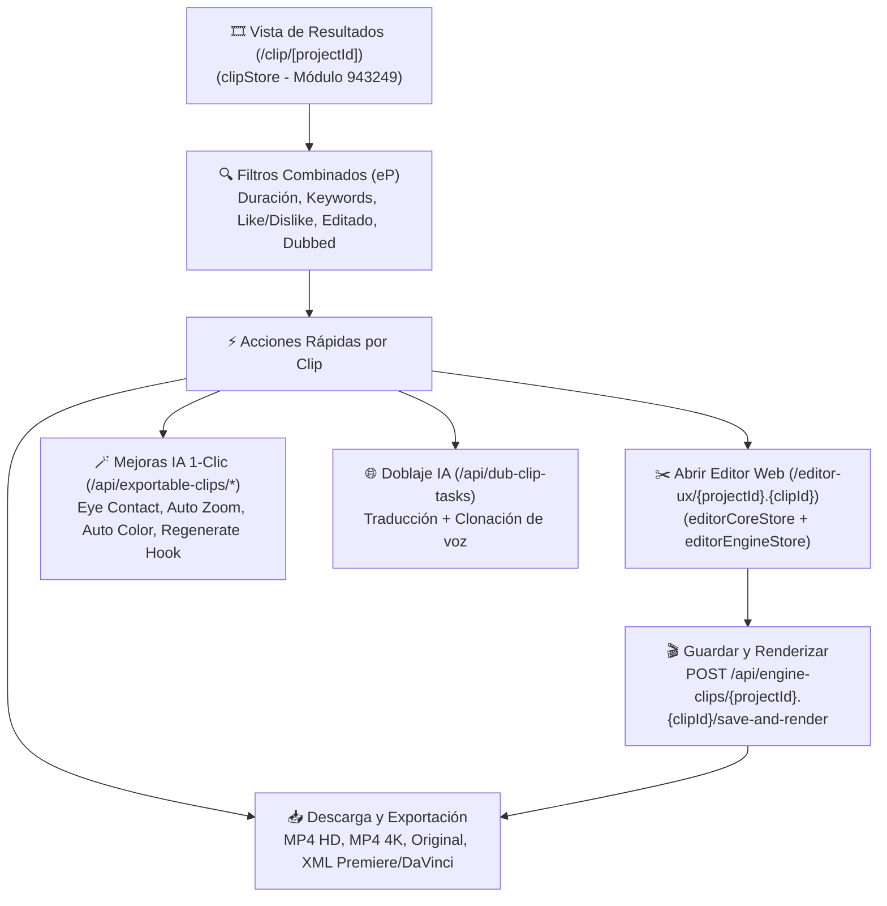

# 🎬 Editor Multipista y Renderizado

> [!abstract] En pocas palabras
> Una vez que un proyecto termina de procesarse, el usuario accede a la vista de resultados (`/clip/[id]`, gobernada por `clipStore` en el módulo `943249`) y al editor multipista en el navegador (`/editor-ux/[clipId]`, gobernado por `editorCoreStore` y `editorEngineStore`), donde puede recortar video editando el texto de la transcripción, insertar B-Roll generativo o de stock, corregir contacto visual (`Eye Contact`), aplicar doblaje a otros idiomas y exportar en HD, 4K o XML para Premiere/DaVinci.

El diagrama muestra cómo se conectan la página de resultados de un proyecto (`clipStore`) con las acciones de mejora en un clic, el editor multipista (`editorCoreStore`) y los canales de exportación final.

> [!example] Ejemplo real: Cómo calcula `clipStore` la duración real de un clip tras recortar silencios
> En el átomo derivado `clipStore.clipIdListWithFilter` (módulo `943249`, líneas 2642–2665 de `extracted_core_modules.txt`), antes de evaluar si un clip entra en el filtro de duración seleccionado por el usuario (`selectedClipDurations`), el código recorre `overlayPlans.captionPlans` y suma los milisegundos recortados al inicio (`startGap = trimmedStartMs - offsetStartMs`) y al final (`endGap = offsetEndMs - trimmedEndMs`), restándolos de `clip.duration` (`duration - startGap/1000 - endGap/1000`). Así el filtro refleja la duración efectiva tras los cortes de edición.

---

## 🗂️ 1. Vista de Resultados y Filtrado Reactivo (`clipStore`, Módulo `943249`)

El módulo `943249` gestiona toda la experiencia de revisión de clips generados:
- **Ordenamiento (`sortBtnValue`)**: Persistido en `localStorage`, por defecto ordena por **`"Virality score"`**.
- **Modo de vista (`viewTabValue`)**: Alterna entre cuadrícula (`"grid"`) y lista.
- **Función de filtrado multi-criterio (`eP`, líneas 2808–2810)**: Filtra en tiempo real los clips combinando 7 dimensiones simultáneas:
  1. Rango de duración efectiva (`selectedClipDurations`).
  2. Palabras clave presentes en el clip (`selectedKeywords` vs. `clipKeywords`).
  3. Clips marcados con *Me gusta* (`selectedLiked` vs. `clip.like`) o *No me gusta* (`selectedDisliked` vs. `clip.dislike`), sincronizados con `POST /api/curated-clips/{projectId}.{clipId}/feedback`.
  4. Clips ya editados manualmente (`selectedIsEdited` vs. `clip.isEdited`).
  5. Clips doblados a otro idioma (`selectedDubbed` / `selectedNotDubbed` evaluando `clipDubProps`).
  6. Búsqueda textual dentro del proyecto (`clipIdWithSearchKeywords`).
- **Evaluación de preferencias RLHF/DPO (`dpoCollectEnabled`, `dpoExposureId`, `dpoPolicyId`)**: Registra señales de preferencia humana para entrenar y evaluar políticas de curación (`judge_policy_id`, valor inicial `"v0"`).

---

## ✂️ 2. Arquitectura del Editor Multipista (`/editor-ux`, `3k764s640-hex.js`)

El editor web se apoya en una familia de 10 tiendas Jotai especializadas:
1. **`editorCoreStore` y `editorEngineStore` (`3k764s640-hex.js`)**: Sincronizan el estado del guion de edición (`editingScript`, obtenido de `GET /api/exportable-clips/{projectId}.{clipId}?include=editingScript`), el árbol de pistas y el reproductor.
2. **`editorRenderTimelineStore` (`3htehg_8rrkcu.js`)**: Controla el cabezal de reproducción (*playhead*), el zoom de la línea de tiempo, las secciones arrastrables (`draggable-section`) y la selección múltiple de palabras (`trim-words`, `remove-words`).
3. **`editorRenderCanvasStore` y `editorRenderAutoTrackingStore` (`0ws0f968v6px2.js`)**: Gestionan el lienzo de previsualización interactivo y el seguimiento automático de rostros/oradores (*Speaker Layout / Manual Reframe*, apoyado en `/scene_detection_timestamp.json` y `/screenplays`).
4. **`editorRenderAssetStore` y `editorRenderPreferenceStore` (`0yub7e4vdqte-.js`)**: Administran los activos multimedia cargados en la composición (música de `/api/musics`, efectos de sonido de `/api/sound-effects` y `/api/stock-sound-effects`, superposiciones de `/api/screen-overlay-assets`).
5. **`renderMainEngineStore` (`14efmolh5jc4m.js`)**: Coordina el envío de trabajos de renderizado final hacia `POST /api/engine-clips/{projectId}.{clipId}/save-and-render` y `/refine`.
6. **`editorCommentStore` (`39zgv_1zk34i7.js`)**: Permite colaboración en equipo con comentarios anclados al código de tiempo y resolución de hilos (`/{id}/resolve`, `/{id}/unresolve`).
7. **Historial de versiones del editor (`/api/editor-history-records`)**: Guarda instantáneas del proyecto de edición (`saveEditorHistoryRecord`, `listEditorHistory`, `getEditorHistoryRecord` en `642390`).

---

## 🪄 3. Motores de Mejora con IA (B-Roll, Audio, Visión y Doblaje)

| Capacidad IA | Endpoints / Módulos asociados | Cómo funciona internamente |
|---|---|---|
| **AI B-Roll (Generativo y Stock)** | `/api/brolls/plan`, `/api/brolls/generate`, `/api/broll/check-quota`, módulo `152759` / `489785` | Soporta 4 modos (`BrollApproach`: `Auto`, `Prompt`, `Regenerate`, `Select`). Para B-Roll de archivo, el experimento `broll_stock_vendor` (`460319`) selecciona dinámicamente entre **Pexels (`Pls`, grupo 0)**, **Storyblocks (`Sbs`, grupo 1)** y **Shutterstock (`Ssk`, grupo 2)**. |
| **Detección de Tomas Falsas (`Bad Takes`) y Limpieza de Habla** | `/api/bad-takes/{id}/detect`, `/api/bad-takes/quota`, `/api/voice-enhancement`, `useVeUsageRecorder` (`703573`) | Detecta repeticiones y muletillas (*filler words*), elimina silencios (*remove pauses*) y mejora la claridad vocal con IA (sujeto a cuota beta controlada por `creditStore.featureQuota.voiceoverEnhancement`). |
| **Efectos de Sonido Automáticos (`Auto SFX`)** | `/api/auto-sound-effect-tasks`, `/api/sound-effects/prices`, `isSfxEntitled` (`453354`) | Analiza transiciones y momentos clave para insertar efectos de sonido automáticos con pistas recuperables (`/api/sound-effects?q=recoverable`). |
| **Mejoras Visuales en 1 Clic** | `/api/exportable-clips/{p}.{c}/eye-contact`, `/auto-zoom`, `/auto-color`, `/preview-loop` | Corrige la mirada hacia la cámara (`eye-contact`), aplica acercamientos dinámicos (`auto-zoom`) y corrección de color (`auto-color`). |
| **Doblaje de Voz IA (`AI Dubbing`)** | `/api/dub-clip-tasks`, `useDubbingConfigState` (`747527`), `estimateDubCredits` (`485361`) | Traduce y dobla el video al idioma destino (`DUBBING_FALLBACK_RESOLUTION`), estimando los créditos según la duración (`estimateDubCredits(durationSec)`). |
| **Asistente Conversacional (`Curate Chat` / `Copilot`)** | `/api/curate/chats/{id}/messages`, `/stream`, `/undo`, `/api/curate/sandboxes/{id}`, `/api/clip-copilot-tasks` | Permite pedir cambios o nuevos recortes mediante chat en streaming con soporte para deshacer (`undo`) y entornos aislados de prueba (`sandboxes`). |

---

## 📥 4. Mapas de Descarga Multi-Formato (`clipStore`, Módulo `943249`)

El módulo `943249` mantiene **5 familias de átomos (`atomFamily`)** independientes para rastrear el estado de descarga de cada clip según la calidad y el formato elegido:
1. `videoDownload` (`videoDownloadMap`): Video MP4 estándar con subtítulos y efectos renderizados (1080p HD).
2. `video4KDownload` (`video4KDownloadMap`): Video MP4 escalado o exportado en **4K UHD** (`3840x2160`), habilitado por `useCanUse4KDownload` (`42296`) cuando el video fuente es $\ge 3840 \times 2160$ o fue escalado con `upscaleOptions.resolution === "4k"` en planes `Pro` o `Enterprise`.
3. `videoOriginalDownload` (`videoOriginalDownloadMap`): Segmento de video limpio sin subtítulos quemados.
4. `video4KOriginalDownload` (`video4KOriginalDownloadMap`): Segmento original en 4K sin superposiciones.
5. `adobeDownload` (`adobeDownloadMap`): Paquete de proyecto editable (XML + medios) para Adobe Premiere Pro y DaVinci Resolve.

Cada descarga queda registrada en auditoría mediante `/api/clip-download-records`, `/api/clip-export-records` y `/api/clip-export-track`.

---

> [!info]- Detalle técnico (para desarrolladores)
> - **Redirección automática desde Quick Editor (`958296` en `3nthk87c1t44i.js`, líneas 1661–1675)**:
>   Cuando el usuario usa el flujo rápido `quick_editor` desde el dashboard, el componente `QuickEditorProgressContent` (`eh`) espera a que el proyecto alcance `stage === "COMPLETE"` o `status === "CONCLUDED"`, obtiene el primer clip con `getClips(projectId)` y navega automáticamente a:
>   `/editor-ux/${projectId}.${clips[0].clipId}?clipId=${clips[0].clipId}`.

## 🔗 Relacionado
- [[Motor de Plantillas de Marca y Subtítulos]] — Cómo se renderizan los subtítulos y animaciones dentro del lienzo del editor.
- [[Flujo de Edición Renderizado y Exportación NLE]] — Secuencia completa de edición y exportación paso a paso.
- [[Sistema de Créditos Planes y Facturación]] — Cómo se tarifan las cuotas de B-Roll, Voiceover, Dubbing y escalado 4K.
