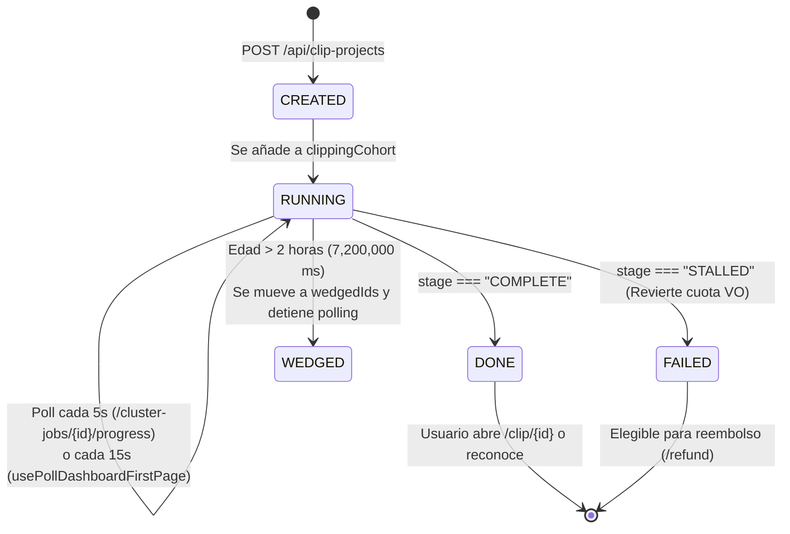

# 🗂️ Gestor de Proyectos Colecciones y Búsqueda

> [!abstract] En pocas palabras
> Este subsistema administra el listado de proyectos del usuario (`clipProjectStore`, módulo `184098`), coordina el seguimiento en vivo de los proyectos en generación mediante una máquina de estados persistente (`generatingProgressStore`, módulo `524235`), organiza proyectos en colecciones y habilita la búsqueda semántica de clips (`/search`).

El diagrama de estados muestra el ciclo de vida exacto de un proyecto dentro de `generatingProgressStore` (`524235`) y `clipProjectStore` (`184098`), incluyendo la protección contra trabajos colgados (`WEDGED`).

> [!example] Ejemplo real: Reversión automática de cuota de Voiceover si un proyecto falla
> En `usePollDashboardFirstPage` (módulo `184098`, líneas 2476–2479 de `extracted_core_modules.txt`), cada `15,000 ms` el cliente consulta `GET /api/clip-projects?page=0&pageSize=16` y revisa en IndexedDB (`localForage("device")`) la clave `"clipping-project-with-vo"`. Si encuentra que un proyecto que usaba Voiceover cayó en estado `"STALLED"`, ejecuta inmediatamente `revertUsage()` (`useAIVoUsageRecorder`) para devolverle el uso de Voiceover al usuario y elimina el ID de la lista pendiente.

---

## 📊 1. Arquitectura de `clipProjectStore` (Módulo `184098`)

Para manejar cientos de proyectos con fluidez, `clipProjectStore` separa la lista de identificadores del diccionario de objetos mediante `atomFamily`:
- **`projectIdList`**: Arreglo ordenado de IDs (`string[]`), siempre mantenido en orden descendente por fecha de creación (`e.createdAt > t.createdAt ? -1 : 1`).
- **`clipProjectDashboardMap` y `clipProjectDashboard(id)`**: Mapa indexado que permite que una tarjeta de proyecto individual (`ProjectCard`) se re-renderice cuando cambia su progreso sin volver a renderizar las demás tarjetas del grid.
- **`clipProjectNextPage`**: Paginador con `{ page: 0, pageSize: 16, hasNextPage: true }`.
- **Operaciones atómicas (`useProjectListUpdater`)**:
  - `upsertItemsIntoList`: Inserta proyectos nuevos, reordena por `createdAt` y actualiza cada átomo individual `clipProjectDashboard(id)`.
  - `prependIfNotExist`, `resetList`, `updateItem`.

---

## ⏳ 2. Máquina de Estados de Progreso (`generatingProgressStore`, Módulo `524235`)

Cuando un usuario envía uno o varios proyectos, OpusClip no depende únicamente de recargar la página; mantiene una **[[Glosario#Clipping Cohort|Clipping Cohort]]** sincronizada entre pestañas y recargas del navegador:

| Constante / Función | Valor / Regla en código (`524235`) | Explicación funcional |
|---|---|---|
| `PROGRESS_POLL_INTERVAL_MS` | `5,000 ms` (`5e3`) | Intervalo de consulta individual a `GET /api/cluster-jobs/{id}/progress?ms={ms}` cuando el usuario no está en una ruta de polling de lista. |
| `usePollDashboardFirstPage` | `15,000 ms` (`15e3`, delay inicial `500 ms`) | Intervalo de refresco de la primera página (`pageSize: 16`) cuando hay proyectos incompletos (`stage !== "COMPLETE" && stage !== "STALLED"`). |
| `MAX_PROGRESS_POLL_AGE_MS` | `7,200,000 ms` (`72e5` = **2 horas**) | Edad máxima permitida para un proyecto en estado `RUNNING`. Si supera 2 horas (`now - observedAt > 72e5`), la función `wedgedRunningIds` lo mueve a `wedgedIds` y `shouldPollProgress` devuelve `false`. |
| Vigencia del Snapshot (`restoreSnapshot`) | `86,400,000 ms` (`864e5` = **24 horas**) | El estado de la cohorte se guarda en `localStorage` bajo `dashboard.generatingProgressSnapshot` atado al `orgId`. Al recargar la página dentro de las 24 horas, `hydrateFromSnapshot` restaura los proyectos en curso, los ya reconocidos (`acknowledged`) y los tiempos observados (`observedAt`). |
| Tope del `99%` antes de concluir (`progressToDisplayPct`) | `status === "CONCLUDED" ? Math.min(t, 99) : t` | Redondea `progress * 100` entre `0` y `100`, asegurando una transición visual limpia hasta que el proyecto pasa formalmente a `COMPLETE`. |
| Eliminación atómica (`commitDeletedProjects`) | Módulo `382326` (`projectDeletionStore`) | Al borrar uno o varios proyectos, limpia en una sola transacción `projectIdList`, `clipProjectDashboardMap` y `clippingCohort`. |

---

## 🗂️ 3. Panel de Proyectos, Agrupación Temporal y Acciones en Lote (`811849` y `420350`)

En `ProjectListPanel` (`0my09scm440pt.js` y `40f7nxhbahq2_.js`):
- **Sección en Dashboard (`dashboard_recent_projects_enabled`)**: Muestra los últimos 16 proyectos (`params: { q: "mine", sortField: "submitTime", sortOrder: "desc" }`) ocultando cabeceras de fecha y colecciones para mantener limpia la portada.
- **Agrupación por mes/fecha (`en` en `811849`)**: En la vista completa de proyectos (`/projects` o `/collections`), agrupa las tarjetas bajo cabeceras fijas (`sticky top-0 z-[35] backdrop-blur-md`) formateadas por `formatDateGroupLabel`.
- **Metadatos de tarjeta (`buildProjectCardMeta`, módulo `420350`)**: Formatea el número de clips generados (`clipCount`) y la fecha en formato `YYYY.M.D` (`formatProjectCreatedAt`).
- **Barra de acciones masivas (`ProjectBulkActionToolbar`)**: Permite seleccionar múltiples proyectos para eliminarlos en lote (`POST /api/clip-projects/batch-delete` con `{ projectIds }`) o moverlos/añadirlos a colecciones (`POST /api/collection-contents/batch-add` y `sync-collection-contents`).
- **Visibilidad y Papelera/Archivo**: Soporta hacer un proyecto público (`POST /api/clip-projects/{id}/make-public`), privado (`/make-private`), cambiar visibilidad (`/update-visibility`) o restaurar proyectos archivados (`POST /api/clip-projects/{id}/restore`).

---

## 🔎 4. Búsqueda Semántica de Clips (`/search` y `searchable-clips`)

Cuando el [[Glosario#Feature Gate|Feature Gate]] `useSearchFeatureGate()` está activo (o a través del modal `searchModalStore` en `05mcedn8zdtmx.js`), el usuario puede buscar momentos específicos dentro de toda su biblioteca de videos:
- Consulta frases sugeridas en `/api/search-phrases`.
- Ejecuta búsquedas paginadas en `GET /api/searchable-clips?pageSize={s}&page={p}&q=findByQuery`.
- Permite previsualizar y abrir directamente el clip encontrado (`/api/searchable-clips/{projectId}.{clipId}`).

---

> [!info]- Detalle técnico (para desarrolladores)
> - **Rutas que activan el polling de lista (`isListPollingRoute` en `524235`)**:
>   Devuelve `true` si `pathname.startsWith("/collections")` o si `pathname.startsWith("/projects") && normalizeProjectsPageTab(tab) !== "collections"`.
> - **Detección de proyecto eliminado en servidor (`isProjectGoneStatus`)**:
>   Si el polling recibe HTTP `404` o `410`, el proyecto se retira automáticamente de la cohorte activa.

## 🔗 Relacionado
- [[Módulo Dashboard y Enrutamiento de Workflows]] — Cómo monta `ProjectListPanel` y el indicador de título de pestaña en `/dashboard`.
- [[Editor Multipista y Renderizado]] — Qué ocurre cuando el usuario entra a un proyecto completado (`/clip/{id}`) y edita sus clips.
- [[Flujo de Consumo Congelamiento y Reembolso de Créditos]] — Cómo se gestiona el reembolso de proyectos que terminan en estado `STALLED`.
