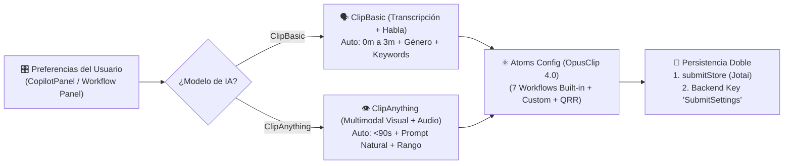

# 🧠 Motor de Curación IA y Configuración de Clips

> [!abstract] En pocas palabras
> Este subsistema traduce las intenciones creativas del usuario (qué modelo de IA usar, cuánto deben durar los clips, qué género tiene el video, qué palabras clave o prompts buscar y qué efectos automáticos aplicar) en los objetos de configuración `curationPref`, `renderPref` y `atomsConfig` que consume el backend al crear un proyecto.

El diagrama muestra cómo la elección entre los dos motores de IA (`ClipBasic` y `ClipAnything`) condiciona los parámetros disponibles, se combina con la arquitectura de átomos de OpusClip 4.0 y se persiste tanto localmente como en el perfil del usuario.

> [!example] Ejemplo real: Diferencia en las cubetas de duración automática (`useClipLen`)
> En el módulo `528182` (`2pdyo3gbgw8ji.js`), el hook `useClipLen` cambia la definición de duración `"Auto"` dependiendo del modelo activo: cuando el usuario selecciona **`ClipAnything`**, la opción automática se restringe a **`Auto (<90s)`**, mientras que en **`ClipBasic`** la opción automática abarca **`Auto (0m-3m)`**, además de permitir seleccionar múltiples cubetas explícitas desde `<30s` hasta `10m~15m`.

---

## 🤖 1. Los dos modelos de curación: `ClipBasic` vs. `ClipAnything`

| Característica | `ClipBasic` (Estándar / Hablado) | `ClipAnything` (Multimodal Avanzado) |
|---|---|---|
| **Valor en `submitStore.preferenceModel`** | `"ClipBasic"` (o `"Auto"`) | `"ClipAnything"` |
| **Feature Gate de control** | Disponible por defecto | Gobernado por `clip_anything_ban` (si el gate está activo, oculta el selector salvo que ya esté en `ClipAnything`). |
| **Tipo de video ideal** | Podcasts, entrevistas, charlas, webinars, tutoriales con diálogo claro. | Deportes, gaming, vlogs visuales, cine, comedia física, momentos sin diálogo o con música. |
| **Dirección por el usuario** | Palabras clave (`preferenceKeywords`), género (`preferenceGenre`, ej. `Podcast`, `Educational`, `Marketing`) y grupos narrativos (`/api/narratives`). | Prompts en lenguaje natural (`preferencePrompt`, ej. *"Find all three-point shots and celebrations"*) y plantillas de prompts. |
| **Duración `Auto` por defecto** | `0m - 3m` (`[0, 180]`) | `< 90s` (`[0, 90]`) |

---

## ⏱️ 2. Cubetas de duración (`preferenceClipLengths`) y Rango de recorte (`preferenceRanges`)

El módulo `528182` define las cubetas de duración seleccionables (en segundos) que se envían en `curationPref.clipDurations`:
- `[0, 30]` → `<30s`
- `[30, 60]` → `30s~59s`
- `[60, 90]` → `60s~89s`
- `[90, 180]` → `90s~3m`
- `[180, 300]` → `3m~5m`
- `[300, 600]` → `5m~10m`
- `[600, 900]` → `10m~15m`

Adicionalmente:
- **Modo sin recorte (`preferenceSkipSlicing` / `preferenceSkipCurate`)**: Permite procesar el video completo como una sola pieza editada (usado en los flujos de solo subtítulos, B-Roll, mejora de voz o `Auto Edits`).
- **Timeframe de procesamiento (`submitStore.preferenceRanges`)**: Permite elegir un sub-rango `[startSec, endSec]` del video original para ahorrar créditos cuando el usuario solo desea extraer clips de una parte específica del video.

---

## ⚛️ 3. Catálogo de Workflows Integrados en OpusClip 4.0 (Módulo `265539`)

En la arquitectura **Workflow Revamp**, la función `createBuiltinWorkflows()` (`0-cw8uppghurd.js`, líneas 3559–3585 de `extracted_core_modules.txt`) define **7 flujos de trabajo nativos**, distinguiendo entre trabajos de tipo `"clipping"` (`output.count === "many"`) y de tipo `"editing"` (`output.count === "one"`):

| `workflowId` | Nombre comercial | `jobType` | Configuración de átomos (`atomsConfig`) |
|---|---|---|---|
| `builtin:long-to-shorts` *(Default)* | **Long to shorts** | `clipping` | `output: { count: "many", aspectRatio: "portrait" }`, `captions: { enabled: true }`, `autoHeadline: { enabled: true }` |
| `builtin:auto-edits` | **Auto Edits** | `editing` | `output: { count: "one", aspectRatio: "no_change" }`, `captions`, `aiEmoji`, `removeFillerWords`, `removePauses`, `autoHeadline`, `aiImageBRoll`, `autoZoom` todos en `{ enabled: true }` |
| `builtin:ai-captions` | **AI Captions** | `editing` | `output: { count: "one", aspectRatio: "no_change" }`, `captions: { enabled: true }` |
| `builtin:ai-broll` | **AI B-roll** | `editing` | `output: { count: "one", aspectRatio: "no_change" }`, `aiVideoBRoll: { enabled: true }` |
| `builtin:auto-cleaning` | **Auto Cleaning** | `editing` | `output: { count: "one", aspectRatio: "no_change" }`, `removeFillerWords: { enabled: true }`, `removePauses: { enabled: true }` |
| `builtin:ai-reframe` | **AI Reframe** | `editing` | `output: { count: "one", aspectRatio: "portrait" }` |
| `builtin:translate-dubbing` | **Translate & dubbing** | `editing` | `output: { count: "one", aspectRatio: "no_change", model: "ClipAnything" }`, `translation: { enabled: true }`, `dubbing: { enabled: true }` |

### Filtro de átomos avanzados QRR (`resolveWorkflowQrrAtoms`, módulo `411369`)
El módulo `411369` (`2wgzebltzq0s_.js`, líneas 277–309) define 7 características avanzadas denominadas **`WORKFLOW_QRR_FEATURES`**:
- `viralHook`, `autoMotionGraphics`, `autoSfx`, `autoTransitions`, `eyeContact`, `autoColor`, `enhanceAudio`.
Antes de enviar el proyecto a `POST /api/clip-projects`, la función `resolveWorkflowQrrAtoms(atomsConfig, qrrReady)` verifica si cada característica QRR está permitida para la sesión; si no lo está, desactiva el átomo correspondiente (`enabled: false`) o remueve el `hookTemplateId` (`withoutViralHookTemplate`). Además, si `enhanceAudio.enabled === true`, verifica la cuota beta de 10 usos (`VeUsageRecorder.getUsageCount() >= maxCount`).

---

## 💾 4. Persistencia de Preferencias (`SubmitSettings`, módulo `105675`)

Para que el creador no tenga que reconfigurar sus preferencias en cada visita, el hook `useSaveSetting` (módulo `105675` en `2pdyo3gbgw8ji.js`) sincroniza con el backend bajo la clave `"SubmitSettings"` el objeto:
- `brandTemplateId`
- `preferenceGenre` (cargado desde el Dynamic Config `curation_api_config` con listas `genres.ready` y `genres.beta`)
- `preferenceKeywords`
- `preferenceModel`
- `preferenceNarrative`
- `preferencePrompt`
- `preferenceClipLengths`
- `preferenceSkipSlicing`
- `renderPreference`
- `enableAutoHook`

---

> [!info]- Detalle técnico (para desarrolladores)
> - **Módulos y tiendas**:
>   - `311846` (`0t5v9hztvwr7u.js`): Definición completa de `submitStore` (31 átomos).
>   - `265539` (`0-cw8uppghurd.js`): `DEFAULT_WORKFLOW_ID` (`"builtin:long-to-shorts"`), `AUTO_EDIT_WORKFLOW_ID` (`"builtin:auto-edits"`) y `createBuiltinWorkflows()`.
>   - `411369` y `888248` (`2wgzebltzq0s_.js`): `WORKFLOW_QRR_FEATURES`, `resolveWorkflowQrrAtoms`, `workflowQrrReadyAtom`.
>   - `882239` (`3956_sfin5yo1.js`): Hook `useWorkflowSubmission()`, encargado de construir el payload unificado y enviarlo a `POST /api/clip-projects`.

## 🔗 Relacionado
- [[Módulo Dashboard y Enrutamiento de Workflows]] — Cómo se seleccionan estos workflows desde la portada del dashboard.
- [[Motor de Plantillas de Marca y Subtítulos]] — Cómo se configuran `brandTemplateId`, `BrandKit` y `autoHeadline`.
- [[Modelo de datos y Estado Global Jotai]] — Detalle de los 31 átomos de `submitStore`.
