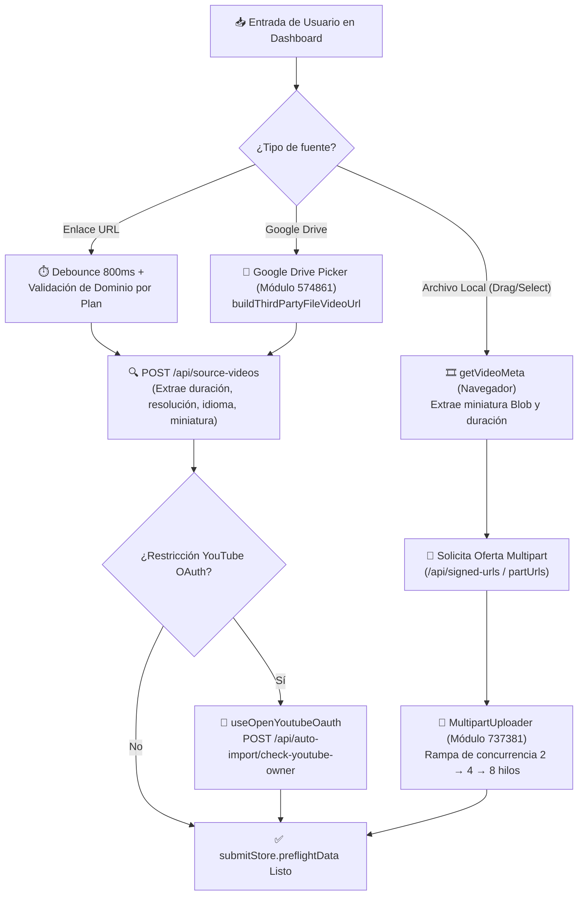

# 📥 Motor de Ingesta y Subida de Medios

> [!abstract] En pocas palabras
> Este subsistema gestiona todas las vías por las que un video entra a OpusClip desde el dashboard: enlaces web (YouTube, Rumble, Zoom, Twitch, Vimeo, Loom, etc.), subida de archivos locales desde el navegador y transferencia directa desde Google Drive, ejecutando validaciones de dominio por plan, [[Glosario#Preflight|Preflight]] de metadatos y subida multiparte en paralelo hacia Google Cloud Storage.

El diagrama muestra las tres tuberías de ingesta (URL externa, archivo local con subida multiparte y Google Drive) y cómo convergen en el átomo derivado `submitStore.preflightData`.

> [!example] Ejemplo real: Escalado automático de velocidad en `MultipartUploader`
> Cuando un creador arrastra un archivo `.mp4` de 2 GB al dashboard, la clase `MultipartUploader` (módulo `737381` en `2sx5shs8nlm61.js`) no abre 8 conexiones de golpe para no saturar una conexión lenta. Empieza con **concurrencia `2`** (`new V({ concurrency: 2 })`). A medida que las partes se completan, el método `rampConcurrency()` evalúa `this.completedParts`: al completar `3` partes sube la concurrencia a **`4`**, y al completar `8` partes la eleva hasta **`maxConcurrency` (`8` conexiones simultáneas)**, reintentando cada parte fallida hasta 100 veces con `withHighToleranceRetry`.

---

## 🔍 1. Validación de URLs y dominios permitidos por plan (`818420`)

En `WorkflowSourcePicker` (`3956_sfin5yo1.js`, líneas 398–420), cada cambio en la caja de texto pasa por un `useDebounceFn` de **`800 ms`** antes de ejecutar la validación `eg(url)`:
1. **Verificación de formato**: Comprueba `isUrl(e)`.
2. **Restricción de plataformas según el plan (`useSupportedPlatformDomains`)**:
   - Si la organización tiene un plan privilegiado (`isHighPrivilegedPlan(plan)` como `Pro`/`Enterprise`) o pega un enlace directo terminado en `.mp4`, se permite el paso.
   - Si el enlace pertenece a una plataforma soportada solo en planes superiores (`allSupportedPlatforms` vs. `supportedPlatforms` del plan actual), muestra un toast de error específico (`supported_platform_messages.<Plan>.errorMessage`, por ejemplo indicando que cierta fuente requiere plan Pro).
3. **Formatos de archivo de video aceptados (`VIDEO_ACCEPT`)**:
   - `.avi`, `.flv`, `.m4v`, `.mkv`, `.mov`, `.mp4`, `.mpeg`, `.ogv`, `.webm`, `.wmv`.

---

## 🚀 2. Arquitectura interna de `MultipartUploader` (Módulo `737381`)

Para archivos locales, OpusClip implementa una cola de prioridad asíncrona propia (`class V`, basada en `p-queue` en las líneas 3152–3314 de `extracted_core_modules.txt`) y la clase `MultipartUploader` (`class z`, líneas 3317–3388):

| Mecanismo | Implementación en código (`737381`) | Propósito técnico |
|---|---|---|
| **Registro estático de instancias** | `MultipartUploader.instances = new Map()` (`register`, `release`, `cancelByUploadId`) | Permite cancelar cualquier subida en curso desde otros componentes o diálogos de confirmación (`CancelUploadDialog`) devolviendo el `gcsUploadId`. |
| **Particionado por bytes** | `const i = e * this.offer.partSizeBytes; const o = Math.min(i + partSizeBytes, file.size); file.slice(i, o)` | Corta el `File`/`Blob` en fragmentos exactos en memoria sin duplicar el archivo completo. |
| **Rampa de concurrencia (`rampConcurrency`)** | `completedParts >= 8 ? maxConcurrency (8) : completedParts >= 3 ? 4 : 2` | Evita cuellos de botella TCP iniciales en conexiones domésticas y maximiza el ancho de banda en archivos grandes. |
| **Verificación de integridad (`ETag`)** | `const s = n.getHeader("etag"); if (!s) throw Error("part response exposed no ETag header")` | Exige que el bucket de GCS devuelva la cabecera `ETag` de cada parte subida; si falla o el código HTTP no es `2xx`, reinicia los bytes contados de esa parte a `0` y lanza excepción para reintento. |
| **Tolerancia a cortes de red (`withHighToleranceRetry`)** | Módulo `183357` (`retries: 100, maxTimeout: 10000`) | Reintenta automáticamente cada fragmento hasta 100 veces con backoff exponencial (tope de 10 segundos por intento), deteniéndose únicamente si el error es un `AbortError` (`DOMException`) provocado por cancelación manual del usuario. |
| **Subida en segundo plano (`useBackgroundUploadExp`)** | Experimento `enableUploadBg` + `useLocalSubmitTasks` (`850013`) | Permite al usuario pulsar *"Submit"* y configurar el proyecto mientras el archivo local aún se está subiendo en segundo plano (`local_project_submitted`). |

---

## 🔍 3. Preflight de video y verificación OAuth de YouTube (`642390` y `252547`)

Antes de crear el proyecto, el sistema necesita conocer la duración exacta y el idioma del video para calcular los créditos:
- **Preflight de URL o Google Drive**: Llama a `POST /api/source-videos` (`preflightProject` en `642390` o `useWorkflowSourceCheck` en `255374`) enviando `{ videoUrl, previewFrames }`. Si `videoLanguage` viene vacío, el cliente lo normaliza a `"auto"`. Si `durationMs <= 0`, rechaza la fuente (`Invalid source duration`).
- **Preflight de archivo local**: Extrae en el navegador el primer fotograma como `ObjectURL` (`getVideoMeta`) para mostrar la miniatura instantáneamente (`uploadHandoffAtom`) y guarda `{ duration, resolution, thumbnailUrl, title, type, size }` en `submitStore.localVideoPreflightdata`.
- **Átomo unificado `submitStore.preflightData` (`311846`)**: Átomo derivado de solo lectura que selecciona automáticamente `localVideoPreflightdata` si `videoSourceSeed.type === "local"`, o `thirdVideoPreflightdata` si es `"url"` o `"thirdPartyFile"`.
- **Verificación de propiedad de canal de YouTube (`useOpenYoutubeOauth`, módulo `176067`)**:
  Si YouTube bloquea la descarga de un video o requiere validación de derechos, `SubmitPanel` (`252547`, líneas 1393–1426) abre un diálogo para que el usuario autentique su cuenta de YouTube y llama a `POST /api/auto-import/check-youtube-owner` con `{ videoUri }`. Si `hasAccess === false`, muestra la advertencia `not_your_yt`.

---

> [!info]- Detalle técnico (para desarrolladores)
> - **Módulos involucrados**:
>   - `818420` y `404748` (`3956_sfin5yo1.js`): `WorkflowSourcePicker` y `DashboardSubmitCard`.
>   - `682284` (`3956_sfin5yo1.js`): `uploadHandoffAtom` (transfiere la subida en vuelo y su miniatura Blob desde `/dashboard` hacia `/workflow-canary` sin interrumpir el `XHR`!).
>   - `737381` (`2sx5shs8nlm61.js`): `MultipartUploader` y cola `V`.
>   - `252547` (`3nthk87c1t44i.js`): `SubmitPanel` y manejo de `useOpenYoutubeOauth`.

## 🔗 Relacionado
- [[Módulo Dashboard y Enrutamiento de Workflows]] — Componente padre que monta los selectores de ingesta.
- [[Flujo de Subida y Creación de Proyecto de Clipping]] — Secuencia completa paso a paso desde el clic hasta la creación del proyecto.
- [[Motor de Curación IA y Configuración de Clips]] — Qué ocurre con el video una vez superado el Preflight.
