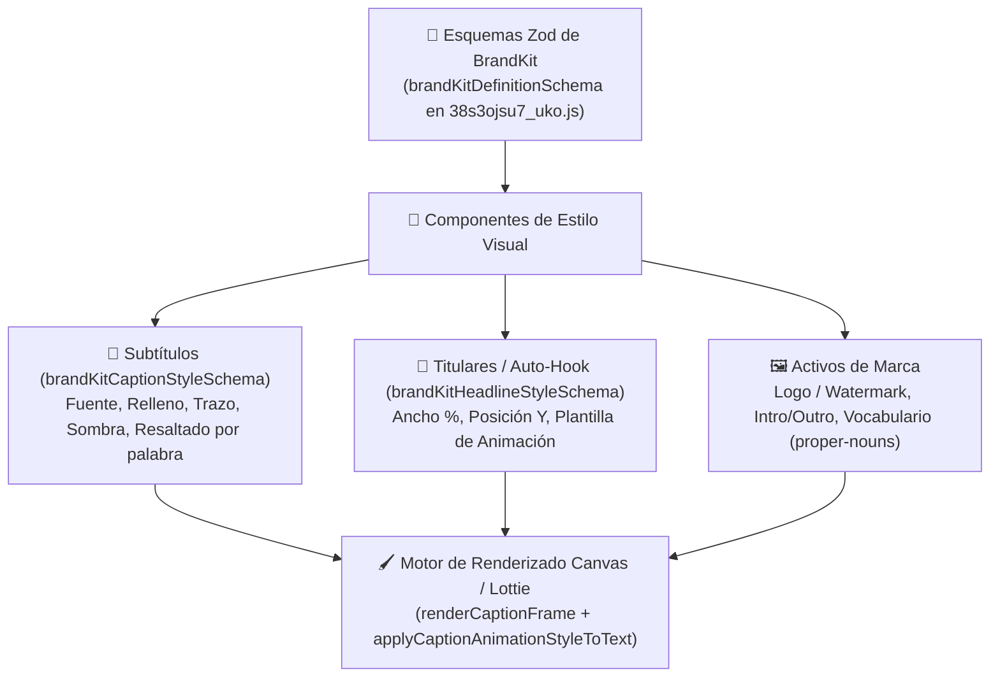

# 🎨 Motor de Plantillas de Marca y Subtítulos

> [!abstract] En pocas palabras
> Este subsistema define la identidad visual de los clips generados: valida esquemas de **[[Glosario#Brand Kit|Brand Kits]] y Plantillas de Marca** con **Zod**, renderiza subtítulos animados palabra por palabra sobre un lienzo HTML5 Canvas (`renderCaptionFrame`), gestiona fuentes tipográficas multilingües y superpone ganchos visuales automáticos (**[[Glosario#Auto-Hook|Auto-Hook]]**).

El diagrama muestra cómo la definición declarativa validada con Zod alimenta el motor de renderizado en tiempo real que previsualiza y empaqueta los subtítulos, titulares y activos de marca.

> [!example] Ejemplo real: Conmutación inteligente de la ruta de plantillas (`useBrandTemplatePath`)
> En el módulo `42296` (`0_hne8424faiu.js`, línea 946 de `extracted_revamp_and_worker.txt`), el hook `useBrandTemplatePath()` decide a qué página dirigir al usuario cuando hace clic en *"Brand Templates"* en la barra lateral:
> - Si `useWorkflowRevampEnabled()` es `true` (OpusClip 4.0) → redirige a **`/brand-kit-canary`**.
> - Si el experimento Statsig `brand_template_ux` está activo → redirige a **`/brand-templates-ux`**.
> - En caso contrario → redirige a la ruta clásica **`/brand-templates`**.

---

## 📐 1. Arquitectura de Esquemas Zod (`38s3ojsu7_uko.js` y `424q9vq1sv-m7.js`)

OpusClip valida en cliente la integridad de cada plantilla mediante esquemas Zod componibles:
- **`brandKitDefinitionSchema`**: Contenedor raíz del Brand Kit, con soporte de versionado (`/api/brand-templates/{id}/versions`, `/restore`) y migración desde plantillas legadas (`/api/brand-template-migrations`).
- **`brandKitCaptionStyleSchema`**: Define la tipografía (`fontFamily`, `fontWeight`, `fontSize`, URL de fuente personalizada en GCS `/mg/fonts/`), colores de texto base y colores de palabra activa (*highlighted word* / karaoke), grosor de borde (`stroke`), sombra (`shadow`), caja de fondo por línea o por palabra (`bg`), espaciado y número de líneas visibles (`1` o `2` líneas).
- **`brandKitHeadlineStyleSchema` y `brandKitTextPresetSchema`**: Configuración de titulares superpuestos y presets tipográficos reutilizables.

---

## 🖌️ 2. Motor de Renderizado de Subtítulos y Animaciones Lottie

El motor de previsualización y composición (distribuido en `27b0yt_qpmt_v.js`, `3tisevbeniujh.js` y `30liyww4qvick.js`) dibuja los fotogramas de subtítulos con precisión de píxel sobre dimensiones estándar (`STAGE_WIDTH`, `STAGE_HEIGHT`):

1. **Funciones de trazado en Canvas**:
   - `renderCaptionFrame`: Calcula qué palabras están activas en el milisegundo actual de reproducción.
   - `renderOneLineText`: Mide métricas de glifos, aplica ajuste de línea (*word wrap*) y dibuja primero las capas de fondo/sombra, luego el trazo (`strokeText`) y finalmente el relleno (`fillText`).
   - **Mapas de fuentes para idiomas minoritarios**: Si detecta scripts no latinos (CJK, árabe, devanagari, cirílico), sustituye automáticamente la fuente por una familia compatible para evitar caracteres rotos (*tofu*).
2. **Catálogo de animaciones de subtítulos (`applyCaptionAnimationStyleToText`)**:
   En las rutas extraídas del bundle (`extracted_core_modules.txt`, líneas 183–196 y 438) se identifican dos motores de animación combinados (**AVEngine JSON** y **Lottie JSON**):
   - **AVEngine**: `baby-earthquake-avengine.json`, `blur-zoom-avengine.json`, `glitch-infiniteZoom-avengine.json`, `simple-bounce-back-avengine.json`.
   - **Lottie Subtítulos**: `blur-in.json`, `breathe-scale-wiggle.json`, `hover.json`, `individual-focus.json`, `marker-sweep.json`, `scale-in.json`, `simple-words-pop.json`, `slide-in-from-top.json`, `soft-build.json`, `word-cut.json`.
   - **Lottie Titulares**: `/text_animation/lottie/cnn-title/template.json` y animaciones personalizadas por organización (`/api/org-assets/custom-lottie-animations`).

---

## 🪝 3. Sistema de `Auto-Hook` y Titulares Iniciales (`0o27-pc3qcfe4.js`)

Controlado por el [[Glosario#Feature Gate|Feature Gate]] `enable_auto_hook` (`useAutoHookExperiment`), el subsistema de **Auto-Hook** genera un titular visual llamativo durante los primeros segundos del clip:
- **Constantes de diseño (`0o27-pc3qcfe4.js`)**: `DEFAULT_AUTO_HOOK_TEXT_STYLE`, `DEFAULT_AUTO_HOOK_WIDTH_PCT` y `autoHookAnimationTemplate`.
- **Activos de previsualización en Workflow (`extracted_core_modules.txt`, líneas 472–474)**:
  - `/workflow/auto-headline-background-20261013.webp`
  - `/workflow/auto-headline-default-20261006.webp`
  - `/workflow/auto-hook-preview-all-stack-20261007.png`
- **Regeneración individual por clip**: Dentro de los resultados del proyecto o del editor, el usuario puede regenerar el gancho de un clip específico invocando `POST /api/exportable-clips/{projectId}.{clipId}/regenerate-auto-hook`.

---

## 📖 4. Vocabulario de Marca (`properNounStore`, `/api/proper-nouns`)

Para evitar que el motor de transcripción ASR (Whisper) escriba mal el nombre de la empresa, productos o anfitriones del podcast, las plantillas se complementan con el diccionario de nombres propios (`properNounStore` en `28vqapumf6ya0.js` y `39zgv_1zk34i7.js`):
- `GET /api/proper-nouns?q=self`
- `POST /api/proper-nouns/add-self`
- `POST /api/proper-nouns/update-self`
- `POST /api/proper-nouns/delete-self`
- También gestiona librerías de palabras (como filtros de groserías / *curse words*): `/api/word-libraries`, `/api/word-libraries/{id}/append-words`.

---

> [!info]- Detalle técnico (para desarrolladores)
> - **Tiendas Jotai asociadas**:
>   - `brandTemplatesStore` (`043y77x67xehf.js`, `37c5muzwq9ykx.js`)
>   - `autoHookRedDotStore` (`1837gpiei8b2d.js`)
>   - `properNounStore` (`28vqapumf6ya0.js`)
>   - Átomos en `clipStore` (`943249`): `autoHookIntroDialogDisplay`, `autoHookBannerDisplay`, `autoHookBannerDismiss`, `hasAutoHook`, `isRemovingAutoHookGlobal`, `templateCopyRunning`.

## 🔗 Relacionado
- [[Motor de Curación IA y Configuración de Clips]] — Cómo se vincula el `brandTemplateId` o `brandKitId` al enviar el proyecto.
- [[Editor Multipista y Renderizado]] — Cómo se editan los subtítulos y titulares en la línea de tiempo interactiva.
- [[Campañas y Marketplace de Clippers]] — Uso de `campaign-brand-templates` obligatorios en campañas de marca.
