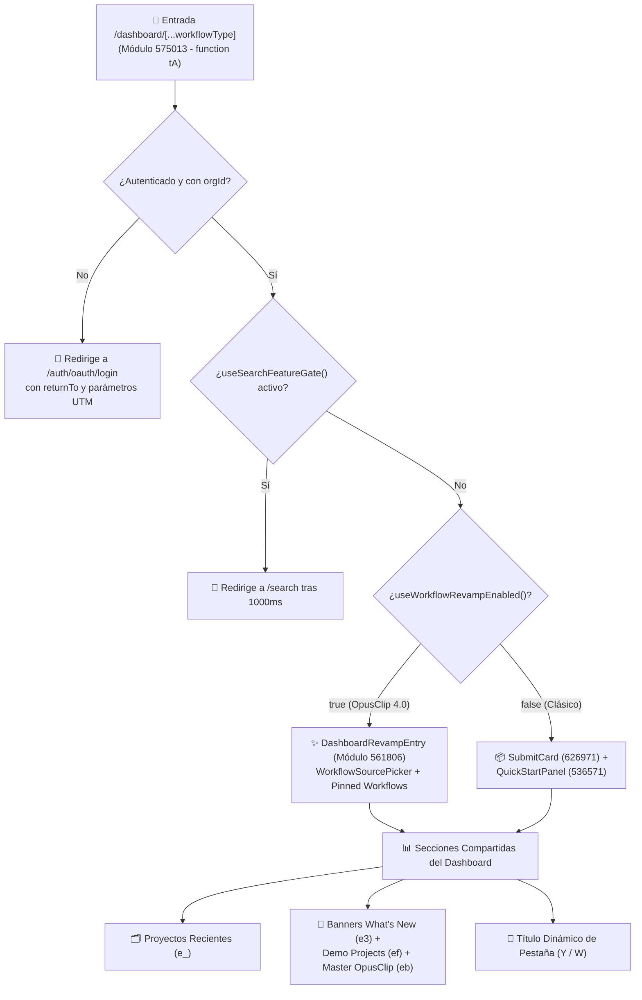

# 🎛️ Módulo Dashboard y Enrutamiento de Workflows

> [!abstract] En pocas palabras
> Es el componente raíz que se ejecuta al abrir `https://clip.opus.pro/dashboard` (módulo `575013` en `2pdyo3gbgw8ji.js`). Se encarga de autenticar la sesión, perfilar el hardware del usuario, resolver enlaces profundos (`workflowType`), decidir si mostrar la interfaz **Clásica** o **OpusClip 4.0 (`DashboardRevampEntry`)** y coordinar los paneles de proyectos recientes, banners dinámicos y diálogos de inicio rápido.

El diagrama detalla el árbol de decisión exacto que ejecuta la función `tA()` en cada montaje de `/dashboard`, desde la verificación de credenciales hasta el renderizado condicional de los subárboles de interfaz.

> [!example] Ejemplo real: Qué pasa cuando un usuario entra a `/dashboard/clip-anything`
> Cuando el parámetro de ruta `router.query.workflowType` vale `["clip-anything"]` y el [[Glosario#Feature Gate|Feature Gate]] `quickstart_deeplink_enabled` está activo, el efecto de enrutamiento (líneas 193–215 de `2pdyo3gbgw8ji-formatted.txt`) evalúa si el usuario tiene **OpusClip 4.0** activo (`x === true`). Si lo tiene, ejecuta `router.replace("/workflow-canary?from=dashboard&preset=builtin:long-to-shorts&workflowId=builtin:long-to-shorts&upload=1&model=ClipAnything")`. Si está en el **Dashboard Clásico** (`x === false`), asigna `submitStore.preferenceModel = "ClipAnything"` y mantiene el dashboard abierto en modo `"normal"`.

---

## ⚙️ Funciones principales del módulo

### 1. Enrutamiento de enlaces profundos (`workflowType` y `usecase`)
La ruta de Next.js es `/dashboard/[...workflowType]`, lo que permite invocar flujos específicos directamente por URL:

| Valor de `workflowType[0]` | Comportamiento en Dashboard Clásico (`!x`) | Comportamiento en OpusClip 4.0 (`x === true`) |
|---|---|---|
| `"normal"` (o vacío) | Muestra `SubmitCard` y `QuickStartPanel` estándar. | Muestra `DashboardRevampEntry` con pestaña `"clipping"` (`builtin:long-to-shorts`). |
| `"caption"` | Abre `QuickStartDialog` de subtítulos IA (`892714`). | Redirige a `/workflow-canary?from=dashboard&preset=builtin:ai-captions&workflowId=builtin:ai-captions&upload=1`. |
| `"reframe"` | Abre `QuickStartDialog` de reencuadre IA (`235491`). | Redirige a `/workflow-canary?from=dashboard&preset=builtin:ai-reframe&workflowId=builtin:ai-reframe&upload=1`. |
| `"broll"` | Abre `QuickStartDialog` de B-Roll IA (`603609`). | Redirige a `/workflow-canary?from=dashboard&preset=builtin:ai-broll&workflowId=builtin:ai-broll&upload=1`. |
| `"voiceover"` | Abre `QuickStartDialog` de Voiceover (`eO`). | Activa automáticamente el modo `"auto-edit"` (`ec(true)`) en el selector superior. |
| `"enhance_speech"` | Abre `QuickStartDialog` de mejora de voz (`960083`). | Abre `QuickStartDialog` de mejora de voz sobre el dashboard. |
| `"quick_editor"` | Abre `QuickStartDialog` de editor rápido (`958296`). | Redirige inmediatamente a `/editor-start`. |
| `"upscale"` | Abre el diálogo de escalado `AiUpscale` (`ew` en `536571`). | Abre el diálogo de escalado con diseño translúcido `backdrop-blur-2xl` y fuentes inline (`ea`). |
| `"clip-anything"` | Fija `submitStore.preferenceModel = "ClipAnything"`. | Redirige a `/workflow-canary` con `preset=builtin:long-to-shorts` y `model=ClipAnything`. |
| `"auto-import"` | Abre automáticamente el modal de Auto-Importación (`submitStore.autoImportDialogOpen = "auto-open"`). | Abre el modal de Auto-Importación de YouTube (`336871`). |

Además, si la URL incluye `?usecase=auto-edit` con OpusClip 4.0 activo, el estado `es` (`autoEdit`) se inicializa en `true`.

---

### 2. Conmutación entre OpusClip 4.0 (`DashboardRevampEntry`) y Dashboard Clásico
La función `useWorkflowRevampEnabled()` (módulo `889399`) combina un flag remoto de Statsig con una preferencia local del usuario:
- **Fórmula**: `enable_workflow_revamp && !workflowRevampClassicStore.classic`
- **Qué incluye `DashboardRevampEntry` (`561806` en `2wgzebltzq0s_.js`)**:
  - Un `ToggleGroup` superior para alternar entre **Long to shorts (`clipping`)** y **Auto Edits (`auto-edit`)**, acompañado del botón **Open editor** (`/editor-start`).
  - El componente `WorkflowSourcePicker` (`818420`), con placeholder rotativo cada `2,000 ms` (*YouTube link*, *Rumble link*, *Zoom link*, *Twitch link*), soporte Drag & Drop y menú de subida desde archivo local o Google Drive.
  - Una fila de **Workflows fijados (`pinnedWorkflows`, módulo `289931`)** que muestra hasta `4` píldoras combinando hasta `2` workflows personalizados del usuario (`source === "custom"`, con icono de estrella) y `2` workflows integrados (`source === "builtin"`), priorizando siempre el último workflow utilizado (`lastUsedWorkflowId`).
  - Un banner de guardado rápido (`WorkflowSaveControl`, módulo `468484`) si `workflowSavePromptAtom` detecta cambios no guardados en las preferencias de un workflow anterior.
  - El diálogo `WorkflowManagementDialog` (`217280`) al pulsar el botón **More**, que incluye la tarjeta interactiva de comparación *Before/After* de **AI Upscale** (`L` en `2wgzebltzq0s_.js`).

---

### 3. Carrusel dinámico "What's New" con sanitización de seguridad (`e3` / `e6` / `e4`)
El carrusel de novedades se alimenta del [[Glosario#Dynamic Config|Dynamic Config]] `dashboard_whats_new_banner` de Statsig. Antes de renderizar cualquier tarjeta, el módulo `575013` ejecuta un validador estricto (líneas 55–114 de `2pdyo3gbgw8ji-formatted.txt`):
- **Validación de esquemas**: Exige `id` y `title` no vacíos, descarta duplicados y registra motivos de descarte con `console.warn("[whats-new] ...")`.
- **Sanitización contra XSS y Open Redirect (`eF` y `eB`)**: Rechaza cualquier URL que contenga caracteres de control ASCII (`/[\u0000-\u001F\u007F]/`) y solo permite rutas relativas seguras que comiencen con una sola barra (`/^\/(?![/\\])/`) o URLs absolutas `http(s)://`.
- **Validación de color hexadecimal (`e$`)**: Solo acepta colores con formato `/^#(?:[0-9a-f]{3,4}|[0-9a-f]{6}|[0-9a-f]{8})$/i`.
- **Segmentación por plan (`eP`)**: Filtra cada tarjeta según el plan actual de la organización (`FREE`, `STARTER`, `ESSENTIAL`, `PRO`, `MAX`, `TRIAL`, `ENTERPRISE`).
- **Expansión interactiva**: En escritorio, al posar el cursor durante `150 ms` (`onPointerEnter`), la tarjeta se expande verticalmente de `180px` a `299px+` y reproduce un video en bucle silenciado (`<video loop muted playsInline>`), respetando `prefers-reduced-motion: reduce`.

---

### 4. Progreso en vivo en el título de la pestaña (`W` y `Y`)
Cuando el [[Glosario#Feature Gate|Feature Gate]] `enable_dynamic_tab_project_progress` (`DYNAMIC_TAB_PROJECT_PROGRESS_GATE`) está activo, los componentes `Y` y `W` observan la [[Glosario#Clipping Cohort|Clipping Cohort]] y modifican `document.title` en tiempo real:
- Si hay proyectos generándose (`running > 0`): Muestra la clave `tab_title_clipping` con el porcentaje líder (`leadPct`) y el conteo (`done/total`).
- Si todos terminaron con éxito (`failed === 0`): Muestra `tab_title_all_ready`.
- Si todos fallaron (`failed === total`): Muestra `tab_title_all_failed`.
- Si hubo éxitos parciales: Muestra `tab_title_partial_ready`.
Al desmontarse o vaciarse la cohorte, restaura el título original mediante `getTitleContent()`.

---

### 5. Benchmark silencioso de CPU en Web Worker (`91488` en `01sklqt0kl3nd.js`)
Al montarse `tA()`, registra un `PerformanceObserver` esperando el evento `largest-contentful-paint` (con un timeout de respaldo de `10,000 ms`). Cuando se dispara, instancia el worker `turbopack-worker-2ru9m5gbh1na6.js` (`01sklqt0kl3nd.js`), el cual ejecuta cuatro pruebas sintéticas:
1. `integerTime`: Bucle de $10^8$ iteraciones.
2. `floatTime`: Segundo bucle de $10^8$ iteraciones.
3. `memoryTime`: Reserva un arreglo de $10^7$ elementos (`Array(1e7).fill(0)`) y escribe `Math.random()` en cada celda.
4. `branchTime`: Tercer bucle de $10^8$ iteraciones.
El resultado `{ integerTime, floatTime, memoryTime, branchTime }` en milisegundos se guarda en `debugStore.debugCpuBenchmark` y el worker se termina inmediatamente (`terminate()`).

---

> [!info]- Detalle técnico (para desarrolladores)
> - **Archivos fuente**:
>   - `2pdyo3gbgw8ji.js` (módulo `575013`): Componente principal `tA`, carruseles `ef` (`DEMO_PROJECTS`), `eb` (`master_opusclip`), `e_` (`RecentProjects`), `e3` (`WhatsNew`), `tv` (`UserSurveyDialog`) y `Y`/`W` (`DynamicTabTitle`).
>   - `2wgzebltzq0s_.js` (módulos `561806`, `22917`, `289931`, `411369`, `888248`): `DashboardRevampEntry`, `pinnedWorkflows` y átomos QRR (`WORKFLOW_QRR_FEATURES`).
>   - `3nthk87c1t44i.js` (módulo `536571`): `QuickStartPanel`, diálogo de `Upscale` (`ew`), `Dubbing` (`eD`/`eE`) y `Voiceover` (`eO`).
>   - `01sklqt0kl3nd.js` (módulo `91488`): Implementación del Web Worker de benchmark de CPU.

## 🔗 Relacionado
- [[Motor de Ingesta y Subida de Medios]] — Cómo funcionan por dentro `SubmitCard`, `WorkflowSourcePicker` y `MultipartUploader`.
- [[Motor de Curación IA y Configuración de Clips]] — Qué contienen los workflows integrados (`createBuiltinWorkflows`) y los átomos QRR.
- [[ADR-002 Convivencia de Dashboard Clásico y Workflow Revamp OpusClip 4]] — Por qué existen ambas interfaces y cómo se controla su transición.
