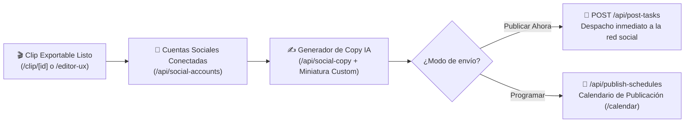

# 📅 Publicación Social Calendario y Analíticas

> [!abstract] En pocas palabras
> Este subsistema permite a los creadores conectar sus cuentas de **TikTok, YouTube, Instagram, Facebook, LinkedIn y X (Twitter)** para publicar clips inmediatamente o programarlos en un calendario visual (`/calendar`), generando automáticamente los títulos/descripciones con IA (`/api/social-copy`) y gestionando subcuentas o páginas de marca.

El diagrama muestra el flujo desde que un clip está listo hasta que se redacta su copy social y se envía de inmediato (`post-tasks`) o se agenda en el calendario (`publish-schedules`).

> [!example] Ejemplo real: Miniaturas personalizadas en publicaciones programadas (`scheduler_thumbnail`)
> En el módulo `42296` (`0_hne8424faiu.js`, línea 955 de `extracted_revamp_and_worker.txt`), el hook `useSchedulePostCustomThumbnailExperiment()` evalúa el experimento de Statsig **`scheduler_thumbnail`**. Cuando está activo para la organización (`enabled: true`), el programador de publicaciones habilita la subida de portadas personalizadas mediante `/api/plan-social-upload-links` antes de crear la tarea en `/api/publish-schedules`.

---

## 🔗 1. Gestión de Cuentas y Subcuentas OAuth (`/api/social-accounts`)

El flujo de vinculación de redes sociales (distribuido en el espacio de nombres `plansocial.json` y el prefijo `apiStore.planSocialApiPrefix`) soporta tanto cuentas personales como páginas/canales administrados:
- **Generación de enlace OAuth**: Llama a `/api/social-accounts/generate-oauth-url` para la plataforma seleccionada y abre la ventana de autorización.
- **Flujo dedicado para TikTok**: Cuenta con endpoints específicos para enlaces de autorización (`/api/tiktok-auth-links`), intercambio de tokens (`/api/tiktok-auth-tokens`), enlaces compartibles (`/api/tiktok-shareable-links`) e inyección de marcas de agua invisibles de trazabilidad (`/api/tiktok-invisible-watermarks`).
- **Selección de subcuentas (`select-sub-accounts`)**: Para plataformas como Facebook Pages, Instagram Business o páginas de empresa en LinkedIn, tras el OAuth inicial se invoca `/api/social-accounts/select-sub-accounts` para elegir qué página o canal específico quedará vinculado a la organización.
- **Estado de diálogo global**: Controlado por el átomo `socialAccountListDialogOpen` (`debugLabel: "submit.social_account_list_dialog_open"` en el módulo `766705`).

---

## 📅 2. Calendario de Publicación y Tareas de Posteo

Una vez conectadas las cuentas, el usuario gestiona su parrilla de contenidos desde el modal de posteo o desde la ruta `/calendar`:
1. **Generación de Copy para Redes (`/api/social-copy`)**: Genera automáticamente títulos, descripciones y hashtags adaptados al tono de cada red social a partir de la transcripción del clip.
2. **Subida de activos para publicación (`/api/plan-social-upload-links`)**: Obtiene enlaces firmados para adjuntar miniaturas personalizadas.
3. **Ejecución inmediata (`/api/post-tasks`)**: Encola la subida directa del clip hacia las APIs de TikTok, YouTube Shorts, Reels, LinkedIn o X.
4. **Programación en Calendario (`/api/publish-schedules`)**: Permite consultar (`GET /api/publish-schedules?q={query}`), crear, reprogramar o cancelar publicaciones futuras.
5. **Integración especial con LinkedIn**: Incluye insignias y gestión de publicaciones en LinkedIn (`linkedInBadgeRedDotStore` en `40lq8si9mefa2.js`, `/api/lp-linkedin-badge` y acción `/{orgId}/{id}/remove-from-linkedin`).

---

> [!info]- Detalle técnico (para desarrolladores)
> - **Prefijo de API**: Todas las llamadas de este subsistema utilizan `apiStore.planSocialApiPrefix` (`https://api.opus.pro/api`).
> - **Diccionario de traducciones**: Las cadenas de interfaz de usuario del calendario, estados de conexión OAuth y errores de cuota de las APIs de TikTok/Meta/YouTube se cargan desde `locales/en/plansocial.json`.
> - **Conmutador de depuración**: En `debugStore.debugTabMap` (`422720`), las claves `CALENDAR` y `FSC` permiten apuntar el calendario social a entornos de prueba independientes.

## 🔗 Relacionado
- [[Integraciones]] — Visión general de todas las plataformas conectadas.
- [[Editor Multipista y Renderizado]] — Paso previo donde se prepara y renderiza el clip antes de publicarlo.
- [[Sistema de Auto-Importación de YouTube]] — Comparte la infraestructura de conexiones OAuth (`useSocialConnect`) y el prefijo `planSocialApiPrefix`.
