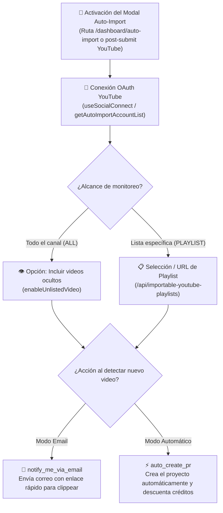

# 📺 Sistema de Auto-Importación de YouTube

> [!abstract] En pocas palabras
> El **Sistema de Auto-Importación** (módulo `336871` en `2pdyo3gbgw8ji.js` y métodos `auto-import` en `642390`) permite a los creadores conectar sus canales o listas de reproducción de YouTube para que, cada vez que suban un video nuevo a YouTube, OpusClip les avise por correo o cree automáticamente el proyecto de clipping en segundo plano.



El diagrama muestra el flujo de configuración dentro de `AutoImportDialog` (`336871`), desde la vinculación OAuth del canal de YouTube hasta la elección del alcance y la acción automatizada.

> [!example] Ejemplo real: Apertura inteligente después de enviar un video de YouTube
> En `SubmitPanel` (`252547`, líneas 1330–1334 de `extracted_core_modules.txt`), inmediatamente después de que un usuario envía manualmente un enlace de YouTube (`C.sourcePlatform === "YOUTUBE"`), el código ejecuta `getAutoImportAccountList("YOUTUBE", "1")` (`GET /api/auto-import?platform=YOUTUBE&needPopupFlag=1`). Si el backend responde `data.shouldPop === true`, el cliente cambia el átomo `submitStore.autoImportDialogOpen` a `"auto-open"`, invitando al creador a automatizar ese canal para sus próximos videos.

---

## ⚙️ Capacidades y reglas del subsistema

### 1. Dos formas de abrir el configurador
1. **Enlace directo o botón en Dashboard**: Entrando a `/dashboard/auto-import` o haciendo clic en el botón de Auto-Importación en el encabezado de proyectos (`showAutoImport`), lo cual cambia `submitStore.autoImportDialogOpen` de `"close"` a `"open"` o `"auto-open"`.
2. **Disparo contextual post-envío (`needPopupFlag=1`)**: Tras crear un proyecto manual desde un enlace de YouTube, si el usuario aún no ha configurado la auto-importación y el servidor determina que es candidato (`shouldPop`).

### 2. Alcance de sincronización: Canal completo (`ALL`) vs. Playlist (`PLAYLIST`)
El usuario puede elegir qué videos monitorear dentro de su canal conectado:
- **Todo el canal (`importVideoType: "ALL"`)**: Monitorea todas las subidas nuevas del canal. Incluye el interruptor `enableUnlistedVideo` para decidir si también deben procesarse los videos configurados como **Ocultos (*Unlisted*)** en YouTube.
- **Listas de reproducción (`importVideoType: "PLAYLIST"`)**:
  - Consulta las listas existentes del canal mediante `GET /api/importable-youtube-playlists?q=findByExtChannelId&extChannelId={channelId}`.
  - También permite pegar la URL de una lista de reproducción externa mediante `POST /api/auto-import/add-playlist-from-url`, que inicializa por defecto la configuración de colección (`collectionSetting`):
    ```json
    {
      "brandTemplateId": "preset-fancy-Deep_Diver",
      "clipDurations": [ [90, 180] ],
      "aspectRatio": "landscape",
      "importVideoType": "ALL",
      "enableCaption": false
    }
    ```

### 3. Modos de acción al detectar un nuevo video
En `POST /api/auto-import/set-config`, el usuario define cómo debe reaccionar OpusClip:
- **Notificación por correo (`email` / `notify_me_via_email`)**: No consume créditos automáticamente; envía un correo electrónico al propietario en cuanto detecta el nuevo video en YouTube para que confirme la creación con un clic.
- **Creación automática de proyectos (`auto_create` / `auto_create_pr`)**: Dispara automáticamente el pipeline de clipping aplicando la plantilla de marca asociada a la colección (`auto-import-collections`) y deduce los créditos correspondientes de la billetera de la organización.

---

## 🔌 Contratos de API del subsistema (Módulo `642390`)

Todos los endpoints de auto-importación se enrutan a través del prefijo `apiStore.planSocialApiPrefix` (`https://api.opus.pro/api`):

| Método en `useClipProjectApi` | Endpoint HTTP | Función |
|---|---|---|
| `getAutoImportAccountList(platform, needPopupFlag)` | `GET /api/auto-import?platform={p}&needPopupFlag={0\|1}` | Obtiene los canales conectados y la bandera `shouldPop`. |
| `createAutoImportAccount(payload)` | `POST /api/auto-import` | Registra un nuevo canal para auto-importación. |
| `updateAutoImportAccount(payload)` | `POST /api/auto-import/set-config` | Actualiza el modo (`email` vs. `auto_create`), filtro `ALL`/`PLAYLIST` y `enableUnlistedVideo`. |
| `deactivateAutoImportAccount({ platform, extUserId })` | `DELETE /api/auto-import?platform={p}&extUserId={id}` | Desvincula el canal y detiene el monitoreo automático. |
| `checkYoutubeOwner({ videoUri })` | `POST /api/auto-import/check-youtube-owner` | Verifica mediante OAuth si el usuario autenticado es dueño del video de YouTube. |
| `getAutoImportCollections(extChannelId)` | `GET /api/importable-youtube-playlists?q=findByExtChannelId&extChannelId={id}` | Lista las playlists disponibles en el canal de YouTube conectado. |
| `addPlaylistFromUrl(payload)` | `POST /api/auto-import/add-playlist-from-url` | Importa una playlist a partir de su URL de YouTube. |
| `getAutoImportCollectionsList({ q, channelId })` | `GET /api/auto-import-collections?q={q}&channelId={id}` | Consulta las colecciones de auto-importación configuradas. |
| `createAutoImportCollections(payload)` | `POST /api/auto-import-collections` | Crea reglas de colección para un canal o playlist. |
| `updateAutoImportCollection({ collectionId, collections })` | `PUT /api/auto-import-collections` | Actualiza las reglas de una colección de auto-importación. |
| `updateAutoImportCollections(payload)` | `POST /api/auto-import-collections/displace` | Reemplaza las colecciones activas de auto-importación. |
| `deleteAutoImportCollection(id)` | `DELETE /api/auto-import-collections/{id}` | Elimina una colección de auto-importación. |

---

> [!info]- Detalle técnico (para desarrolladores)
> - **Átomos de control en `submitStore` (`311846`)**:
>   - `submitStore.autoImportDialogOpen` (`debugLabel: "submit.auto_import_dialog_open"`, valor inicial `"close"`): Controla la visibilidad del diálogo (`"close"`, `"open"`, `"auto-open"`).
>   - `submitStore.autoImportActive` (`debugLabel: "submit.auto_import_active"`, booleano): Indica en la interfaz si el usuario tiene al menos una regla de auto-importación activa.
> - **Chunks donde reside la interfaz**: `2pdyo3gbgw8ji.js` (módulo `336871`), `3yj0sxx1--5ek.js` y `40lq8si9mefa2.js`.

## 🔗 Relacionado
- [[Flujo de Auto-Importación y Creación Automática]] — Diagrama de secuencia completo de extremo a extremo.
- [[Motor de Ingesta y Subida de Medios]] — Cómo se relaciona `checkYoutubeOwner` con la ingesta manual de enlaces de YouTube.
- [[Gestor de Proyectos Colecciones y Búsqueda]] — Dónde aterrizan los proyectos y colecciones creados automáticamente.
