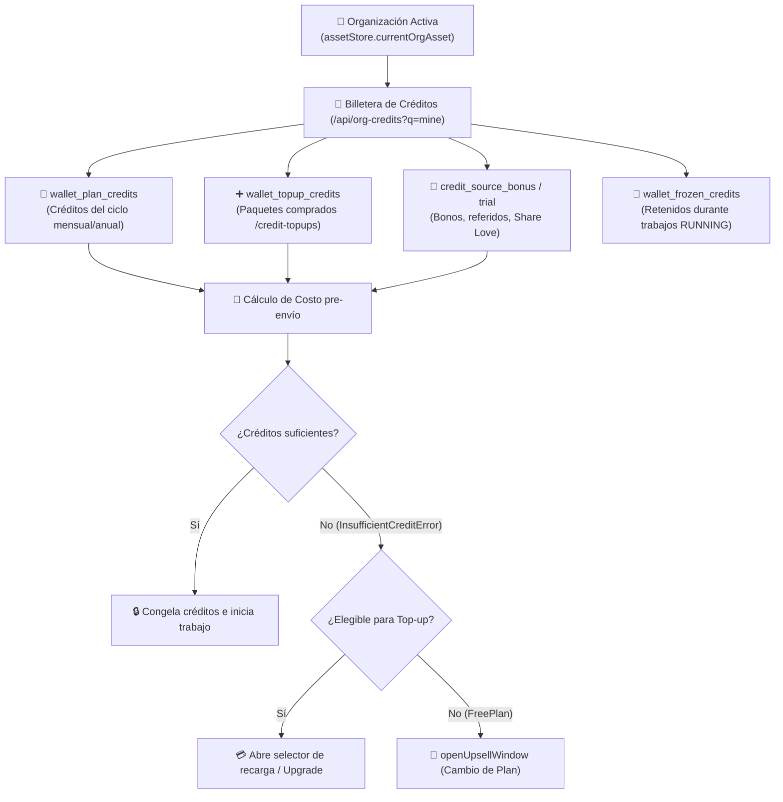

# 💳 Sistema de Créditos Planes y Facturación

> [!abstract] En pocas palabras
> Este subsistema gobierna toda la monetización de **OpusClip**: resuelve el plan activo de la organización (`assetStore`, módulo `579611`), administra los saldos de créditos disponibles y congelados (`creditStore`, módulo `163394` / `2149upcpqttkh.js`), calcula en tiempo real cuántos créditos cuesta cada operación (`timeToCredit`, `upscaleCredits`, `estimateDubCredits`) y dispara ventanas de *upsell* o recarga (*Top-up*) cuando detecta un déficit (`InsufficientCreditError`).



El diagrama muestra la composición de la billetera de la organización, la validación previa a cada trabajo y la bifurcación hacia recarga de créditos (*Top-up*) o mejora de plan (*Upsell*) cuando el saldo es insuficiente.

> [!example] Ejemplo real: Fórmula matemática exacta del costo de AI Upscale (`48711`)
> En el módulo `48711` (`0_hne8424faiu.js`, líneas 935 y 956 de `extracted_revamp_and_worker.txt`), el costo en créditos de escalar un video se calcula con:
> $$\text{upscaleCredits}(\text{rate}, \text{durationSeconds}) = \text{Math.round}\left(\frac{\text{rate}}{6} \times \lceil \frac{\text{durationSeconds}}{10} \rceil\right)$$
> Dado que `useUpscalePricingExperiment()` devuelve `rate = 70`, un video de **25 segundos** ($\lceil 25/10 \rceil = 3$ bloques de 10s) cuesta $\text{Math.round}((70/6) \times 3) = \mathbf{35\text{ créditos}}$ en HD. Si el usuario elige resolución **4K**, el multiplicador `creditsFor("4k", baseCredits)` (`useUpscaleOffer`, módulo `19602`) ajusta el precio final antes de confirmar (`ai_upscale.confirm_accepted`).

---

## 🏛️ 1. Jerarquía de Planes y Estado de Pago (`assetStore`, Módulo `579611`)

En `2n0-aub-2j085.js` (líneas 3392–3439 de `extracted_core_modules.txt`), `assetStore` deriva el estado comercial de la organización activa buscando `currentOrgId` dentro de `authStore.userOrgs`:
- **Propiedades de `currentOrgAsset`**:
  - `plan`: Mapeado por `mapPlanType(o.plan)` (`FreePlan`, `FreeTrial`, `Starter` / `Essential`, `Pro`, `Max`, `Enterprise`).
  - `cycle`: Mapeado por `mapPlanCycle(o.cycle)` (`Monthly` o `Yearly`).
  - `pack`, `expireAt`, `features`, `permissions`, `configs`, `isEnterprise`, `branch`, `hasApiAccess`.
- **Átomos derivados**:
  - `isPaidUser`: `plan !== "FreePlan"`.
  - `payStatus`: `"paid"` si `isPaidPlan(plan)` es verdadero; `"freeplan"` si `plan === "FreePlan"`; `"trial"` en caso contrario.
- **Bootstrap de precios multimoneda (`useUserPlanBoot`)**:
  Al iniciar, llama a `fetchPlanConfig()` (`/api/subscription-plans`), excluye `"ENTERPRISE"` (que tiene cotización a medida) y construye el mapa `userPlanDetail("${plan} ${cycle} ${currency.code}")` convirtiendo los montos con `Money.fromUnitAmount(value, currency)` para `value`, `amount`, `monthlyEquivalentPrice` y `finalPrice`.

---

## 🧮 2. Fórmulas de Cálculo de Créditos y Déficit (`612196` y `252547`)

1. **Conversión de segundos a créditos (`timeToCredit`, módulo `286660`)**:
   - Convierte el tiempo total de video disponible (`creditStore.totalCreditInSecond`) y la duración requerida del video a créditos (a razón de 1 crédito por cada 60 segundos de video en clipping estándar).
2. **Construcción del error de saldo insuficiente (`buildInsufficientCreditError`, módulo `612196`)**:
   ```javascript
   function buildInsufficientCreditError(requiredSeconds, availableSeconds) {
     let required = timeToCredit(requiredSeconds);
     let err = new Error(
       "You don't have enough credits to cover the full video length. Please specify a timeframe below, or purchase more credits."
     );
     err.name = "InsufficientCreditError";
     err.requiredCredits = required;
     err.shortfallCredits = Math.max(0, required - timeToCredit(availableSeconds));
     return err;
   }
   ```
3. **Reacción automática ante el déficit (`SubmitPanel` en `252547`, líneas 1348–1371)**:
   - Calcula el faltante exacto: `shortfall = Math.max(0, currentCreditToConsume - timeToCredit(totalCreditInSecond))`.
   - Cuando `needBuyMore` pasa a `true` (`useOnRisingEdge`), registra el evento `payment.insufficient_credits_panel.viewed` y, si `isEligible` (`useTopupEligibility`) y `autoOpenChooserOnShortfall` son verdaderos, abre automáticamente la ventana de compra (`openUpsellWindow`) con `panelType: "credit_shortfall"`, `requiredCredits` y `shortfallCredits`.
   - Además, si un usuario en `FreePlan` o `FreeTrial` tiene menos de 30 minutos (`totalCreditInSecond < 1800`) y cierra el modal de compra, muestra un banner especial de retención/alternativa (`ez` → componente `910173`).

---

## 🎟️ 3. Cuotas de Funciones Especiales (`creditStore.featureQuota`)

Además de los créditos generales por minuto, ciertas herramientas de IA tienen contadores de cuota específicos almacenados en `creditStore.featureQuota` (`163394`):
- **`voiceover`**: Controlado por `useAIVoUsageRecorder(plan)` (`703573`), almacena `{ hasLimit: true, remain: Math.max(0, maxCount - used), total: maxCount }`.
- **`voiceoverEnhancement`**: Controlado por `useVeUsageRecorder()` (`703573`), limita los usos durante la fase beta (`account_limit_in_beta_10`).
- **`genAIBroll` y `genStockBroll`**: Sincronizados mediante `checkBrollQuota()` (`GET /api/broll/check-quota` y `/api/broll-free-quota`), que devuelve `{ checkQuota, remainingQuota, totalQuota }` para B-Roll generativo con IA y B-Roll de stock.

---

## 🔌 4. Endpoints de Facturación, Billetera y Promociones

| Categoría | Endpoints en `https://api.opus.pro/api` | Función |
|---|---|---|
| **Billetera y Consumo** | `/org-credits?q=mine`, `/org-credits/consumptions`, `/org-credits/consumption-settlements`, `/org-credit-txns?q=mine`, `/org-credit-consumption-records?q=mine&grouped=true` | Consulta de saldo actual, historial de transacciones paginado y desglose agrupado de consumo. |
| **Recargas (`Top-up`)** | `/credit-topup-skus?source={s}`, `/credit-topups` | Catálogo de paquetes de créditos adicionales y ejecución de compra puntual. |
| **Bonos y Renovación Gratuita** | `/org-credits/renew-free-plan`, `/org-credits/add-by-special-link`, `/org-credits/add-by-trial-bonus-promotion`, `/org-credits/check-second-trial`, `/share-love-bonus?feature={f}` | Acreditación de bonos promocionales, segundo trial y recompensas por compartir en redes (*Share Love*). |
| **Suscripciones y Pagos** | `/subscription-plans`, `/subscriptions?q=mine`, `/subscriptions/estimate-amount`, `/subscriptions/confirm-payment`, `/subscriptions/{id}/check-next-payment-amount`, `/subscriptions/{id}/get-bill`, `/dlocal-payments/latest` | Ciclo completo de alta, cambio de plan (`/org-assets/switch-plan`), estimación de prorrateo, facturas y pagos locales vía dLocal. |
| **Cancelación y Retención** | `/subscriptions/cancel`, `/subscriptions/withdraw-cancel`, `/subscriptions/withdraw-change`, `/offer-coupon-for-subscription-operation`, `/subscription-coupons?q=mine` | Flujo de retención con oferta de cupones de descuento antes de cancelar y reversión de cancelaciones programadas. |

---

> [!info]- Detalle técnico (para desarrolladores)
> - **Tiendas Jotai del subsistema financiero**:
>   - `assetStore` (`579611` en `2n0-aub-2j085.js`)
>   - `creditStore` (`163394` en `1fa0vnh24jxow.js` y `2149upcpqttkh.js`)
>   - `subscriptionStore` y `upsellStore` (`09ed_93f77_59.js`, `2g_fxwpvl-f-l.js`)
>   - `couponStore` y `topupUiStore` (`06xtmt6rrbten.js`, `3mt_598nsqp1g.js`)

## 🔗 Relacionado
- [[Flujo de Consumo Congelamiento y Reembolso de Créditos]] — Paso a paso del ciclo de vida de los créditos durante un proyecto y su reembolso en caso de fallo.
- [[ADR-003 Modelo de Billetera con Créditos Congelados]] — Por qué OpusClip separa créditos del plan, top-up y congelados.
- [[Indicadores y métricas]] — Tabla consolidada de fórmulas de precios y límites por plan.
