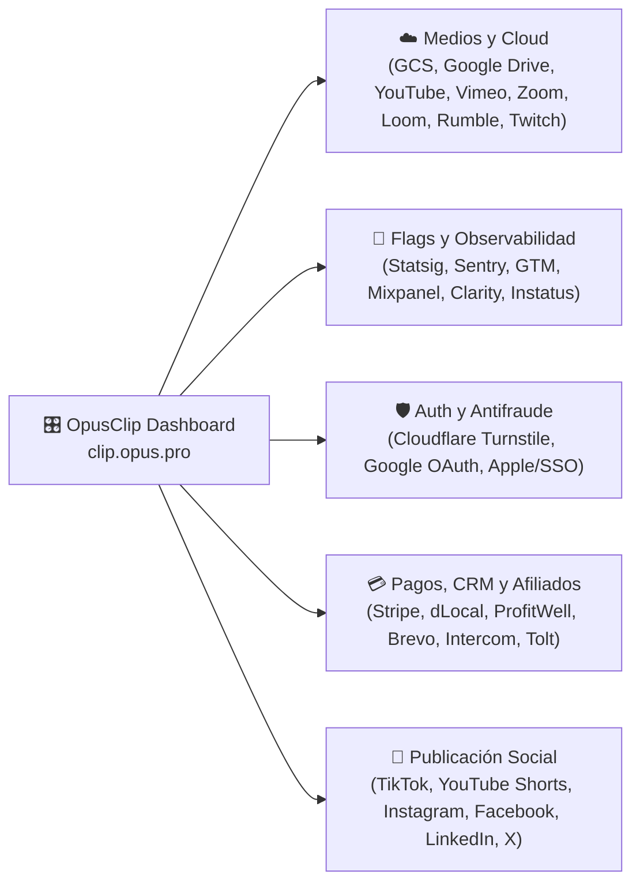

# 🔌 Integraciones

> [!abstract] En pocas palabras
> Para operar su flujo de ingesta, experimentación, pagos, soporte y publicación en redes sociales, **OpusClip Dashboard** se integra con **15 servicios externos** agrupados en cinco categorías: Almacenamiento e Ingesta, Experimentación y Telemetría, Seguridad y Autenticación, Pagos/CRM/Afiliados y Redes Sociales.

El diagrama agrupa las integraciones externas detectadas en los paquetes JS y en las capturas de tráfico de red realizadas con REA.

> [!example] Ejemplo real: Evasión de bloqueadores de anuncios para Statsig
> En la captura de tráfico en vivo (`ev_8c45dfb28c1004e705f4f438aa8606b2c0c11d6a15aa0b4926cb1dd9853d4445`), OpusClip no se conecta a `api.statsig.com`, sino a los dominios proxy oficiales de Statsig **`https://featureassets.org/v1/initialize`** (para descargar todos los Feature Gates y Dynamic Configs al arrancar) y **`https://prodregistryv2.org/v1/rgstr`** (para registrar exposiciones de experimentos y eventos). De esta manera, los bloqueadores de anuncios (*AdBlockers*) no rompen la evaluación de flags como `enable_workflow_revamp`.

---

## 🗂️ Catálogo completo de integraciones

### 1. ☁️ Almacenamiento en Nube e Ingesta de Video

| Servicio | Módulos / Endpoints asociados | Cómo se usa en el Dashboard |
|---|---|---|
| **Google Cloud Storage (GCS)** | `GoogleStorageV3`, `MultipartUploader` (`737381`), `/api/signed-urls`, `public.cdn.opus.pro` | Almacenamiento primario de videos subidos por el usuario, fuentes personalizadas (`/mg/fonts/`), plantillas Lottie y activos estáticos del CDN. |
| **Google Drive Picker API** | `GDRIVE_SCOPES`, módulo `574861`, `/api/oauth-connections?q=mine&sourcePlatform=GDRIVE&needAccessToken=true` | Permite al usuario abrir el selector oficial de Google Drive dentro del dashboard y transferir videos directamente de Drive a OpusClip sin pasar por su disco local. |
| **YouTube Data API / OAuth** | `useOpenYoutubeOauth` (`176067`), `/api/auto-import/check-youtube-owner`, `/api/importable-youtube-playlists` | Verifica si el usuario es propietario del canal de YouTube (`checkOwnership`) cuando existen restricciones de acceso y alimenta el sistema de Auto-Importación de canales y listas de reproducción. |
| **Plataformas de Video Soportadas por URL** | `useSupportedPlatformDomains` (`493457`), `/api/source-videos` | Ingesta directa por enlace desde **YouTube, Rumble, Zoom, Twitch, Vimeo, Loom, Facebook, X (Twitter), Kick, StreamYard** y enlaces directos `.mp4` en S3/GCS. |

### 2. 🧪 Feature Flags, Telemetría y Estado del Servicio

| Servicio | Módulos / Dominios asociados | Cómo se usa en el Dashboard |
|---|---|---|
| **Statsig** | `featureassets.org/v1/initialize`, `prodregistryv2.org/v1/rgstr`, `StatsigTracker` (`339057`), `useFeatureGate` (`568116`) | Motor central de [[Glosario#Feature Gate|Feature Gates]], [[Glosario#Dynamic Config|Dynamic Configs]] y experimentos A/B (`useExperiment`). |
| **Mixpanel (`MP`) & Statsig Events (`SS`)** | Función `event(name, payload, { platform: { MP: true, SS: true } })` (`906615`) | Doble despacho de eventos de producto (clics en QuickStart, expansión de banners, embudo de compra de créditos, encuestas). |
| **Google Tag Manager (GTM) & GA4** | `GtmPushEventOfNewUser`, `GtmPushEventOfExistingUser` (`2pdyo3gbgw8ji.js`) | Atribución de marketing y conversión de nuevos registros en el primer ingreso a `/dashboard`. |
| **Sentry** | SDK de cliente instrumentado en el bootstrap | Captura de excepciones no controladas, trazas de red fallidas y errores de renderizado en React. |
| **Microsoft Clarity** | Script de sesión visual | Mapas de calor y grabación de sesiones para análisis de UX. |
| **Instatus** | `GET https://opuspro.instatus.com/summary.json` | Consulta el estado operativo de los servicios de OpusClip en tiempo real para mostrar alertas de mantenimiento o degradación en el dashboard. |

### 3. 🛡️ Seguridad, Autenticación y Antifraude

| Servicio | Módulos / Endpoints asociados | Cómo se usa en el Dashboard |
|---|---|---|
| **Cloudflare Turnstile** | `callWithTurnstile` (`43le6kegn6rlc.js`) | Desafío invisible anti-bots antes de operaciones sensibles o de alto costo computacional. |
| **OAuth 2.0 / OIDC & SSO** | `/auth/oauth/login`, `/auth/callback`, `/api/oauth-google-callback`, `/api/sso-admins` | Inicio de sesión con Google, Apple, correo con código OTP (`/api/login-codes/send`) y SSO empresarial. Incluye detección de correos desechables (`/api/login-users/check-disposable-domain`) y multicuentas (`/api/login-users/check-multi-accounts`). |

### 4. 💳 Pagos, CRM, Soporte y Afiliados

| Servicio | Módulos / Endpoints asociados | Cómo se usa en el Dashboard |
|---|---|---|
| **Stripe & dLocal** | `/api/subscriptions/*`, `/api/credit-topups`, `/api/dlocal-payments/latest`, `/api/dlocal-payments/{id}/change-status` | Procesamiento de suscripciones recurrentes, recargas de créditos (`Top-up`) y métodos de pago locales en mercados emergentes vía **dLocal**. |
| **ProfitWell (Paddle Retain)** | Integración en el ciclo de facturación y cancelación (`/api/subscriptions/cancel`) | Métricas de retención y recuperación de bajas (*churn*). |
| **Brevo (ex-Sendinblue)** | `updateBrevoContact` (`627077`), `/api/update-login-user-brevo-contact` | Sincronización de atributos de perfilamiento del usuario (`PERSONA_USER_EXP`, `PERSONA_USER_SIZE`, `PERSONA_USER_FOLLOWER_SIZE`, `PERSONA_USER_CONTENT_SOURCE`) y envío de correos transaccionales/casos de estudio. |
| **Intercom** | `INTERCOM_JWT_REFRESH_MS`, `/api/login-users/intercom-tokens?platform=web`, `/api/intercom-conversations` | Widget de soporte en vivo autenticado mediante tokens JWT rotativos (`showSupportButton: true` en `/dashboard`). |
| **Tolt Affiliates** | `useAffiliateHandler`, cookie/parámetro `tolt_referral`, `/api/affiliates/bind` | Seguimiento de enlaces de afiliados y vinculación de comisiones al registrarse o comprar un plan. |

### 5. 📱 Redes Sociales y Exportación Profesional (NLE)

| Servicio | Módulos / Endpoints asociados | Cómo se usa en el Dashboard |
|---|---|---|
| **TikTok, YouTube, Instagram, Facebook, LinkedIn, X** | `/api/social-accounts/generate-oauth-url`, `/api/tiktok-auth-links`, `/api/publish-schedules`, `/api/post-tasks` | Conexión OAuth de cuentas y subcuentas (`select-sub-accounts`), publicación inmediata o programada en calendario y marcas de agua invisibles para TikTok (`/api/tiktok-invisible-watermarks`). |
| **Adobe Premiere Pro & DaVinci Resolve** | `clipStore.adobeDownload` (`943249`), exportación XML | Descarga de paquetes de proyecto editables con línea de tiempo multipista para editores de video profesionales (NLE). |

---

> [!info]- Detalle técnico (para desarrolladores)
> - **Atribución automática de UTM en enlaces salientes del Dashboard (`2pdyo3gbgw8ji.js`, líneas 122–125)**:
>   Cuando un usuario hace clic en un banner de *"What's New"* que apunta a `*.opus.pro` (como Agent Opus o AI Producer), la función decora automáticamente la URL:
>   - `utm_source`: `"opus-clip"` (en producción) o `"opus-clip-nonprod"` (en staging).
>   - `utm_medium`: `"dashboard_whats_new"`.
>   - `utm_campaign`: `"oc_quickstart"`.
>   - `utm_content`: `<bannerId>`.

## 🔗 Relacionado
- [[Arquitectura general]] — Cómo se insertan estas integraciones dentro de las 4 capas del cliente.
- [[Flujo de Autenticación y Bootstrap de Sesión]] — Uso de OAuth, Intercom, Tolt y Brevo durante el arranque.
- [[Publicación Social Calendario y Analíticas]] — Detalle de la integración con redes sociales y programación de contenido.
