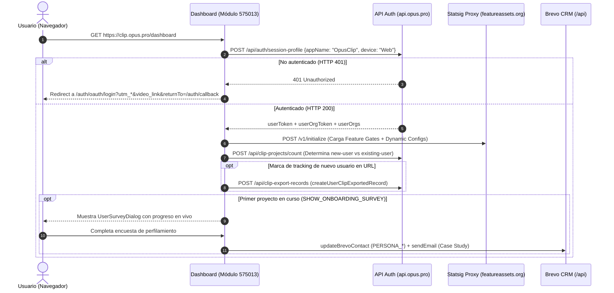

# 🔐 Flujo de Autenticación y Bootstrap de Sesión

> [!abstract] En pocas palabras
> Describe todo lo que ocurre desde el instante en que el navegador solicita `https://clip.opus.pro/dashboard` hasta que la interfaz queda autenticada, con la organización activa cargada, los [[Glosario#Feature Gate|Feature Gates]] de Statsig inicializados y —si es el primer ingreso del usuario— la encuesta de perfilamiento y correo de bienvenida disparados.

El diagrama de secuencia muestra las llamadas reales observadas tanto en la captura de tráfico REA (`ev_8c45dfb28c1004e705f4f438aa8606b2c0c11d6a15aa0b4926cb1dd9853d4445`) como en el código del módulo `575013`.

> [!example] Ejemplo real: Preservación del enlace de video durante el login (`rawVideoLink`)
> Si un visitante anónimo pega un enlace de YouTube en la landing page de OpusClip y es enviado a `/dashboard?video_link=https://youtu.be/...&utm_source=google`, el efecto de redirección en el módulo `575013` (línea 192 de `2pdyo3gbgw8ji-formatted.txt`) detecta `!isAuthenticated && ready` y llama a `loginWithRedirect` inyectando `utm_medium`, `utm_source`, `utm_campaign` y **`video_link`** dentro de `loginIframeSrc` y fijando `returnTo` hacia `/auth/callback?back_to=${window.location.href}`. Así, cuando el usuario termina de autenticarse con Google, regresa al dashboard con su video ya pre-cargado en `SubmitCard`.

---

## 📋 Paso a paso detallado

### Paso 1: Hidratación y consulta de `session-profile` (`11_0k0l7jwulg.js`)
1. El cliente carga el HTML SSR de `/dashboard` y ejecuta el bootstrap de sesión enviando:
   - **Método y URL**: `POST https://api.opus.pro/api/auth/session-profile`
   - **Credenciales**: `credentials: "include"` (cookies `HttpOnly`)
   - **Body JSON**: `{"appName": "OpusClip", "device": "Web"}`
2. Si la respuesta es `401 Unauthorized` (evidencia `ev_8c45dfb28c1004e705f4f438aa8606b2c0c11d6a15aa0b4926cb1dd9853d4445`), `isAuthenticated` queda en `false` y se dispara la redirección OAuth.

### Paso 2: Decodificación de Tokens y Selección de Organización (`authStore`, Módulo `847027`)
Cuando la sesión es válida:
1. Se almacenan `userToken` y `userOrgToken` en `authStore`.
2. El átomo derivado `authStore.authReady` pasa a `true` (`!!userToken && !!userOrgToken`).
3. El átomo `authStore.userOrgInfo` decodifica en memoria el segmento payload (parte 2 separada por punto) del `userToken` en Base64 para obtener `loginId: payload.sub`, y extrae del `userOrgToken` el par `{ userId: current.userId, orgId: current.orgId }`.
4. Se puebla `authStore.accountList` mapeando todas las organizaciones a las que pertenece el usuario (`userOrgs`), marcando `selected: e.orgId === currentOrgId` y resolviendo su plan con `mapPlanType(e.plan)`.

### Paso 3: Limpieza de marcas de tracking y registro de primer ingreso (`575013`)
En las líneas 189–192 de `2pdyo3gbgw8ji-formatted.txt`:
1. El dashboard inspecciona `window.location.search` con `searchParamsHasTrackingMark(e)`.
2. Si existe marca de registro nuevo:
   - La elimina de la URL tras `1,000 ms` usando `window.history.replaceState({}, "", cleanUrl)`.
   - Dispara el evento de conversión `GtmPushEventOfNewUser(cleanUrl)` hacia Google Tag Manager.
   - Invoca `createUserClipExportedRecord(orgId, userId)` (`POST /api/clip-export-records`); si devuelve `HTTP 409 Conflict`, registra un warning silencioso (`"User clip exported record already exists, skipping creation."`) y continúa.
3. Si no tiene marca de nuevo registro, dispara `GtmPushEventOfExistingUser()`.

### Paso 4: Encuesta de Onboarding y Automatización de Email (`UserSurveyDialog`, líneas 160–171)
Si el usuario acaba de enviar su primer proyecto (`!!projectId`) y el flag `SHOW_ONBOARDING_SURVEY` está activo:
1. Se abre el modal `UserSurveyDialog` (`tv`), que en su parte superior renderiza el subcomponente `tf` (`useProjectProgress({ projectId })`) mostrando una barra en tiempo real (*"Processing your first project..."* → *"Your first project is done!"*) mientras el usuario responde las preguntas.
2. Las opciones de cada pregunta se barajan aleatoriamente en memoria (`Math.random() - 0.5`), dejando siempre la opción `"other"` al final (`"other" === e.value ? 1 : -1`) para eliminar sesgo de posición en la encuesta.
3. Al enviar la última respuesta (`user.survey_submit`):
   - Lanza una animación de confeti (`particleCount: 100, spread: 45, origin: { y: 0.99 }`).
   - Actualiza el contacto en **Brevo** (`updateBrevoContact`) con:
     - `PERSONA_USER_EXP`: `e.userExp`
     - `PERSONA_USER_SIZE`: `e.userSize`
     - `PERSONA_USER_FOLLOWER_SIZE`: `e.followerSize`
     - `PERSONA_USER_CONTENT_SOURCE`: `e.contentSource`
     - `PERSONA_USER_SOURCE_CHANNEL`: `e.sourceChannel`
   - Si el experimento `send_survey_email_exp` está activo (`f === true`), envía inmediatamente un correo con caso de estudio personalizado (`sendEmail`):
     - Si `contentSource === "agency"` → plantilla `"case-study-agency"`, asunto *"Boost Monthly Revenue by \$20K with OpusClip!"*.
     - Si `userSize === "small_business"` o `"large_business"` → plantilla `"case-study-marketer"`, asunto *"Win 136% More Brand Exposure with OpusClip!"*.
     - En cualquier otro caso → plantilla `"case-study-podcaster"`, asunto *"Hit 1 Million Views Faster OpusClip!"*.

---

> [!info]- Detalle técnico (para desarrolladores)
> - **Guardia de renderizado del Dashboard (`2pdyo3gbgw8ji-formatted.txt`, línea 220)**:
>   Mientras `!isAuthenticated || !currentOrgId || useSearchFeatureGate() !== false`, el componente `tA` devuelve un esqueleto de carga a pantalla completa (`<o.default />`) y no monta ningún subcomponente del dashboard.
> - **Prefetch automático**: En cuanto se monta `/dashboard`, ejecuta `router.prefetch("/workflow")` (línea 192) para acelerar la transición cuando el usuario pegue un enlace.

## 🔗 Relacionado
- [[Actores y responsables]] — Cómo se diferencian los permisos una vez cargada la organización en `authStore`.
- [[Flujo de Subida y Creación de Proyecto de Clipping]] — El siguiente flujo que ejecuta el usuario tras autenticarse.
- [[Integraciones]] — Detalle de Auth, Statsig, GTM y Brevo.
