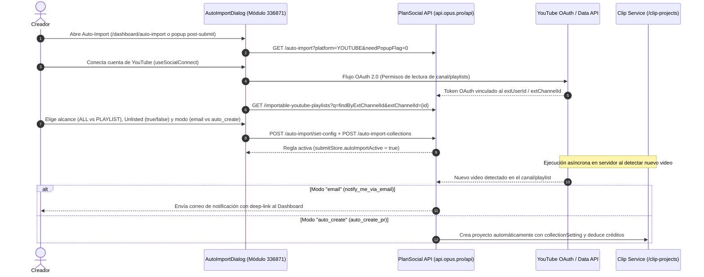

# 📺 Flujo de Auto-Importación y Creación Automática

> [!abstract] En pocas palabras
> Explica la secuencia técnica mediante la cual un creador conecta su canal de YouTube a OpusClip, configura reglas de importación por canal completo o lista de reproducción (`auto-import-collections`) y automatiza la creación de proyectos de clipping cada vez que publica un video nuevo en YouTube.

El diagrama de secuencia recorre tanto la fase interactiva de configuración en el dashboard como la fase desatendida que ocurre cuando el canal de YouTube publica nuevo contenido.

> [!example] Ejemplo real: Configuración por defecto al importar una Playlist por URL
> Cuando el usuario añade una lista de reproducción pegando su enlace en `addPlaylistFromUrl` (`642390`, líneas 2238–2245 de `extracted_core_modules.txt`), el cliente envía a `POST /api/auto-import/add-playlist-from-url` el siguiente `collectionSetting` predeterminado:
> - `brandTemplateId`: `"preset-fancy-Deep_Diver"`
> - `clipDurations`: `[ [90, 180] ]` (clips de 90 segundos a 3 minutos)
> - `aspectRatio`: `"landscape"`
> - `importVideoType`: `"ALL"`
> - `enableCaption`: `false`

---

## 📋 Paso a paso detallado

### Paso 1: Descubrimiento de cuentas y estado actual
1. Al montarse el diálogo `AutoImportDialog` (módulo `336871` en `2pdyo3gbgw8ji.js`), consulta `getAutoImportAccountList("YOUTUBE", "0")`.
2. Si el usuario ya tiene un canal vinculado, recupera sus colecciones activas mediante `GET /api/auto-import-collections?q={q}&channelId={channelId}` y marca `submitStore.autoImportActive = true`.

### Paso 2: Vinculación OAuth y carga de listas de reproducción
1. Si no hay canal conectado, el usuario inicia el flujo `useSocialConnect` para `"YOUTUBE"`.
2. Al completarse el callback OAuth, el cliente llama a `POST /api/auto-import` (`createAutoImportAccount`) y luego consulta las listas de reproducción del canal con `GET /api/importable-youtube-playlists?q=findByExtChannelId&extChannelId={extChannelId}`.
3. Durante la indexación inicial del canal, el cliente puede consultar el estado de los trabajos de indexación mediante `GET /api/initial-indexing-jobs?q=mine` (línea 300 de `extracted_core_modules.txt`).

### Paso 3: Definición de reglas (`set-config` y `auto-import-collections`)
1. El usuario selecciona si desea importar todos los videos del canal (`"ALL"`) o solo listas de reproducción seleccionadas (`"PLAYLIST"` en `PlaylistDialog`).
2. Activa o desactiva la casilla para incluir videos ocultos (`enableUnlistedVideo`).
3. Elige el comportamiento de disparo:
   - **`notify_me_via_email`**: Recibir aviso por correo sin gastar créditos automáticamente.
   - **`auto_create_pr`**: Crear el proyecto de clipping automáticamente en segundo plano usando la plantilla de marca elegida.
4. Al guardar, el cliente invoca `POST /api/auto-import/set-config` (`updateAutoImportAccount`) y sincroniza las colecciones mediante `POST /api/auto-import-collections`, `PUT /api/auto-import-collections` o `POST /api/auto-import-collections/displace`.

### Paso 4: Desactivación o eliminación de reglas
- Si el creador desea pausar una lista específica, llama a `DELETE /api/auto-import-collections/{collectionId}`.
- Si desea desconectar por completo el canal de YouTube, llama a `DELETE /api/auto-import?platform=YOUTUBE&extUserId={extUserId}` (`deactivateAutoImportAccount`).

---

> [!info]- Detalle técnico (para desarrolladores)
> - **Verificación de propiedad en videos restringidos (`checkYoutubeOwner`)**:
>   El mismo servicio de auto-importación expone `POST /api/auto-import/check-youtube-owner` (recibiendo `{ videoUri }`), que es reutilizado por `SubmitPanel` (`252547`) cuando un usuario intenta procesar manualmente un video de YouTube que requiere demostrar que es el propietario del canal (`not_your_yt`).

## 🔗 Relacionado
- [[Sistema de Auto-Importación de YouTube]] — Arquitectura interna y tabla completa de endpoints del componente.
- [[Flujo de Subida y Creación de Proyecto de Clipping]] — Cómo se procesa el proyecto una vez disparado manual o automáticamente.
- [[Gestor de Proyectos Colecciones y Búsqueda]] — Gestión de las colecciones donde se agrupan los videos importados.
