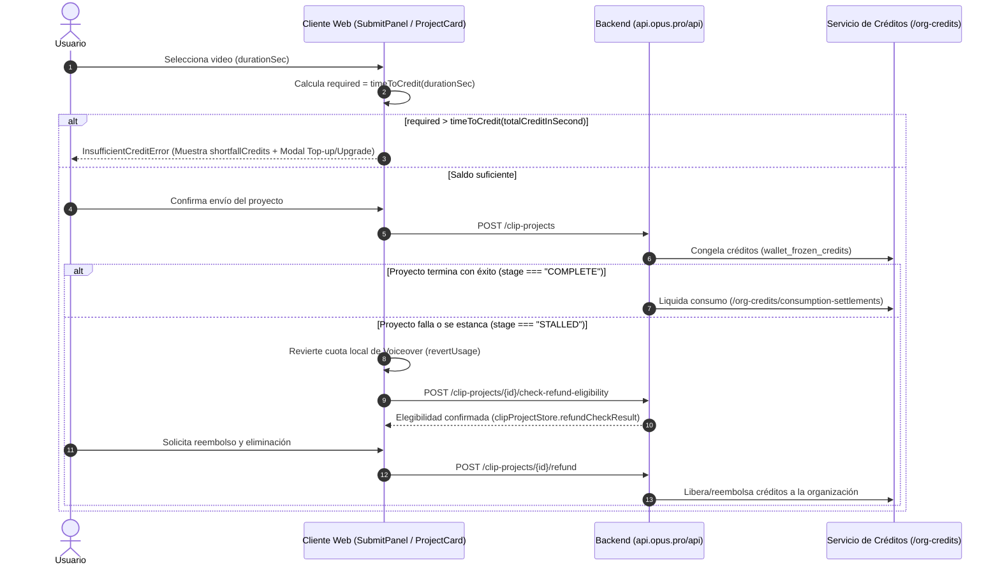

# 💳 Flujo de Consumo Congelamiento y Reembolso de Créditos

> [!abstract] En pocas palabras
> Explica el ciclo financiero exacto de los créditos en **OpusClip**: cómo se verifica el saldo antes de iniciar un trabajo, cómo pasan los créditos a estado **congelado (`wallet_frozen_credits`)** mientras los servidores GPU procesan el video, cómo se liquidan al completarse (`consumption-settlements`) y cómo el usuario o el sistema ejecutan el **reembolso (`refund`)** si un proyecto falla.

El diagrama de secuencia detalla las tres salidas posibles de una transacción de créditos: bloqueo preventivo por saldo insuficiente, liquidación exitosa tras completar el trabajo, o reembolso verificado tras un fallo.

> [!example] Ejemplo real: Almacenamiento en caché de la elegibilidad de reembolso (`refundCheckResult`)
> En `clipProjectStore` (módulo `184098`, líneas 2414–2431 de `extracted_core_modules.txt`), existe una familia de átomos dedicada llamada **`refundCheckResult`** (`clipProject.refundCheckResultMap`). Cuando una tarjeta de proyecto detecta un problema o el usuario abre las opciones de un proyecto fallido, el cliente invoca `checkProjectRefund(projectId)` (`POST /api/clip-projects/{projectId}/check-refund-eligibility` con `{ noErrorToast: true }`) y guarda el dictamen en `clipProjectStore.refundCheckResult(projectId)`. Si es elegible, habilita la acción `refundAndDeleteProject(projectId)` (`POST /api/clip-projects/{projectId}/refund`).

---

## 📋 Paso a paso detallado

### Paso 1: Cálculo preventivo y manejo de déficit (`InsufficientCreditError`)
1. Cuando `submitStore.preflightData` recibe la duración del video (`duration`), actualiza `submitStore.currentCreditToConsume`.
2. El cliente compara los créditos requeridos con `creditStore.totalCreditInSecond` (obtenido de `GET /api/org-credits?q=mine`).
3. Si hay déficit (`needBuyMore === true`):
   - Calcula `shortfallCredits = Math.max(0, requiredCredits - timeToCredit(totalCreditInSecond))`.
   - Ofrece al usuario dos caminos inmediatos sin perder su configuración:
     1. **Recortar el rango de procesamiento (`submitStore.preferenceRanges`)**: Elegir solo un fragmento del video para que quepa en sus créditos actuales.
     2. **Comprar créditos o subir de plan**: Abre `openUpsellWindow` con `trigger: "buy-more-from-workflow"` y `panelType: "credit_shortfall"`, registrando el evento `payment.insufficient_credits_panel.upgrade_clicked`.

### Paso 2: Congelamiento temporal (`wallet_frozen_credits`)
1. Al enviarse `POST /api/clip-projects` (o `POST /api/video-upscaling-tasks/standalone` en el caso de AI Upscale), el backend verifica el saldo disponible (`wallet_plan_credits + wallet_topup_credits + credit_source_bonus - wallet_frozen_credits`).
2. Los créditos requeridos por el trabajo pasan a `wallet_frozen_credits`. En el diálogo de Upscale se informa explícitamente al usuario con la cadena `video_upscale_credits_charged_hint`: *"Credits are charged once upscaling starts."*

### Paso 3: Liquidación y auditoría de consumo
1. Cuando el cluster GPU entrega los clips (`stage === "COMPLETE"`), los créditos congelados se convierten en consumo definitivo mediante `/api/org-credits/consumptions` y `/api/org-credits/consumption-settlements`.
2. El usuario puede auditar cada descuento desde la configuración de su cuenta, que consulta:
   - `GET /api/org-credit-txns?q=mine&page={page}&pageSize={pageSize}` (historial transaccional detallado).
   - `GET /api/org-credit-consumption-records?q=mine&grouped=true` (consumo agrupado por proyecto/función).

### Paso 4: Verificación de elegibilidad y Reembolso (`check-refund-eligibility` y `refund`)
En `useClipProjectApi` (`642390`, líneas 1926–1953 de `extracted_core_modules.txt`) se implementan los dos métodos de recuperación de créditos:
1. **`checkProjectRefund(projectId)`**:
   - Llama a `POST /api/clip-projects/{projectId}/check-refund-eligibility` con la cabecera `"x-opus-clip-project-toggle": "clip-api"` y la opción `{ noErrorToast: true }`.
2. **`refundAndDeleteProject(projectId)`**:
   - Llama a `POST /api/clip-projects/{projectId}/refund`, lo que restituye los créditos a la billetera de la organización y retira el proyecto fallido.
3. **Reversión local de cuotas de Voiceover (`usePollDashboardFirstPage` en `184098`)**:
   - De manera paralela, si el proyecto incluía generación de Voiceover (rastreado localmente en IndexedDB bajo `"clipping-project-with-vo"`) y su etapa pasa a `"STALLED"`, el poller del dashboard ejecuta automáticamente `revertUsage()` sin requerir intervención del usuario.

---

> [!info]- Detalle técnico (para desarrolladores)
> - **Orden de prelación en el consumo de créditos**:
>   La billetera distingue entre créditos de ciclo (`wallet_plan_credits`, que expiran en `expireAt` al final del ciclo mensual/anual si no se usan) y créditos de recarga (`wallet_topup_credits`), además de bonos promocionales (`add-by-special-link`, `add-by-trial-bonus-promotion`, `share-love-bonus`).
> - **Módulos involucrados**:
>   - `642390` (`0v5vcdwkoo-9r.js`): `checkProjectRefund` (`h`) y `refundAndDeleteProject` (`v`).
>   - `184098` (`00ycdg_js-ita.js`): `clipProjectStore.refundCheckResult` (`E`) y reversión de Voiceover en `usePollDashboardFirstPage`.
>   - `612196` (`2sx5shs8nlm61.js`): `buildInsufficientCreditError` y `resolveLocalSubmitError`.

## 🔗 Relacionado
- [[Sistema de Créditos Planes y Facturación]] — Descripción completa de las tiendas `assetStore` y `creditStore`.
- [[ADR-003 Modelo de Billetera con Créditos Congelados]] — Decisión arquitectónica detrás de `wallet_frozen_credits`.
- [[Gestor de Proyectos Colecciones y Búsqueda]] — Cómo se detecta el estado `"STALLED"` durante el polling del dashboard.
