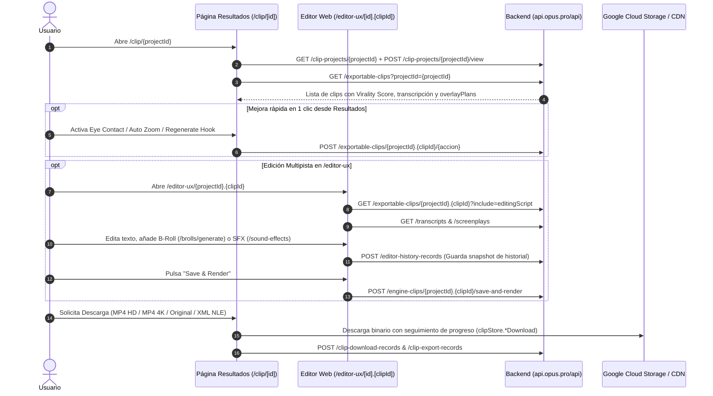

# 🎬 Flujo de Edición Renderizado y Exportación NLE

> [!abstract] En pocas palabras
> Describe el recorrido técnico desde que el usuario abre un proyecto completado (`/clip/[projectId]`), filtra y previsualiza los clips generados, aplica mejoras de IA en un clic o entra al editor multipista (`/editor-ux`), hasta que renderiza y descarga el video final en MP4 (HD o 4K) o exporta la secuencia editable para Adobe Premiere Pro / DaVinci Resolve.

El diagrama de secuencia muestra las llamadas que ocurren al abrir los resultados de un proyecto, al aplicar mejoras rápidas, al editar en `/editor-ux` y al exportar el archivo final.

> [!example] Ejemplo real: Registro de primera exportación y celebración (`check-first-operation`)
> Cuando un usuario descarga o exporta un clip, el cliente consulta `/api/clip-export-records/check-first-operation` y `/api/check-export-operation` (líneas 199 y 209 de `extracted_core_modules.txt`), actualizando `clipStore.isFirstTimeDownload` (`943249`) y disparando modales de celebración (`celebrationStore`) o bonos por compartir (`clipStore.showShareLove` → `/api/share-love-bonus`).

---

## 📋 Paso a paso detallado

### Fase 1: Carga del proyecto y marcado de lectura (`/clip/[projectId]`)
1. Al entrar a `/clip/[projectId]`, el hook `useRegisterProjectId(projectId)` (`943249`) inicializa `clipStore.rawProjectId`.
2. Se invoca `getClipProject(projectId)` (`GET /api/clip-projects/{projectId}`) y `markProjectViewed(projectId)` (`POST /api/clip-projects/{projectId}/view`).
3. Se descargan los clips exportables mediante `GET /api/exportable-clips?projectId={projectId}` y se pueblan los átomos `clipStore.clipIdList` y `clipStore.clipItem(clipId)`.
4. Los clips se ordenan por defecto según `clipStore.sortBtnValue` (`"Virality score"`).

### Fase 2: Mejoras en 1 clic sin entrar al editor
Desde la tarjeta de cada clip en `/clip/[projectId]`, el creador puede disparar transformaciones asíncronas directas sobre `exportable-clips`:
- **Contacto visual con IA**: `POST /api/exportable-clips/{projectId}.{clipId}/eye-contact` (y `/eye-contact/active`).
- **Acercamiento dinámico**: `POST /api/exportable-clips/{projectId}.{clipId}/auto-zoom`.
- **Corrección de color**: `POST /api/exportable-clips/{projectId}.{clipId}/auto-color`.
- **Bucle fluido al final del corto**: `POST /api/exportable-clips/{projectId}.{clipId}/preview-loop`.
- **Regenerar gancho o subtítulos**: `POST /api/exportable-clips/{projectId}.{clipId}/regenerate-auto-hook` y `/regenerate-captions`.
- **Duplicar clip para crear variantes**: `POST /api/exportable-clips/{projectId}.{clipId}/duplicate` (rastreado en `clipStore.duplicateClipIds`).
- **Doblaje a otro idioma**: `POST /api/dub-clip-tasks`.

### Fase 3: Edición avanzada en `/editor-ux/{projectId}.{clipId}`
1. Al abrir el editor, el cliente solicita el clip con su guion completo de edición:
   `GET /api/exportable-clips/{projectId}.{clipId}?include=editingScript`.
2. Carga en paralelo la transcripción y el guion visual de cámaras/escenas:
   - `GET /api/transcripts?q=findByProjectIdAndSourceId&sourceId={s}&projectId={p}`
   - `GET /api/screenplays?q=findByProjectIdAndSourceId&sourceId={s}&projectId={p}`
   - Archivos JSON en caché de GCS: `/${data}/scene_detection_timestamp.json`, `/${data}/screenplay.json`, `/${data}/transcript.json` y medios redimensionados para previsualización rápida (`/${media}/resize/video.resize.mp4` y `audio.resize.m4a`).
3. Cada cambio relevante se respalda en `/api/editor-history-records` (`saveEditorHistoryRecord`).
4. Cuando el usuario confirma los cambios, se invoca `POST /api/engine-clips/{projectId}.{clipId}/save-and-render` (o `/render` / `/refine` seguidos de polling en `/api/refine-tasks?q=findByTaskId&taskId={id}`).

### Fase 4: Descarga y Exportación Multi-Formato
El usuario elige entre las opciones de descarga gobernadas por `clipStore` (`943249`):
- **Video HD (1080p)**: Seguimiento en `clipStore.videoDownload(clipId)`.
- **Video 4K (2160p)**: Verificado por `useCanUse4KDownload(projectId)` (`42296`); si el video requiere escalado independiente o por proyecto, coordina con `/api/video-upscaling-tasks` y rastrea la descarga en `clipStore.video4KDownload(clipId)`.
- **Video Original sin subtítulos**: Seguimiento en `clipStore.videoOriginalDownload(clipId)` o `video4KOriginalDownload(clipId)`.
- **Exportación a NLE (Premiere Pro / DaVinci Resolve)**: Seguimiento en `clipStore.adobeDownload(clipId)`.
- **Descarga del medio fuente crudo**: `GET /api/raw-source-media?projectId={projectId}`.

---

> [!info]- Detalle técnico (para desarrolladores)
> - **Eliminación de marca de agua en cuentas de prueba (`clipStore`, líneas 2761–2769 de `extracted_core_modules.txt`)**:
>   Si `clipStore.clipsHaveWatermark` detecta que los clips tienen `renderPreferenceOverride.enableWatermark === true` y el usuario intenta descargar sin marca de agua, se abre el diálogo `trialWatermarkUpsellDialogOpen` con `watermarkParams: { clipId, type }`. Una vez que el usuario mejora su plan, el `projectId` se añade a `autoRemoveWatermarkProjectIdList` para regenerar los clips limpios.

## 🔗 Relacionado
- [[Editor Multipista y Renderizado]] — Arquitectura de las 10 tiendas Jotai del editor.
- [[Motor de Plantillas de Marca y Subtítulos]] — Cómo se renderizan los subtítulos y animaciones dentro de `overlayPlans`.
- [[Publicación Social Calendario y Analíticas]] — Alternativa a la descarga local: envío directo a TikTok, YouTube Shorts, Reels y LinkedIn.
