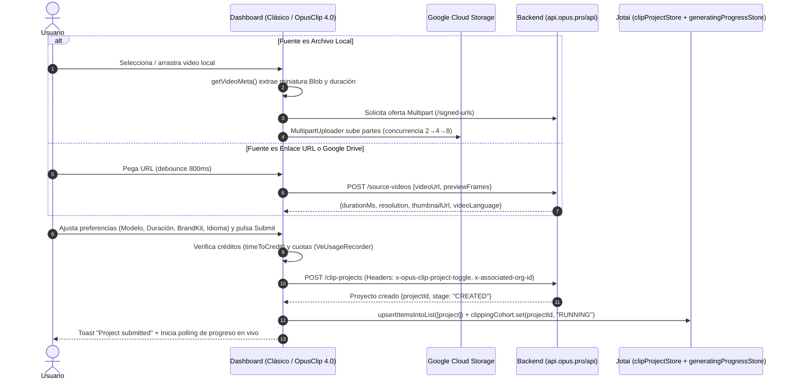

# 📥 Flujo de Subida y Creación de Proyecto de Clipping

> [!abstract] En pocas palabras
> Describe el proceso completo mediante el cual un video (por enlace URL, archivo local o Google Drive) pasa por la inspección previa (**[[Glosario#Preflight|Preflight]]**), valida límites de duración y saldo de créditos, recibe la configuración de IA y plantillas, y se registra como un nuevo proyecto en `POST https://api.opus.pro/api/clip-projects`.



El diagrama de secuencia contrasta la rama de subida local a GCS con la rama de enlace externo y muestra cómo ambas convergen en `POST /api/clip-projects` y en la inserción optimista dentro de las tiendas Jotai.

> [!example] Ejemplo real: Transferencia sin cortes de una subida en curso (`uploadHandoffAtom`)
> En **OpusClip 4.0** (`3956_sfin5yo1.js`, líneas 442–460), cuando el usuario arrastra un archivo pesado en `/dashboard`, el hook `useWorkflowUpload` inicia inmediatamente la subida en segundo plano, guarda la referencia del archivo y el estado `{ phase: "uploading", file, thumbnailUrl }` en `uploadHandoffAtom` (`682284`) y navega instantáneamente a `/workflow-canary?from=dashboard&preset=builtin:long-to-shorts&upload=1`. La página `/workflow-canary` lee `uploadHandoffAtom` y continúa mostrando la misma barra de progreso sin reiniciar la subida HTTP.

---

## 📋 Paso a paso detallado

### Fase 1: Selección de fuente y Preflight
1. **Si el usuario pega una URL**:
   - En el Dashboard Clásico (`SubmitCard`, módulo `626971`), al superar el preflight (`onPassPreflight`), si el flujo es `"normal"`, navega a `/workflow` para mostrar las opciones completas de configuración.
   - En OpusClip 4.0 (`DashboardRevampEntry`, módulo `561806`), la función `Y` invoca `useWorkflowSourceCheck()` (`255374`), que ejecuta `queryClient.fetchQuery` contra `POST /api/source-videos` con `staleTime: 30000 ms`. Si `durationMs <= 0`, aborta y muestra un toast de error (`isUserRejection`). Si es válido, guarda `{ scope: { userId, orgId }, apiPrefix, workflowId, videoUrl }` en `workflowEntryAtom` (`912485`) y navega a `/workflow-canary`.
2. **Si el usuario sube un archivo local**:
   - Se valida la extensión contra `VIDEO_ACCEPT` y el límite de subida del plan (`useUploadLimit`).
   - `getVideoMeta(file)` extrae en cliente la miniatura y la duración en segundos.
   - `MultipartUploader` (`737381`) sube los bloques a GCS verificando los headers `ETag`.

### Fase 2: Validación de límites de duración y créditos
1. **Advertencia de duración máxima (`useDurationWarning`, módulo `100980`)**:
   - Comprueba si la duración del video supera el límite permitido para el `workflowType` y el plan actual (`upgradeLimit`). Por ejemplo, en el diálogo de `Upscale`, el límite estándar mostrado es de 5 minutos (`video_upscale_upload_limit_hint`).
2. **Verificación de saldo (`useCheckCredit` / `timeToCredit`)**:
   - Compara `submitStore.currentCreditToConsume` contra `creditStore.totalCreditInSecond`.
   - Si no alcanza el saldo, construye un `InsufficientCreditError` (`612196`) y abre el modal de recarga o permite recortar el rango temporal (`submitStore.preferenceRanges`).

### Fase 3: Envío a `POST /api/clip-projects`
Dependiendo del modo activo, el envío se realiza mediante `startClipProject` (`642390`) o `useWorkflowSubmission` (`882239`):

- **Cabeceras HTTP obligatorias**:
  - `"x-opus-clip-project-toggle": "clip-api"`
  - `"x-associated-org-id": <orgId>`
- **Estructura del cuerpo JSON enviado a `POST /api/clip-projects`**:
  ```json
  {
    "videoUrl": "https://www.youtube.com/watch?v=...",
    "workflowId": "builtin:long-to-shorts",
    "atomsConfig": {
      "output": { "count": "many", "aspectRatio": "portrait" },
      "captions": { "enabled": true },
      "autoHeadline": { "enabled": true }
    },
    "importPref": {
      "sourceLang": "en",
      "targetLang": null
    },
    "curationPref": {
      "model": "ClipAnything",
      "clipDurations": [[30, 60], [60, 90]],
      "genre": "Podcast",
      "keywords": [],
      "customPrompt": ""
    },
    "renderPref": {},
    "uploadedVideoAttr": {
      "title": "My Video.mp4",
      "durationMs": 1200000
    },
    "brandTemplateId": "tpl_...",
    "brandKitId": "bk_...",
    "submitSurface": "workflow-panel",
    "isPrivate": false,
    "collectionIds": [],
    "campaignId": null,
    "campaignSourceId": null,
    "campaignBrandTemplateId": null
  }
  ```

### Fase 4: Actualización optimista y activación de la Cohorte (`252547`, líneas 1316–1335)
En cuanto `POST /api/clip-projects` devuelve el nuevo `projectId`:
1. Muestra el toast de éxito (`project_submitted`).
2. Inserta inmediatamente un objeto optimista en `clipProjectStore` mediante `upsertItemsIntoList`:
   `{ id: projectId, projectId, title, createdAt: nowISO, updatedAt: nowISO, stage: "CREATED" }`.
3. Registra el proyecto en `generatingProgressStore.clippingCohort` con estado `"RUNNING"` (si todos los proyectos anteriores de la cohorte ya habían terminado, limpia el mapa y crea una cohorte fresca).
4. Guarda `{ projectId, fromPath: router.pathname }` en `generatingProgressStore.pendingReveal`.
5. Si el usuario modificó la configuración de un workflow en OpusClip 4.0, guarda el borrador en `workflowSavePromptAtom` (`161113`) para ofrecerle guardar esos cambios al regresar a `/dashboard`.
6. Navega de vuelta a `/dashboard?projectId={projectId}` (o a `/collections?projectId={projectId}` si `useSearchFeatureGate()` está activo).

---

> [!info]- Detalle técnico (para desarrolladores)
> - **Protección contra doble envío en `useWorkflowSubmission` (`882239`, líneas 673–738)**:
>   Utiliza un cerrojo síncrono `A.current = true` y un estado `R.status` (`"idle"` | `"pending"` | `"success"` | `"failed"` | `"uncertain"`). Si ocurre un error de red que no es un `4xx` (`!isUserRejection(n)`), el estado pasa a `"uncertain"` y mantiene `locked = true` para evitar que un reintento ciego cobre dos veces los créditos del usuario.

## 🔗 Relacionado
- [[Motor de Ingesta y Subida de Medios]] — Detalle interno de `MultipartUploader` y `WorkflowSourcePicker`.
- [[Motor de Curación IA y Configuración de Clips]] — Estructura de `curationPref` y `atomsConfig`.
- [[Gestor de Proyectos Colecciones y Búsqueda]] — Cómo continúa el ciclo de vida del proyecto una vez entra en `clippingCohort`.
