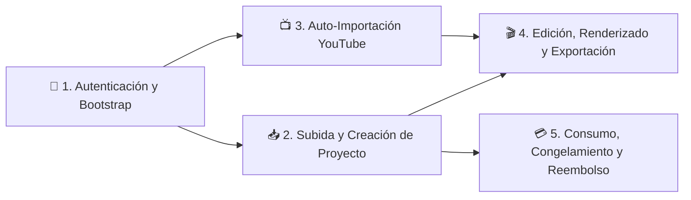

# 🔄 Flujos y procesos

> [!abstract] En pocas palabras
> Esta sección documenta paso a paso cómo colaboran el navegador, las tiendas reactivas **Jotai** y el backend **`api.opus.pro`** durante los cinco procesos críticos de negocio de **OpusClip Dashboard**: inicio de sesión, subida y creación de proyectos, auto-importación desde YouTube, edición/exportación y gestión financiera de créditos y reembolsos.

El diagrama muestra el orden natural en el que ocurren los cinco flujos operativos a lo largo de la jornada de un creador dentro del dashboard.

> [!example] Ejemplo real: Qué ocurre cuando falla un proyecto de clipping a mitad de camino
> Si un video enviado en el [[Flujo de Subida y Creación de Proyecto de Clipping]] cae en estado `"STALLED"` en los servidores de GPU, el [[Flujo de Consumo Congelamiento y Reembolso de Créditos]] detecta el fallo, revierte las cuotas locales de Voiceover (`revertUsage()`) y habilita el endpoint `POST /api/clip-projects/{id}/check-refund-eligibility` seguido de `POST /api/clip-projects/{id}/refund` para devolver los créditos congelados a la billetera de la organización.

---

## 📑 Catálogo de flujos documentados

| Flujo | Qué explica paso a paso | Módulos principales |
|---|---|---|
| [[Flujo de Autenticación y Bootstrap de Sesión]] | Cómo arranca la aplicación (`session-profile`), cómo redirige a `/auth/oauth/login` preservando UTMs, cómo decodifica el JWT de usuario y organización, y cómo lanza la encuesta de onboarding con correos automatizados vía Brevo. | `11_0k0l7jwulg.js`, `847027`, `575013` |
| [[Flujo de Subida y Creación de Proyecto de Clipping]] | El camino completo desde pegar un enlace o arrastrar un archivo hasta `POST /api/clip-projects`, cubriendo tanto el flujo Clásico (`SubmitPanel`) como OpusClip 4.0 (`useWorkflowSubmission`) y la transferencia de subida en vuelo (`uploadHandoffAtom`). | `818420`, `737381`, `252547`, `882239`, `642390` |
| [[Flujo de Auto-Importación y Creación Automática]] | Cómo se vincula un canal de YouTube, cómo se valida la propiedad del canal y cómo el backend crea proyectos desatendidos al detectar nuevos videos. | `336871`, `642390` |
| [[Flujo de Edición Renderizado y Exportación NLE]] | Cómo un proyecto completado pasa de `/clip/[id]` a `/editor-ux`, cómo se aplican mejoras IA en un clic y cómo se renderiza/descarga en MP4 HD, 4K o XML para Premiere/DaVinci. | `943249`, `3k764s640-hex.js`, `958296` |
| [[Flujo de Consumo Congelamiento y Reembolso de Créditos]] | Cómo se validan créditos antes de enviar, cómo se congelan durante el procesamiento, cómo se liquidan al concluir y cómo se reembolsan si el trabajo falla. | `579611`, `163394`, `612196`, `642390` |

---

> [!info]- Detalle técnico (para desarrolladores)
> Todos los flujos de red autenticados inyectan las credenciales desde `authStore` (`847027`):
> - `userToken`: Token JWT global del usuario (decodificado en cliente con `Buffer.from(token.split(".")[1], "base64")` para extraer `loginId = payload.sub`).
> - `userOrgToken`: Token contextual que contiene `current.userId` y `current.orgId`.
> - `cachedIdHeaders`: Persistido en `localStorage` (`global.auth.cachedIdHeaders`) para adjuntar `"x-associated-org-id"` desde el primer milisegundo de hidratación.

## 🔗 Relacionado
- [[00 - Inicio]] — Portada principal del vault.
- [[Componentes]] — Detalle estructural de los subsistemas que participan en estos flujos.
- [[Referencia de Endpoints API Backend]] — Lista completa de endpoints invocados en cada diagrama de secuencia.
