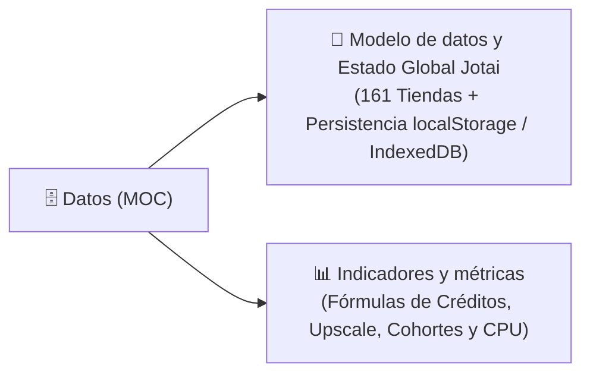

# 🗄️ Datos

> [!abstract] En pocas palabras
> Esta sección documenta el modelo de datos en el navegador y las fórmulas cuantitativas de **OpusClip Dashboard**: cómo se estructuran las **161 tiendas reactivas Jotai (`*Store`)**, qué claves persisten en `localStorage` e `IndexedDB`, y cómo se calculan matemáticamente los créditos, porcentajes de progreso y benchmarks de hardware.

El diagrama divide la sección de Datos en sus dos pilares: la estructura de almacenamiento reactivo en cliente y las fórmulas algorítmicas de medición y tarifación.

> [!example] Ejemplo real: Sincronización entre memoria RAM y `localStorage`
> Cuando un proyecto entra en la cohorte de generación (`generatingProgressStore.clippingCohort`), la función `serializeSnapshot` (módulo `837606` en `2sx5shs8nlm61.js`) guarda en `localStorage` (`dashboard.generatingProgressSnapshot`) el objeto `{ orgId, savedAt, cohort, acknowledged, observedAt, wedged }`. Al recargar la pestaña, `restoreSnapshot` verifica que `orgId` coincida y que `now - savedAt <= 86,400,000 ms` (24 horas) antes de hidratar la memoria RAM.

---

## 📑 Notas de esta sección

| Nota | Qué encontrarás ahí |
|---|---|
| [[Modelo de datos y Estado Global Jotai]] | Inventario completo de las tiendas Jotai (`authStore`, `apiStore`, `assetStore`, `submitStore`, `clipProjectStore`, `clipStore`, `generatingProgressStore`, `editor*Store`), sus átomos internos y las claves exactas de `localStorage` e `IndexedDB`. |
| [[Indicadores y métricas]] | Fórmulas matemáticas verificadas en el código para conversión de créditos (`timeToCredit`, `upscaleCredits`, `estimateDubCredits`), cálculo de progreso en vivo, retención de historial y benchmark de CPU. |

---

> [!info]- Detalle técnico (para desarrolladores)
> - **Mecanismo de persistencia (`atomWithPersistence`, módulo `357054`)**:
>   Acepta una clave de almacenamiento, un valor por defecto y opciones `{ lifespan: "local" | "session", preload: boolean }`, permitiendo además crear familias de átomos persistidos por clave (`atomFamily`).

## 🔗 Relacionado
- [[00 - Inicio]] — Portada principal del vault.
- [[Arquitectura general]] — Cómo se inserta la capa Jotai dentro del stack Next.js + Turbopack.
- [[Referencia de Endpoints API Backend]] — De dónde provienen los datos que hidratan estas tiendas.
