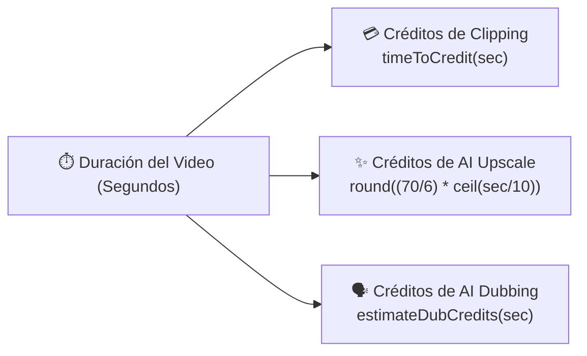

# 📊 Indicadores y métricas

> [!abstract] En pocas palabras
> Reúne todas las **fórmulas matemáticas, umbrales de tiempo, constantes de retención y métricas de rendimiento** extraídas directamente de los paquetes JavaScript de **OpusClip Dashboard (`clip.opus.pro/dashboard`)**.

El diagrama muestra cómo la duración en segundos del video fuente (`durationSeconds`) alimenta las tres funciones de tarifación del cliente antes de autorizar cualquier trabajo en la nube.

> [!example] Ejemplo real: Tabla de costos de AI Upscale según la duración del video
> Aplicando la fórmula exacta del módulo `48711` (`Math.round(70 / 6 * Math.ceil(t / 10))`):
> - Video de **10 segundos** ($\lceil 10/10 \rceil = 1$ bloque) → $\text{Math.round}(11.666) = \mathbf{12\text{ créditos}}$.
> - Video de **30 segundos** ($\lceil 30/10 \rceil = 3$ bloques) → $\text{Math.round}(35) = \mathbf{35\text{ créditos}}$.
> - Video de **60 segundos** ($\lceil 60/10 \rceil = 6$ bloques) → $\text{Math.round}(70) = \mathbf{70\text{ créditos}}$.
> - Video de **5 minutos / 300 segundos** (límite máximo de subida en Upscale, $\lceil 300/10 \rceil = 30$ bloques) → $\text{Math.round}(350) = \mathbf{350\text{ créditos}}$.

---

## 🧮 1. Fórmulas de Tarifación y Créditos

| Indicador / Función | Módulo | Fórmula / Regla exacta en código | Descripción |
|---|---|---|---|
| **Créditos de Clipping Estándar (`timeToCredit`)** | `286660` | $1\text{ crédito} = 60\text{ segundos}$ de video procesado | Convierte `totalCreditInSecond` y la duración del video o rango (`preferenceRanges`) a unidades de crédito. |
| **Déficit de Créditos (`shortfallCredits`)** | `612196` / `252547` | $\max(0,\; \text{requiredCredits} - \text{timeToCredit}(\text{totalCreditInSecond}))$ | Cantidad exacta de créditos faltantes que se muestra en el banner `credit_shortfall` y se envía al selector de *Top-up*. |
| **Umbral de Alerta en Plan Gratuito (`ez`)** | `252547` (línea 1344) | `needBuyMore && (plan === "FreePlan" \|\| plan === "FreeTrial") && totalCreditInSecond < 1800` | Activa el componente de ayuda/alternativa cuando al usuario gratuito le quedan menos de 30 minutos (`1,800 s`) y agota su saldo. |
| **Créditos de Escalado IA (`upscaleCredits`)** | `48711` (línea 935) | $\text{Math.round}\left(\frac{\text{rate}}{6} \times \lceil \frac{\text{durationSeconds}}{10} \rceil\right)$ con $\text{rate} = 70$ | Cobra por bloques indivisibles de 10 segundos a una tasa base experimental de 70 créditos por minuto. |
| **Duración Efectiva de Clip Editado** | `943249` (línea 2658) | $\text{duration} - \frac{\text{startGapMs}}{1000} - \frac{\text{endGapMs}}{1000}$ | Resta los recortes iniciales (`trimmedStartMs - offsetStartMs`) y finales (`offsetEndMs - trimmedEndMs`) de `captionPlans` para filtrar con precisión. |

---

## ⏱️ 2. Constantes Temporales, Polling y Límites Operativos

| Parámetro / Constante | Módulo | Valor exacto | Significado operativo |
|---|---|---|---|
| `PROGRESS_POLL_INTERVAL_MS` | `524235` | `5,000 ms` (5 s) | Frecuencia de polling de progreso de un trabajo activo (`/api/cluster-jobs/{id}/progress`) y del fallback de proyectos recientes en `/dashboard`. |
| Intervalo de `usePollDashboardFirstPage` | `184098` | `15,000 ms` (15 s) | Frecuencia con la que se refresca la primera página de proyectos (`pageSize: 16`) mientras existan proyectos en generación. |
| `MAX_PROGRESS_POLL_AGE_MS` | `524235` | `7,200,000 ms` (**2 horas**) | Tiempo máximo antes de declarar un proyecto como estancado (**[[Glosario#Wedged Project|Wedged]]**) y detener su polling infinito. |
| Vigencia de `generatingProgressSnapshot` | `837606` (`524235`) | `86,400,000 ms` (**24 horas**) | Tiempo máximo durante el cual se restaura desde `localStorage` la cohorte de proyectos en generación tras cerrar o recargar el navegador. |
| Retención del Historial de AI Upscale | `536571` (línea 646) | `604,800,000 ms` (**7 días**, `6048e5`) | Filtro aplicado sobre `O.tasks` (`Date.now() - e.startedAt <= 6048e5`): las tareas de escalado de más de 7 días se ocultan (`"History is only kept for 7 days."`). |
| Gracia de carga inicial de conteo (`K`) | `575013` (línea 186) | `2,500 ms` (2.5 s) | Tiempo máximo de espera de `countClipProjects()` antes de mostrar las secciones secundarias del dashboard (`Master OpusClip`, `What's New`). |
| Debounce de validación de URL | `818420` (línea 420) | `800 ms` | Espera tras escribir en el campo de enlace antes de disparar la validación de dominio y el preflight. |
| Rotación de Placeholder en Dashboard | `818420` (línea 427) | `2,000 ms` (2 s) | Intervalo de cambio automático del texto sugerido (*YouTube link* → *Rumble link* → *Zoom link* → *Twitch link*). |
| Caché de Preflight en React Query | `255374` (línea 363) | `30,000 ms` (30 s, `3e4`) | `staleTime` de la consulta `["workflow-revamp-source", ...]` para evitar llamadas repetidas a `POST /api/source-videos` con la misma URL. |
| Retardo de expansión en `What's New` | `575013` (línea 143) | `150 ms` | Delay en `onPointerEnter` antes de expandir la tarjeta y reproducir el video de vista previa. |
| Umbral de `IntersectionObserver` móvil | `575013` (línea 149) | `0.6` (60% visible) | Porcentaje del banner `What's New` que debe ser visible en pantalla móvil para iniciar la reproducción automática del video. |

---

## 🖥️ 3. Métricas del Benchmark de Hardware en Cliente (`01sklqt0kl3nd.js`)

Ejecutado tras `largest-contentful-paint` (o a los `10,000 ms` como tope) en el módulo `91488`, mide cuatro indicadores de velocidad del navegador en milisegundos (`Math.round(performance.now() - start)`):
1. **`integerTime`**: Tiempo en completar un bucle vacío de $100,000,000$ ($10^8$) iteraciones.
2. **`floatTime`**: Tiempo en completar un segundo bucle de $100,000,000$ ($10^8$) iteraciones.
3. **`memoryTime`**: Tiempo en reservar un arreglo de $10,000,000$ ($10^7$) posiciones (`Array(1e7).fill(0)`) y llenarlo con números pseudoaleatorios (`Math.random()`).
4. **`branchTime`**: Tiempo en completar un tercer bucle de $100,000,000$ ($10^8$) iteraciones.

---

> [!info]- Detalle técnico (para desarrolladores)
> - **Fórmula de ajuste dinámico de la fila de píldoras QuickStart (`pillRowFits`, módulo `755299`, línea 1026 de `extracted_revamp_and_worker.txt`)**:
>   Para decidir si insertar un salto de línea antes de la píldora `video_dubbing` en pantallas grandes (`xl:block`), un `ResizeObserver` mide el ancho de las píldoras de la primera fila (`[data-quickstart-first-row]`) y evalúa:
>   $$\sum_{i=1}^{n} \text{width}_i + 8 \times (n - 1) \le \text{containerClientWidth}$$

## 🔗 Relacionado
- [[Sistema de Créditos Planes y Facturación]] — Cómo se aplican las fórmulas de créditos en los flujos de pago y *upsell*.
- [[Gestor de Proyectos Colecciones y Búsqueda]] — Uso de las constantes de polling y detección de proyectos *wedged*.
- [[Módulo Dashboard y Enrutamiento de Workflows]] — Dónde se ejecutan el benchmark de CPU y los temporizadores de interfaz.
