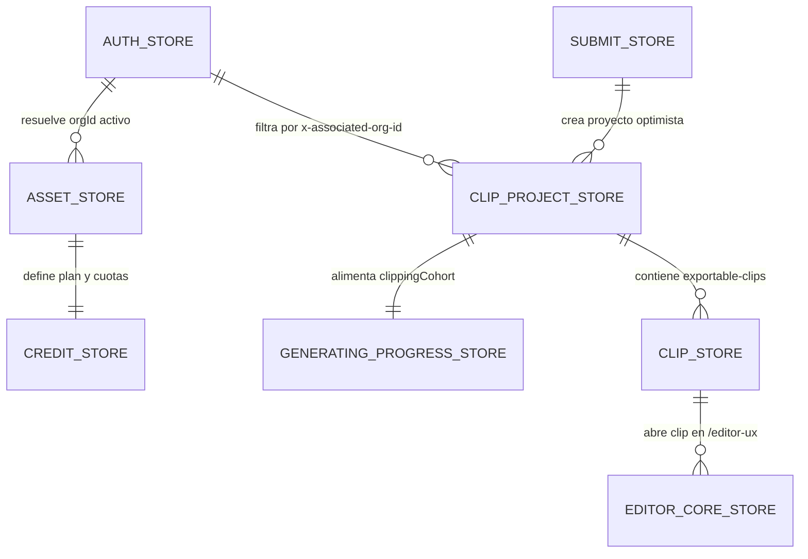

# 🧬 Modelo de datos y Estado Global Jotai

> [!abstract] En pocas palabras
> El estado completo del cliente de **OpusClip** está distribuido en **161 exportaciones de tiendas Jotai (`*Store`)** agrupadas en siete dominios: Autenticación y API, Activos y Facturación, Ingesta y Envío, Gestión de Proyectos y Progreso, Resultados de Clips, Editor Multipista y UI/Notificaciones.

El diagrama entidad-relación muestra cómo se encadenan las siete tiendas troncales desde la identidad del usuario (`AUTH_STORE`) hasta la edición multipista de un clip individual (`EDITOR_CORE_STORE`).

> [!example] Ejemplo real: Cómo evita `clipStore` re-renderizar 50 tarjetas de clips cuando solo una se está descargando
> En el módulo `943249` (`0_hne8424faiu.js`, líneas 2673–2744 de `extracted_core_modules.txt`), en lugar de que todas las tarjetas de clips se suscriban al diccionario completo `videoDownloadMap`, cada tarjeta se suscribe únicamente a **`clipStore.videoDownload(clipId)`** (creado con `atomFamily`). Así, cuando avanza el porcentaje de descarga del clip `A`, React actualiza exclusivamente el botón de descarga del clip `A`.

---

## 🗂️ 1. Desglose de las Tiendas Principales (Átomos y Debug Labels)

### A. `authStore` (Módulo `847027` en `0p9u92dpxgm13.js`)
Gestiona la identidad del usuario, los tokens JWT y la selección de organización:
- `user` (`"global.auth.userRaw"`, persistido): Datos crudos del perfil del usuario (`email`, `name`, `avatar`).
- `everLogin` (`"global.auth.everLogin"`, persistido): Booleano que indica si el navegador ya inició sesión alguna vez.
- `currentOrgId` (`"global.auth.currentOrgId"`, persistido): ID de la organización seleccionada actualmente.
- `currentOrgOwnerUserId` (`"global.auth.currentOrgOwnerUserId"`, persistido): ID del propietario de la organización activa.
- `userToken` (`"global.auth.userToken"`): JWT de autenticación global.
- `userOrgToken` (`"global.auth.userOrgToken"`): Objeto con el contexto de organización activa (`current.userId`, `current.orgId`).
- `userOrgs` (`"global.auth.userOrgs"`): Lista de organizaciones del usuario con `plan`, `cycle`, `packs`, `expireAt`, `features`, `permissions`, `isEnterprise`, `hasApiAccess`.
- `userOrgInfo` (`"global.auth.userOrgInfo"`, derivado): Decodifica en Base64 el payload de `userToken` y devuelve `{ userId, orgId, loginId }`.
- `accountList` (`"global.auth.accountList"`, `loadable`): Lista formateada para el selector de cuentas en la cabecera.
- `isOpusEmail` (`"global.auth.isOpusEmail"`, `loadable`): `true` si el correo termina en `@opus.pro` o `.opus.pro`.
- `cachedIdHeaders` (`"global.auth.cachedIdHeaders"`, persistido): Cabeceras cacheadas para inyectar `x-associated-org-id`.

### B. `assetStore` (Módulo `579611` en `2n0-aub-2j085.js`)
- `currentOrgAsset` (`"asset.currentOrgAsset"`, asíncrono): Cruza `userOrgs` con `currentOrgId` y devuelve `{ plan, cycle, pack, expireAt, features, permissions, configs, isEnterprise, branch, hasApiAccess }`.
- `isPaidUser` (`"asset.isPaidUser"`): `plan !== "FreePlan"`.
- `payStatus` (`"asset.payStatus"`): `"paid"` | `"freeplan"` | `"trial"`.
- `userPlanDetail` (`atomFamily`): Precios por combinación `"${plan} ${cycle} ${currencyCode}"`.
- `storageData` (`"asset.storage"`): Uso y límite de almacenamiento de la organización.

### C. `submitStore` (Módulo `311846` en `0t5v9hztvwr7u.js`)
Contiene **31 átomos** que representan el formulario de envío y preflight en el dashboard:
- **Preferencias de IA**: `preferenceModel` (`"submit.preference.model"`, persistido, default `"Auto"`), `preferencePrompt` (`"submit.preference.customPrompt"`), `preferenceNarrative`, `preferenceRanges`, `rangesChanged`, `brandTemplateId`, `preferenceClipLengths`, `preferenceKeywords`, `preferenceSkipSlicing`, `preferenceSkipCurate`, `preferenceGenre` (default `"Auto"`), `renderPreference`, `enableAutoHook`, `disableAutoHook` (persistido), `dubbingOptions`, `isPrivateProject`, `collectionIds`.
- **Datos de Preflight**:
  - `thirdVideoPreflightdata`: `{ errorMessage, resolution, isBadQuality, duration, thumbnailUrl, videoLanguage, translationLanguage, sourcePlatform }`.
  - `localVideoPreflightdata`: `{ errorMessage, resolution, duration, thumbnailUrl, title, type, size, videoLanguage, translationLanguage }`.
  - `videoSourceSeed`: Semilla activa (`{ type: "url" | "local" | "thirdPartyFile", url, file }`).
  - `preflightData` (`"submit.preflight.data"`, derivado): Devuelve automáticamente el objeto de preflight válido según `videoSourceSeed.type` si `duration > 0`.
- **Créditos y Automatización**: `currentCreditToConsume`, `insufficientCreditsErrorTime`, `autoImportDialogOpen` (`"close"` | `"open"` | `"auto-open"`), `autoImportActive`, `localSubmitTasks`, `localSubmitProjectList`, `campaignContext`.

### D. `clipProjectStore` (Módulo `184098`) y `generatingProgressStore` (Módulo `524235`)
- **En `clipProjectStore`**: `projectIdList`, `clipProjectDashboardMap`, `clipProjectDashboard(id)` (`atomFamily`), `projectList` (derivado), `clipProjectNextPage` (`{ page: 0, pageSize: 16, hasNextPage: true }`), `projectAccessDenied`, `refundCheckResult(id)` (`atomFamily`), `projectListOwner`.
- **En `generatingProgressStore`**: `clippingCohort` (`Map<projectId, "RUNNING" | "DONE" | "FAILED">`), `knownProjectIds`, `hasIndicatorRows`, `progressPollerRegistry`, `backfillRegistry`, `acknowledgedDoneIds`, `progressPollErrorIds`, `pendingReveal`, `panelSuppressed`, `persistedSnapshot` (`"dashboard.generatingProgressSnapshot"`), `snapshotHydrated`, `hydrateFromSnapshot`, `restoredObservedAt`, `wedgedIds`, `hasLiveProgress`.

### E. `clipStore` (Módulo `943249` en `0_hne8424faiu.js`)
Contiene **60+ átomos** para la vista de resultados `/clip/[id]`:
- Identidad y proyecto: `rawProjectId`, `projectId`, `isDemo` (`projectId.includes("demo-")`), `clipProject(id)`, `clipProjectProcess(id)`.
- Clips y filtros: `clipIdList`, `clipItem(id)`, `clipList`, `clipIdListWithFilter`, `clipListWithFilter`, `selectedClipDurations`, `selectedKeywords`, `selectedLiked`, `selectedDisliked`, `selectedIsEdited`, `selectedDubbed`, `selectedNotDubbed`, `clipIdWithSearchKeywords`, `sortBtnValue` (persistido, default `"Virality score"`), `viewTabValue` (persistido, default `"grid"`).
- Descargas (`atomFamily`): `videoDownload`, `video4KDownload`, `videoOriginalDownload`, `video4KOriginalDownload`, `adobeDownload`.
- Selección masiva y duplicación: `bulkSelectedClipIds`, `bulkSelectedClipList`, `duplicateClipIds`, `templateCopyRunning(id)`.

---

## 💾 2. Tabla de Claves Persistidas en `localStorage` / `sessionStorage` / `IndexedDB`

| Clave de almacenamiento | Tienda / Módulo | Tipo y valor por defecto | Propósito |
|---|---|---|---|
| `global.api.apiPrefixV2` | `apiStore` (`986231`) | `"https://api.opus.pro/api"` | URL base del API general. |
| `global.api.nestApiPrefixV2` | `apiStore` (`986231`) | `"https://api.opus.pro/api"` | URL base del servicio NestJS (`/clip-projects`). |
| `global.api.planSocialApiPrefix` | `apiStore` (`986231`) | `"https://api.opus.pro/api"` | URL base de planificación social y auto-importación. |
| `global.auth.userRaw` | `authStore` (`847027`) | `undefined` | Caché local del perfil de usuario. |
| `global.auth.currentOrgId` | `authStore` (`847027`) | `undefined` | Última organización seleccionada por el usuario. |
| `global.auth.cachedIdHeaders` | `authStore` (`847027`) | `undefined` | Cabeceras de organización listas para el primer request. |
| `global.baseContext.deviceIdRaw` | `baseContext` (`766705`) | `nanoid(12)` | Identificador único persistente de dispositivo de 12 caracteres. |
| `global.baseContext.utm` | `baseContext` (`766705`) | `undefined` | Atribución UTM/Opus (`source`, `medium`, `campaign`, `coupon_code`). |
| `submit.preference.model` | `submitStore` (`311846`) | `"Auto"` | Modelo de curación preferido (`Auto`, `ClipBasic`, `ClipAnything`). |
| `workflowRevamp.classic` | `workflowRevampClassicStore` (`557304`) | `false` | Si es `"true"`, fuerza el Dashboard Clásico aunque `enable_workflow_revamp` esté activo. |
| `dashboard.generatingProgressSnapshot` | `generatingProgressStore` (`524235`) | `null` | Snapshot JSON de la cohorte de proyectos en generación (expira en 24h). |
| `sort_btn_value` | `clipStore` (`943249`) | `"Virality score"` | Criterio de ordenamiento en `/clip/[id]`. |
| `view_tab_value` | `clipStore` (`943249`) | `"grid"` | Modo de visualización de clips (`grid` vs `list`). |
| `agent_opus_popup_seen_dashboard_script_to_video` | `QuickStartPanel` (`536571`) | `false` | Indica si el usuario ya vio el modal promocional de Script to Video (Agent Opus). |
| `clip.debug.debugMode` | `debugStore` (`422720`) | `false` | Habilita herramientas internas de depuración. |
| `clip.debug.dashboardUiMode` | `debugStore` (`422720`) | `"real"` | Fuerza el modo visual (`"real"`, `"new-user"`, `"existing-user"`). |
| `clipping-project-with-vo` *(IndexedDB `device`)* | `clipProjectStore` (`184098`) | `string[]` | Lista de proyectos en curso que consumieron cuota de Voiceover (para revertir si fallan). |

---

> [!info]- Detalle técnico (para desarrolladores)
> - **Generador criptográfico de `deviceId` (`992000` y `377864` en `0p9u92dpxgm13.js`)**:
>   Utiliza `crypto.getRandomValues(new Uint8Array(e))` con un alfabeto alfanumérico de 62 caracteres (`a-z`, `0-9`, `A-Z`) para generar identificadores seguros sin colisiones.

## 🔗 Relacionado
- [[Indicadores y métricas]] — Fórmulas que operan sobre los valores almacenados en estas tiendas.
- [[Arquitectura general]] — Cómo se coordina Jotai con TanStack React Query.
- [[Flujo de Subida y Creación de Proyecto de Clipping]] — Cómo cambian de estado `submitStore`, `clipProjectStore` y `generatingProgressStore` durante un envío.
