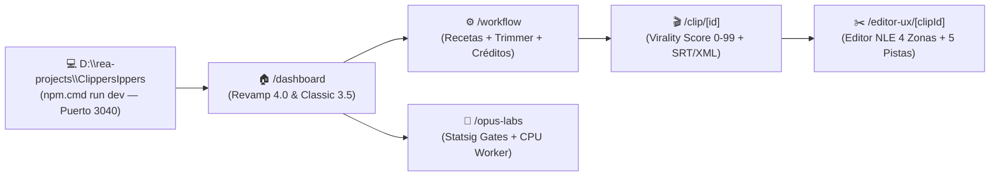

# 💻 Cómo ejecutar y usar la réplica local ClippersIppers

> [!abstract] En pocas palabras
> Esta guía explica cómo poner en marcha y utilizar la réplica local de **OpusClip (`D:\rea-projects\ClippersIppers`)**, construida con **Next.js 15, React 19, TypeScript, Tailwind CSS v4 y Jotai** a partir de los hallazgos de ingeniería inversa documentados en este vault. Permite experimentar sin conexión a la nube con el flujo completo de creación, curación, cálculo de créditos, edición multipista NLE y pruebas de Feature Gates de Statsig.

El diagrama superior resume el recorrido principal dentro de la aplicación local ejecutándose en `http://localhost:3040`, conectando la pantalla de entrada (`/dashboard`) con el configurador de recetas (`/workflow`), la vista de clips curados (`/clip/[id]`), el editor no lineal (`/editor-ux/[clipId]`) y el laboratorio de telemetría (`/opus-labs`).

> [!example] Ejemplo real: Pegar un enlace de YouTube o subir un archivo MP4 local
> 1. Abre `http://localhost:3040/dashboard` y pega cualquier enlace de YouTube (ej. `https://www.youtube.com/watch?v=dQw4w9WgXcQ` o cualquier video real).
> 2. La aplicación consulta el endpoint local `/api/inspect-media`, extrayendo en vivo mediante oEmbed y scraping el título real, el canal, la miniatura maxres y la duración exacta en segundos, mostrando una tarjeta verde de confirmación instantánea.
> 3. En `/workflow`, el video se reproduce directamente mediante el reproductor embebido de YouTube o `<video>` local, los deslizadores se calibran con la duración real del video y la calculadora computa los créditos exactos.
> 4. En `/clip/[id]` y `/editor-ux/[clipId]`, descarga los subtítulos `.srt` o el archivo `.xml` para Premiere Pro / DaVinci Resolve, edita palabras en tiempo real y resalta términos clave en dos colores (`#bef737` / `#ffc141`).

---

## 🚀 Pasos para iniciar el proyecto en local

1. **Abrir una terminal PowerShell** en la carpeta del proyecto:
   - Ruta: `D:\rea-projects\ClippersIppers`
2. **Instalar dependencias** (solo si aún no existe `node_modules`):
   - Ejecuta `npm.cmd install`
3. **Levantar el servidor en modo desarrollo o producción**:
   - Modo desarrollo: `npm.cmd run dev` (escucha en `http://localhost:3040`)
   - Modo producción compilado: `npm.cmd run build` seguido de `npm.cmd run start`

---

## 🗺️ Mapa de vistas implementadas frente a los módulos originales

| Ruta local | Módulo original replicado | Capacidades interactivas disponibles |
|---|---|---|
| `/dashboard` | `575013`, `561806`, `811849`, `383241` | Conmutación en vivo entre **OpusClip 4.0 (`DashboardRevampEntry`)** y **Dashboard Clásico (`SubmitCard`)**, carga de archivos con `MultipartUploader`, cohorte en progreso con botones para liquidar (`COMPLETE`) o estancar (`STALLED`), proyectos demo con sus gradientes originales, `What's New` expandible y `Master OpusClip`. |
| `/workflow` | `536571`, `265539`, `286660`, `277924` | Recortador de rango temporal (`startSec`–`endSec`), selector de las 7 recetas nativas (`builtin:*`), prompts multimodales de [[Glosario#ClipAnything|ClipAnything]] y calculadora exacta de créditos (incluyendo exención `ProAnnual` para videos `< 30 min` y `< 1080p`). |
| `/clip/[id]` | `CuratedClipResults` | Tarjetas de clips con `Virality Score (0–99)`, reproductor `<video>` MP4 nativo en `9:16` (sin interfaz de YouTube), subtítulos karaoke multifrase 100% reales extraídos palabra por palabra desde YouTube Innertube, sincronización exacta con el reloj de audio y descarga directa de `.mp4`, `.srt` y `.xml`. |
| `/editor-ux/[clipId]` | `138iloj2ieje2.css`, `3j-a1bzfy7_ix.css` | Editor NLE de 4 zonas con corte de video real basado en texto (**Jump-Cut Engine**: al recortar una palabra o muletilla, el reproductor MP4 salta automáticamente ese fragmento), controles interactivos de encuadre horizontal (`cropX` 0%–100%), `zoom`, modo `Split Screen` dual y línea de tiempo de 5 pistas. |
| `/brand-template` | `3icf7l4ivv-o7.css` | Creador de [[Glosario#Brand Kit|Brand Kits]] con las 6 animaciones CSS originales (`simple-words-pop`, `marker-sweep`, `breathe-scale-wiggle`, `slide-in-from-top`, `word-cut`, `individual-focus`). |
| `/projects`, `/collections`, `/favorites`, `/library` | `811849` | Gestión de retención de almacenamiento (`PERMANENT` vs `TEMPORARY`), colecciones públicas/privadas, favoritos y biblioteca de activos de marca. |
| `/calendar`, `/analytics`, `/campaigns` | `575013` | Programador de publicaciones sociales, curva de retención de los primeros 60 segundos y marketplace de campañas para clippers con tarifa CPM. |
| `/opus-labs` | `681368`, `Statsig` | Interruptores en vivo para los [[Glosario#Feature Gate|Feature Gates]] de Statsig y ejecución real del benchmark de CPU en un `Web Worker` aislado. |

---

## 🧠 Extracción Real de Audio/Subtítulos (YouTube Innertube) y Motores de IA

La réplica local combina la extracción directa de pistas ASR (`json3`) y flujo `video/mp4` desde la API Innertube de YouTube (`src/lib/youtubeInnertube.ts` y `/api/video-stream`) con curación asistida por IA:

1. **Transcripción Real Palabra por Palabra y Video MP4 Directo (Sin requerir clave API)**:
   - Al procesar cualquier enlace de YouTube, el servidor extrae la pista de subtítulos real con precisión de milisegundos (`tStartMs` + `tOffsetMs`) y el stream `video/mp4` directo (`itag 18`) con soporte `HTTP 206 Partial Content`.
   - Si tenías un proyecto creado con una versión anterior, basta con abrir `/clip/[id]` (o pulsar **«Sincronizar Video y Subtítulos Reales»**) para actualizarlo automáticamente al video MP4 limpio y los subtítulos reales.
2. **Conexión Opcional con Motores de IA (Google Gemini, Groq y OpenAI)**:
   - Haz clic en el botón superior **«Conectar IA»** o en el botón dentro de `/workflow`.
   - **Google Gemini (Recomendado / Gratuito)**: Obtén tu clave en [Google AI Studio](https://aistudio.google.com/app/apikey). El sistema detecta automáticamente el modelo disponible (`gemini-3.8-flash`, `gemini-2.5-flash` o `gemini-1.5-flash`).
   - **Groq Cloud (Ultra Rápido)**: Obtén tu clave en [Groq Console](https://console.groq.com/keys) para curación con `llama-3.3-70b-versatile`.
   - **OpenAI**: Utiliza tu clave de OpenAI para procesamiento con `gpt-4o-mini`.
3. **Curación sobre el Guion Real en `/workflow`**:
   - Al pulsar **«Generar Clips Instantáneamente»**, `/api/ai-curate` envía la transcripción real con marcas de tiempo (`[MM:SS]`) al modelo de IA para elegir los 3 momentos más virales y recorta exactamente las palabras reales pronunciadas en el video para cada clip.

---

> [!info]- Detalle técnico (para desarrolladores)
> - **Estado reactivo persistente**: `D:\rea-projects\ClippersIppers\src\store\opusStore.ts` implementa los átomos Jotai con `atomWithStorage` en `localStorage` bajo el prefijo `clippers.*`.
> - **Tokens visuales duales**: `D:\rea-projects\ClippersIppers\src\app\globals.css` soporta tanto el modo oscuro de estudio original (`[data-theme="dark"]` `#1a1a1a` / `#bef737`) como la superficie clara SaaS (`[data-theme="light"]` `#f8fafc`), conmutables desde la barra superior.
> - **Diccionarios i18n**: Los 6 archivos JSON extraídos de producción se sirven desde `D:\rea-projects\ClippersIppers\public\locales\en\`.

## 🔗 Relacionado
- [[Guías]] — Índice general de manuales prácticos del proyecto.
- [[Módulo Dashboard y Enrutamiento de Workflows]] — Documentación del módulo `575013` en el que se basa `/dashboard`.
- [[Editor Multipista y Renderizado]] — Arquitectura original del editor `/editor-ux`.
- [[Indicadores y métricas]] — Fórmulas matemáticas implementadas en `opusStore.ts`.
