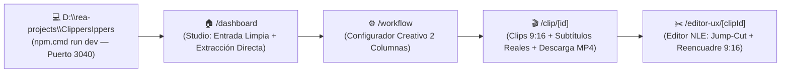

# 💻 Cómo ejecutar y usar la réplica local ClippersIppers

> [!abstract] En pocas palabras
> Esta guía explica cómo poner en marcha y utilizar **ClippersIppers (`D:\rea-projects\ClippersIppers`)**, una suite local de edición y curación de video con IA construida con **Next.js 15, React 19, TypeScript, Tailwind CSS v4 y Jotai**. Tras el rediseño v1.5.0, la interfaz adopta una estética **minimalista, creativa y premium (macOS + Creator IA + Linear)** en paleta clara (`#FAFAFC` / `#FFFFFF` / `#E8E8ED` con acento púrpura `#7652E8`), eliminando planes de pago, límites de créditos o pantallas de suscripción para un flujo 100% personal, ilimitado y local.

El diagrama superior resume el flujo principal optimizado en `http://localhost:3040`, conectando el lienzo creativo de entrada (`/dashboard`) con el configurador de clips (`/workflow`), la vista de resultados (`/clip/[id]`) y el editor de video (`/editor-ux/[clipId]`).

> [!example] Ejemplo real: Pegar un enlace de YouTube o subir un archivo MP4 local
> 1. Abre `http://localhost:3040/dashboard` y pega cualquier enlace de YouTube o arrastra un archivo local.
> 2. La aplicación detecta en vivo el título, miniatura y duración, ofreciendo selección directa de formato (`9:16 Vertical`, `16:9 Horizontal`, `1:1 Cuadrado`).
> 3. Con un solo clic en **«Generar Clips con IA»**, el servidor extrae la transcripción palabra por palabra y el flujo MP4 nativo mediante YouTube Innertube.
> 4. En `/clip/[id]` y `/editor-ux/[clipId]`, visualiza los clips en vertical `9:16` con subtítulos dinámicos sincronizados al audio, realiza cortes de video eliminando palabras de la transcripción y descarga el MP4 o subtítulos `.srt`.

---

## 🚀 Pasos para iniciar el proyecto en local

1. **Abrir una terminal PowerShell** en la carpeta del proyecto:
   - Ruta: `D:\rea-projects\ClippersIppers`
2. **Instalar dependencias** (solo si aún no existe `node_modules`):
   - Ejecuta `npm.cmd install`
3. **Levantar el servidor en modo desarrollo o producción**:
   - Modo desarrollo: `npm.cmd run dev` (escucha en `http://localhost:3040`)
   - Modo producción compilado: `npm.cmd run build` seguido de `npm.cmd run start`

---

## 🗺️ Mapa de vistas del flujo creativo principal

| Ruta local | Enfoque de diseño y propósito | Capacidades interactivas disponibles |
|---|---|---|
| `/dashboard` | Studio Creativo Minimalista (macOS / Linear) | Entrada limpia con autodetección de video, subida local de archivos, selector de relación de aspecto (`9:16`, `16:9`, `1:1`), opciones discretas y galería de proyectos locales recientes. |
| `/workflow` | Configurador de Clips en 2 Columnas | Previsualizador con deslizador de rango temporal (`startSec`–`endSec`), selector de longitud de clips, prompt temático opcional, estilo de subtítulos y conmutador de Auto-Hook sin cobros ni bloqueos de créditos. |
| `/clip/[id]` | Resultados de Curación de Video | Tarjetas de clips con `Virality Score (0–99)`, reproductor `<video>` MP4 nativo en `9:16` (sin interfaz de YouTube), subtítulos karaoke multifrase 100% reales extraídos palabra por palabra, sincronización exacta con el reloj de audio y descarga directa de `.mp4`, `.srt` y `.xml`. |
| `/editor-ux/[clipId]` | Editor NLE Jump-Cut | Editor NLE con corte de video real basado en texto (**Jump-Cut Engine**: al recortar una palabra o muletilla, el reproductor MP4 salta automáticamente ese fragmento), controles interactivos de encuadre horizontal (`cropX` 0%–100%), `zoom`, modo `Split Screen` dual y línea de tiempo de 5 pistas. |
| `/brand-template` | Estudio de Subtítulos | Diseñador de estilos de subtítulos con animación tipográfica, paleta de colores para palabras clave y vista previa interactiva. |
| `/projects` | Biblioteca de Proyectos | Galería visual de todos los proyectos locales creados con buscador en tiempo real y acceso directo a clips. |

---

## 🧠 Extracción Real de Audio/Subtítulos (YouTube Innertube) y Motores de IA

La réplica local combina la extracción directa de pistas ASR (`json3`) y flujo `video/mp4` desde la API Innertube de YouTube (`src/lib/youtubeInnertube.ts` y `/api/video-stream`) con curación asistida por IA:

1. **Transcripción Real Palabra por Palabra y Video MP4 Directo (Sin requerir clave API)**:
   - Al procesar cualquier enlace de YouTube, el servidor extrae la pista de subtítulos real con precisión de milisegundos (`tStartMs` + `tOffsetMs`) y el stream `video/mp4` directo (`itag 18`) con soporte `HTTP 206 Partial Content`.
   - Si tenías un proyecto creado con una versión anterior, basta con abrir `/clip/[id]` (o pulsar **«Sincronizar Video y Subtítulos Reales»**) para actualizarlo automáticamente al video MP4 limpio y los subtítulos reales.
2. **Conexión Opcional con Motores de IA (Google Gemini, Groq y OpenAI)**:
   - Haz clic en el botón superior **«Conectar IA»** o en el botón dentro de `/workflow`.
   - **Google Gemini (Recomendado / Gratuito)**: Obtén tu clave en [Google AI Studio](https://aistudio.google.com/app/apikey). El sistema detecta automáticamente el modelo disponible (`gemini-3.8-flash`, `gemini-2.5-flash` o `gemini-1.5-flash`).
   - **Groq Cloud (Ultra Rápido)**: Obtén tu clave en [Groq Console](https://console.groq.com/keys) para curación con `llama-3.3-70b-versatile`.
   - **OpenAI**: Utiliza tu clave de OpenAI para procesamiento con `gpt-4o-mini`.
3. **Curación sobre el Guion Real en `/workflow`**:
   - Al pulsar **«Generar Clips Instantáneamente»**, `/api/ai-curate` envía la transcripción real con marcas de tiempo (`[MM:SS]`) al modelo de IA para elegir los 3 momentos más virales y recorta exactamente las palabras reales pronunciadas en el video para cada clip.

---

> [!info]- Detalle técnico (para desarrolladores)
> - **Estado reactivo persistente**: `D:\rea-projects\ClippersIppers\src\store\opusStore.ts` implementa los átomos Jotai con `atomWithStorage` en `localStorage` bajo el prefijo `clippers.*`.
> - **Tokens visuales duales**: `D:\rea-projects\ClippersIppers\src\app\globals.css` soporta tanto el modo oscuro de estudio original (`[data-theme="dark"]` `#1a1a1a` / `#bef737`) como la superficie clara SaaS (`[data-theme="light"]` `#f8fafc`), conmutables desde la barra superior.
> - **Diccionarios i18n**: Los 6 archivos JSON extraídos de producción se sirven desde `D:\rea-projects\ClippersIppers\public\locales\en\`.

## 🔗 Relacionado
- [[Guías]] — Índice general de manuales prácticos del proyecto.
- [[Módulo Dashboard y Enrutamiento de Workflows]] — Documentación del módulo `575013` en el que se basa `/dashboard`.
- [[Editor Multipista y Renderizado]] — Arquitectura original del editor `/editor-ux`.
- [[Indicadores y métricas]] — Fórmulas matemáticas implementadas en `opusStore.ts`.
