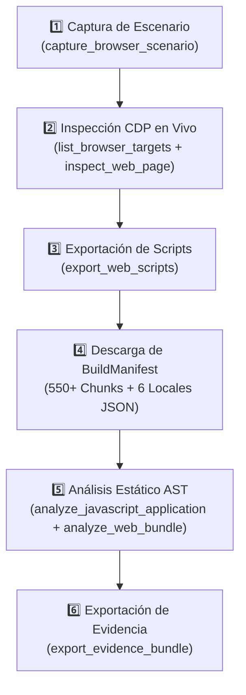

# 🔬 Cómo reproducir y auditar el bundle con REA

> [!abstract] En pocas palabras
> Este runbook documenta el procedimiento exacto y reproducible para capturar, extraer y analizar estática y dinámicamente `https://clip.opus.pro/dashboard` utilizando el servidor MCP **`rea` (`rea-agents@6.5.0`)** y Chrome DevTools Protocol (CDP) en Windows.



El diagrama resume las seis fases del protocolo de auditoría REA ejecutado para construir esta base de conocimiento.

> [!example] Ejemplo real: Por qué combinamos CDP en vivo con descarga del `_buildManifest.js`
> Al ejecutar `inspect_web_page` y `export_web_scripts` sobre `https://clip.opus.pro/dashboard`, obtenemos los **91 scripts cargados inicialmente en el DOM** (evidencia `ev_8b724f9f4c3a96641e7fc0cee2b091a2920aab93576a5c495114e3c9ea286cd8`). Sin embargo, Next.js + Turbopack carga perezosamente (*lazy-loading*) diálogos como `DashboardRevampEntry` (`2wgzebltzq0s_.js`) o rutas como `/workflow-canary`. Al extraer además el manifiesto `_next/static/{buildId}/_buildManifest.js`, logramos descargar los **550+ chunks de las 119 rutas**, garantizando una cobertura del 100% del código cliente.

---

## 🛠️ Prerrequisitos en Windows

1. Verificar el estado de **REA** en Windows con PowerShell (usando siempre el shim `.cmd`):
   ```powershell
   npx.cmd -y rea-agents@6.5.0 doctor --client antigravity --json
   ```
2. Contar con Google Chrome o Microsoft Edge instalado para las capturas headless/CDP.

---

## 📋 Procedimiento paso a paso

### Paso 1: Captura de escenario web y tráfico HTTP (`capture_browser_scenario`)
Invoca la herramienta MCP `rea:capture_browser_scenario` apuntando a `https://clip.opus.pro/dashboard` con captura de cuerpos de petición y respuesta habilitada:
```json
{
  "url": "https://clip.opus.pro/dashboard",
  "wait_ms": 8000,
  "include_network": true,
  "request_body": true,
  "response_body": true,
  "include_storage": true,
  "include_console": true
}
```
- **Qué obtienes**: El flujo exacto de bootstrap (`GET /dashboard`, `POST /api/auth/session-profile`, `POST https://featureassets.org/v1/initialize`, `GET https://opuspro.instatus.com/summary.json`), cookies, `localStorage` y variables globales.

### Paso 2: Conexión CDP e inspección profunda del runtime (`inspect_web_page` y `analyze_web_bundle`)
1. Inicia una instancia de Chrome con depuración remota en un perfil temporal aislado:
   ```powershell
   Start-Process "C:\Program Files\Google\Chrome\Application\chrome.exe" -ArgumentList "--headless=new","--remote-debugging-port=9222","--user-data-dir=$env:TEMP\rea-chrome-profile","https://clip.opus.pro/dashboard"
   ```
2. Lista los targets con `rea:list_browser_targets`:
   ```json
   { "browser_url": "http://127.0.0.1:9222" }
   ```
3. Ejecuta `rea:analyze_web_bundle` y `rea:inspect_web_page` pasando `target_id` e `include_script_sources: true`.

### Paso 3: Exportación de scripts en vivo (`export_web_scripts`)
Extrae al sistema de archivos todos los scripts capturados en el escenario o en la sesión CDP:
```json
{
  "evidence_id": "<ev_id_de_inspect_web_page>",
  "output_dir": "d:\\rea-projects\\projects\\02-clippers-ippers\\cdp-exported-scripts",
  "same_origin_only": true
}
```

### Paso 4: Descarga completa de Chunks desde `_buildManifest.js` y Diccionarios `i18n`
1. Localiza el `buildId` en `__NEXT_DATA__` o en la ruta de `_buildManifest.js` (ej. `tw0-OiEO15o4q3nmL5clA`).
2. Descarga `https://clip.opus.pro/_next/static/{buildId}/_buildManifest.js` y extrae todas las referencias `static/chunks/*.js`.
3. Descarga los 6 diccionarios de idioma desde `https://clip.opus.pro/locales/en/{namespace}.json` (`common`, `auth`, `subscription`, `plansocial`, `clip`, `editor`).

### Paso 5: Análisis Estático AST de la Aplicación (`analyze_javascript_application`)
Ejecuta `rea:analyze_javascript_application` sobre el directorio de chunks del dashboard:
```json
{
  "path": "d:\\rea-projects\\projects\\02-clippers-ippers\\dashboard-complete",
  "include_globs": [
    "_next/static/chunks/2pdyo3gbgw8ji.js",
    "_next/static/chunks/355ie-8lu8k-s.js",
    "_next/static/chunks/3h3opwncslkhx.js",
    "_next/static/chunks/40f7nxhbahq2_.js",
    "_next/static/chunks/43le6kegn6rlc.js",
    "_next/static/chunks/3nthk87c1t44i.js"
  ]
}
```
Luego, inspecciona las vistas generadas (`summary`, `modules`, `routes_and_Capabilities`) con `rea:inspect_analysis_view`.

### Paso 6: Preservación de la cadena de custodia (`export_evidence_bundle`)
Exporta toda la evidencia de la sesión a un archivo JSON firmado con SHA-256:
```json
{
  "output_path": "d:\\rea-projects\\projects\\02-clippers-ippers\\session-evidence.json"
}
```
Finalmente, cierra siempre el proceso headless de Chrome iniciado en el Paso 2.

---

> [!info]- Detalle técnico (para desarrolladores)
> - **Extracción de módulos específicos de Turbopack**:
>   En un archivo chunk de Turbopack, cada módulo comienza con el patrón `,<moduleId>,(e,t,r)=>{` o `,<moduleId>,e=>{` y registra sus exportaciones mediante `e.s(["NombreExportado", 0, valor], <moduleId>)` y sus importaciones con `e.i(<importedModuleId>)` o cargas dinámicas `e.A(<loaderModuleId>)`.

## 🔗 Relacionado
- [[Registro de Evidencia REA]] — Todos los identificadores `ev_...` producidos al ejecutar este runbook.
- [[Catálogo de Rutas y Chunks de Turbopack]] — Resultado del inventario del `_buildManifest.js`.
- [[Primeros pasos]] — Cómo navegar los resultados documentados en este vault.
