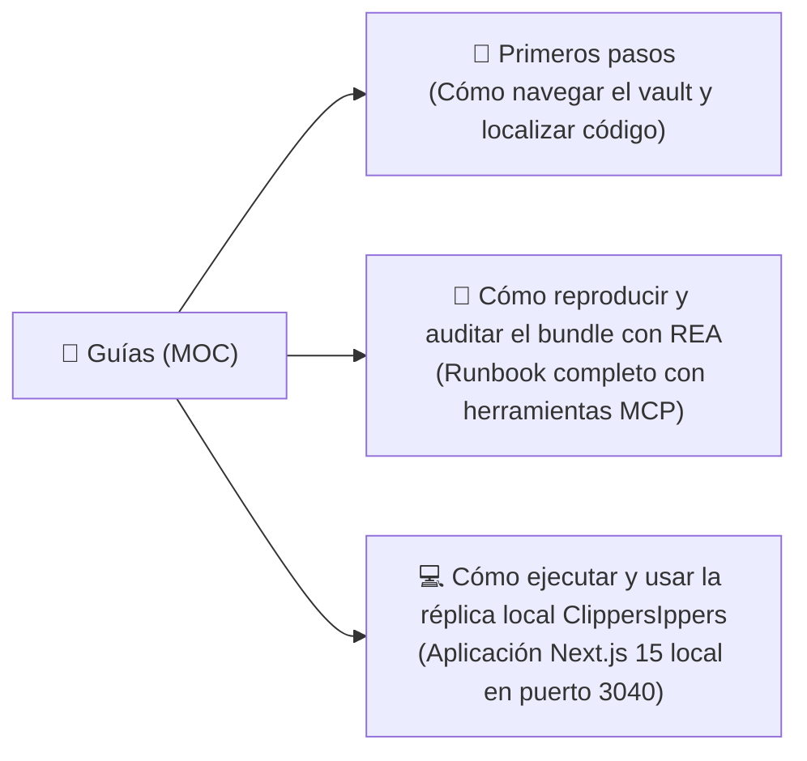

# 📘 Guías

> [!abstract] En pocas palabras
> Esta sección reúne las guías prácticas paso a paso para aprovechar esta documentación y para reproducir o actualizar la auditoría de ingeniería inversa sobre `https://clip.opus.pro/dashboard` utilizando las herramientas MCP de **REA (Reverse Engineer Anything)**.

El diagrama muestra las tres guías disponibles: una orientada a cualquier lector que se incorpora al proyecto, otra orientada a ingenieros de reversing que deseen auditar nuevas versiones de OpusClip y una tercera para ejecutar la réplica funcional local en `D:\rea-projects\ClippersIppers`.

> [!example] Ejemplo real: Auditar un cambio en una nueva versión de OpusClip
> Si OpusClip despliega un nuevo `buildId` la próxima semana, siguiendo [[Cómo reproducir y auditar el bundle con REA]] podrás capturar el nuevo `_buildManifest.js`, exportar los chunks actualizados y usar `compare_application_versions` de REA para detectar exactamente qué funciones, endpoints o Feature Gates cambiaron respecto a la versión `tw0-OiEO15o4q3nmL5clA`.

---

## 📑 Guías disponibles

| Guía | Audiencia | Tiempo estimado |
|---|---|---|
| [[Primeros pasos]] | Todos (Producto, Diseño, Desarrollo, QA) | 5 minutos |
| [[Cómo reproducir y auditar el bundle con REA]] | Desarrolladores / Analistas de Ingeniería Inversa | 15 minutos |
| [[Cómo ejecutar y usar la réplica local ClippersIppers]] | Todos (Ejecución local de la aplicación replicada) | 5 minutos |

---

> [!info]- Detalle técnico (para desarrolladores)
> Todos los scripts y artefactos generados durante esta investigación se conservan en el workspace local `d:\rea-projects\projects\02-clippers-ippers\` y están respaldados por los hashes registrados en [[Registro de Evidencia REA]].

## 🔗 Relacionado
- [[00 - Inicio]] — Portada general del vault.
- [[Registro de Evidencia REA]] — Identificadores `ev_...` generados al seguir estas guías.
- [[Catálogo de Rutas y Chunks de Turbopack]] — Mapa de archivos descargados en el workspace local.
