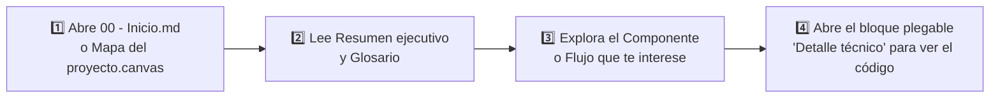

# 🚀 Primeros pasos

> [!abstract] En pocas palabras
> Esta guía rápida te enseña cómo recorrer el vault **ClippersIppers** en Obsidian y cómo localizar en segundos cualquier pantalla, regla de negocio, átomo de estado o módulo de código original de `https://clip.opus.pro/dashboard`.

El diagrama propone un recorrido en cuatro pasos que va de lo general (conceptos de negocio) a lo particular (módulos numéricos de Turbopack y átomos de Jotai).

> [!example] Ejemplo real: Encontrar cómo funciona una función específica desde la interfaz
> Imagina que ves en el dashboard de OpusClip el carrusel **"What's New"** y quieres saber de dónde salen sus tarjetas y cómo decide a quién mostrárselas:
> 1. Entras a [[Módulo Dashboard y Enrutamiento de Workflows]].
> 2. En la sección **3. Carrusel dinámico "What's New"**, ves en lenguaje claro que proviene de Statsig (`dashboard_whats_new_banner`) y que filtra por plan (`FREE`, `PRO`, `ENTERPRISE`, etc.).
> 3. Si eres desarrollador, despliegas la caja `> [!info]- Detalle técnico` al final de la nota y encuentras que la función exacta es `e3` dentro del módulo `575013` del archivo `2pdyo3gbgw8ji.js` (líneas 64–115 de `2pdyo3gbgw8ji-formatted.txt`).

---

## 🛠️ Cómo aprovechar las funciones de Obsidian en este Vault

1. **Mapa visual interactivo (`Canvas`)**:
   - Haz doble clic en [[Mapa del proyecto.canvas]] en el explorador izquierdo de Obsidian para ver todas las áreas del sistema conectadas visualmente y abrir cualquier nota desde ahí.
2. **Vista de Grafo (`Ctrl + G`)**:
   - Todas las notas están entrelazadas mediante `[[00 - Inicio|wikilinks]]` y categorizadas con etiquetas (`#opusclip`, `#arquitectura`, `#flujo`, `#referencia`). Ninguna nota está aislada.
3. **Búsqueda rápida por símbolo técnico (`Ctrl + Shift + F`)**:
   - Puedes buscar por el nombre de cualquier tienda Jotai (ej. `submitStore`, `generatingProgressStore`), por cualquier ruta de API (ej. `/clip-projects`, `/auto-import`), por cualquier Feature Gate (ej. `enable_workflow_revamp`) o por el número de módulo de Turbopack (ej. `575013`, `642390`, `737381`).
4. **Cajas plegables para desarrolladores**:
   - Todas las notas explican primero el comportamiento en lenguaje claro y reservan los fragmentos de código, hashes y firmas técnicas dentro de bloques plegables `> [!info]- Detalle técnico (para desarrolladores)` para no saturar la lectura.

---

> [!info]- Detalle técnico (para desarrolladores)
> - **Ubicación de los archivos fuente extraídos en disco**:
>   - Chunks JS de producción: `d:\rea-projects\projects\02-clippers-ippers\dashboard-complete\_next\static\chunks\`
>   - Diccionarios i18n JSON: `d:\rea-projects\projects\02-clippers-ippers\dashboard-complete\locales\en\`
>   - Código formateado del módulo raíz `575013`: `d:\rea-projects\projects\02-clippers-ippers\2pdyo3gbgw8ji-formatted.txt`
>   - Módulos centrales y 505 rutas API extraídas: `d:\rea-projects\projects\02-clippers-ippers\extracted_core_modules.txt`
>   - Módulos de OpusClip 4.0 y CPU Worker: `d:\rea-projects\projects\02-clippers-ippers\extracted_revamp_and_worker.txt`

## 🔗 Relacionado
- [[00 - Inicio]] — Portada principal del proyecto.
- [[Resumen ejecutivo]] — Lectura recomendada para empezar.
- [[Cómo reproducir y auditar el bundle con REA]] — Siguiente guía para usuarios técnicos que quieran ejecutar las herramientas de ingeniería inversa.
