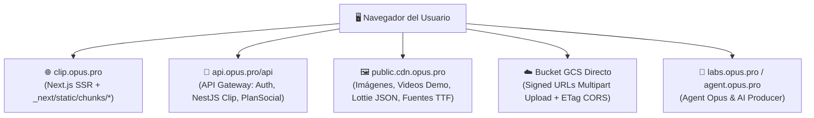

# 🌐 Despliegue y CDN

> [!abstract] En pocas palabras
> Documenta la topología de dominios, servidores de activos estáticos (CDN sobre Google Cloud Storage), configuración de optimización de imágenes de Next.js y mecanismos de seguridad de frontera (CORS, cookies y control de riesgo por IP) observados en **`https://clip.opus.pro/dashboard`**.



El diagrama muestra los cinco puntos finales de red con los que interactúa directamente el navegador del usuario al operar el dashboard.

> [!example] Ejemplo real: Requisito estricto de cabecera `ETag` en CORS de Google Cloud Storage
> En `MultipartUploader.uploadPart` (módulo `737381`, líneas 3377–3381 de `extracted_core_modules.txt`), tras finalizar el `PUT` de cada fragmento hacia la URL firmada de GCS, el código verifica:
> ```javascript
> let s = n.getHeader("etag");
> if (!s) throw Error(`part ${r} response exposed no ETag header; check bucket CORS responseHeader config`);
> ```
> Esto confirma que el bucket de ingesta de GCS requiere obligatoriamente tener expuesto `"ETag"` en la directiva `responseHeader` de su configuración CORS para que el ensamblaje multiparte funcione.

---

## 🌍 1. Mapa de Dominios y Entornos

| Dominio / Prefijo | Entorno | Propósito |
|---|---|---|
| `https://clip.opus.pro` | Producción | Aplicación web principal Next.js (`buildId: tw0-OiEO15o4q3nmL5clA`), rutas `/dashboard`, `/workflow`, `/clip/[id]`, `/editor-ux`, `/calendar`, `/campaigns`. |
| `https://api.opus.pro/api` | Producción | Gateway unificado de backend (`apiPrefix`, `nestApiPrefix`, `planSocialApiPrefix`). |
| `https://stg-api.opus.pro` | Staging | Backend de pre-producción detectado por `isWorkflowStagingApi` (`404898`). |
| `https://public.cdn.opus.pro/clip-web` | Producción CDN | Servidor de activos estáticos (`GCS_IMAGE_PREFIX` en módulo `538938`): imágenes del dashboard (`dashboard-bg.png`), iconos de QuickStart, videos `.mp4` de vista previa, animaciones Lottie (`/caption_animation/lottie/*.json`) y fuentes (`/mg/fonts/poppins.ttf`, `serif.ttf`). |
| `https://labs.opus.pro` / `https://stg-labs.opus.pro` | Prod / Staging | Ecosistema de herramientas experimentales (Agent Opus `script_to_video` y AI Producer). |
| `https://help.opus.pro` | Documentación | Centro de ayuda externo (ej. `/docs/article/video-sources-supported`). |

---

## 🖼️ 2. Configuración de Next.js Image (`725463`)

En el módulo `725463` (`32bpqgg02remy.js`, línea 1680 de `extracted_revamp_and_worker.txt`) se encuentra la configuración compilada del cargador de imágenes de Next.js:
- `deviceSizes`: `[640, 750, 828, 1080, 1200, 1920, 2048, 3840]`
- `imageSizes`: `[32, 48, 64, 96, 128, 256, 384]`
- `qualities`: `[75]`
- `path`: `"/_next/image"`
- `dangerouslyAllowSVG`: `false` (protección contra inyección XSS mediante archivos SVG maliciosos)
- `unoptimized`: `true` (las imágenes servidas desde `public.cdn.opus.pro` en formato `.webp` / `.png` se entregan directamente desde el CDN sin sobrecargar el servidor Node de Next.js).

---

## 🛡️ 3. Seguridad de Frontera, Cookies y Control de Acceso

1. **Serialización y atributos de Cookies (`149059` en `2pdyo3gbgw8ji.js`, líneas 225–260)**:
   - Validación estricta de caracteres permitidos en cookies (`/^[\u0009\u0020-\u007e\u0080-\u00ff]+$/`).
   - Soporte de banderas `HttpOnly`, `Secure` y `SameSite` (`Strict`, `Lax`, `None`).
2. **Control de riesgo por IP y listas blancas de dominio (`/api/client-access-control`)**:
   - El cliente consulta `/api/client-access-control?q=ipRisk` y `/api/client-access-control?q=project` (líneas 200–201 de `extracted_core_modules.txt`), junto con `/api/domain-whitelists` (línea 252), para detectar proxies/abuso y aplicar restricciones de seguridad antes de lanzar trabajos costosos.
3. **Protección contra cuentas desechables y abuso de pruebas gratuitas**:
   - `/api/login-users/check-disposable-domain`: Bloquea correos temporales.
   - `/api/login-users/check-multi-accounts`: Detecta creación masiva de cuentas para abusar del `FreeTrial`.
   - `/api/login-users/login-identify-frozen`: Detecta cuentas congeladas por seguridad.

---

> [!info]- Detalle técnico (para desarrolladores)
> - **Estructura de rutas en almacenamiento intermedio de proyectos (`extracted_core_modules.txt`, líneas 53–63)**:
>   Durante el procesamiento y la edición, los artefactos en la nube de un proyecto se organizan bajo las siguientes claves de ruta (`h`):
>   - `/${h.curationCache}/`
>   - `/${h.data}/scene_detection_timestamp.json`
>   - `/${h.data}/screenplay.json`
>   - `/${h.data}/transcript.json`
>   - `/${h.intermediate}/context.json` y `/${h.intermediateFallback}/context.json`
>   - `/${h.media}/resize/video.resize.mp4` y `/${h.media}/resize/audio.resize.m4a`
>   - `/${h.screenplayCache}/screenplay.json`

## 🔗 Relacionado
- [[Arquitectura general]] — Visión global de las cuatro capas del sistema.
- [[Monitoreo Feature Flags y Telemetría]] — Cómo se supervisa en caliente el despliegue.
- [[Motor de Ingesta y Subida de Medios]] — Funcionamiento de `MultipartUploader` contra Google Cloud Storage.
