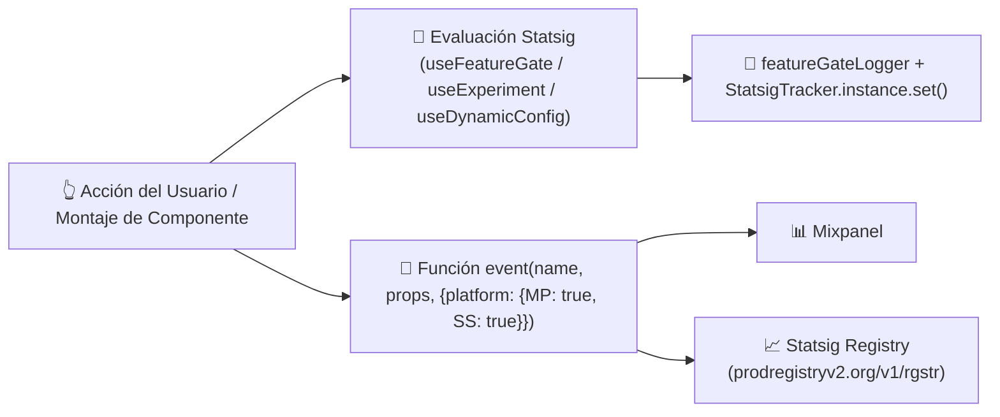

# 📡 Monitoreo Feature Flags y Telemetría

> [!abstract] En pocas palabras
> Explica cómo **OpusClip Dashboard** controla el lanzamiento de funcionalidades en vivo mediante **Statsig** (`StatsigTracker`), cómo despacha eventos de analítica de producto simultáneamente a **Mixpanel (`MP`)** y **Statsig (`SS`)**, y cómo gestiona las cuotas de popups de feedback (`feedback-popup-quota`) y el estado operativo del sistema (`Instatus`).



El diagrama muestra las dos vías de instrumentación en el cliente: el registro de exposición de flags/experimentos (`StatsigTracker`) y el despacho dual de eventos de interacción (`MP` y `SS`).

> [!example] Ejemplo real: Cómo evita OpusClip registrar exposiciones falsas de experimentos antes del login
> En los hooks `useExperimentWithEnabled` y `useExperimentWithGroups` (módulo `42296`, líneas 938–952 de `extracted_revamp_and_worker.txt`), antes de consultar un experimento en Statsig, el código evalúa:
> ```javascript
> let orgId = useAtomValue(authStore.currentOrgId);
> disableExposureLog = disableExposureLog || !orgId;
> let exp = useExperiment(expName, { disableExposureLog });
> ```
> Si el usuario aún no tiene una organización activa (`!orgId`), fuerza `disableExposureLog: true` para no contaminar las métricas A/B de Statsig con visitantes no autenticados. Para experimentos previos al login existen hooks separados (`usePreLoginExperimentWithGroups`).

---

## 🚦 1. Arquitectura de `StatsigTracker` y `featureGateLogger` (`42296` y `568116`)

Cada vez que un componente evalúa un [[Glosario#Feature Gate|Feature Gate]] o un experimento:
1. **Deduplicación de logs en consola (`b(expName, value)`)**:
   - Mantiene un diccionario en memoria `f = {}`. Solo cuando el valor de un experimento cambia respecto a la lectura anterior (`f[e] !== t`), imprime `featureGateLogger.info("Exp ${e}: ${t ? 'ON' : 'OFF'}")` y actualiza `f[e] = t`.
2. **Registro centralizado de contexto (`StatsigTracker.instance.set`)**:
   - Guarda en `StatsigTracker.instance` cada `"feature_gate"` y `"experiment"` evaluado durante la sesión para adjuntarlo como metadato de diagnóstico en los reportes de errores y eventos.
3. **Contexto de disponibilidad (`FeatureGatesReadyContext`, módulo `660315`)**:
   - Expone `useFeatureGatesReady()` para evitar parpadeos visuales (*layout shift*): el componente raíz `tA` (`575013`) espera a que `C = useFeatureGatesReady()` sea `true` antes de montar `DashboardRevampEntry` o `SubmitCard`.

---

## 📊 2. Taxonomía de Eventos de Telemetría (`MP` + `SS`)

A través del módulo `906615` (`event(name, payload, options)`), el dashboard instrumenta cada interacción clave con el objeto `{ platform: { MP: true, SS: true } }`:

| Nombre del Evento | Dónde se dispara | Propiedades registradas (`payload`) |
|---|---|---|
| `project.quick_start.exposed` | `QuickStartPanel` (`351962`) | `variant`, `visible_entries: [{ entry, rank_position }]`, `screen_width`. |
| `project.quick_start.click` | `QuickStartPanel` (`536571`) y `DashboardRevampEntry` | `trigger` (`ai_upscale`, `ai_sound_effect`, `script_to_video`, `ai_producer`, etc.), `was_new_badge`. |
| `dashboard.demo_project.click` | `DemoProjects` (`575013`, línea 39) | `demoProjectId` (`demo-danny`, `demo-basketball`, `demo-podcast`), `position`. |
| `dashboard.clicked.video` | `MasterOpusClip` (`575013`, línea 41) | `title`, `thumbnail`, `videoId`. |
| `whats_new_banner.expand` | `WhatsNew` (`575013`, línea 130) | `bannerId`, `position`. |
| `whats_new_banner.click` | `WhatsNew` (`575013`, línea 121) | `bannerId`, `position`, `target` (`"card"` \| `"cta"`). |
| `ai_upscale.entry_clicked` | `QuickStartPanel` / `DashboardRevampEntry` | `surface: "quick_start"`, `entry` (`"quick_start_row"` \| `"dashboard_pill"` \| `"manage_workflows"`), `is_locked`. |
| `ai_upscale.dialog_opened` | `UpscaleDialog` (`536571`, línea 636) | `surface`, `opened_from` (`"history_link"` \| `"deep_link"` \| `"quick_start_row"`), `initial_tab`. |
| `ai_upscale.confirm_shown` / `confirm_accepted` / `confirm_cancelled` | `UpscaleDialog` (`536571`, líneas 622–700) | `variant`, `credits`, `current_user_plan`, `user_id`, `offered_resolutions`, `source`, `duration_seconds`, `credits_hd`, `credits_4k`. |
| `payment.insufficient_credits_panel.viewed` / `upgrade_clicked` | `SubmitPanel` (`252547`, líneas 1355–1361) | `panel_type` (`"toast"` \| `"submit_banner"`), `surface: "quick_start"`, `feature`, `trigger: "buy-more-from-workflow"`, `required_credits`, `shortfall`. |
| `user.survey_submit` / `user.survey_abort` | `UserSurveyDialog` (`575013`, líneas 162–164) | Respuestas del formulario de onboarding o paso (`form`) en el que abandonó. |
| `user.youtube_oauth.click_link` | `SubmitPanel` (`252547`, línea 1406) | `channelId`, `channelTitle`, `link` (enviado solo a `MP: true, SS: false`). |

---

## 🔔 3. Control de Cuotas de Encuestas y Popups (`popupQueueStore` y `npsStore`)

Para evitar fatigar al usuario con múltiples ventanas emergentes al mismo tiempo:
- **`popupQueueStore` (`1837gpiei8b2d.js`)**: Encola todos los diálogos automáticos (como `UserSurveyDialog` en la línea 218 de `2pdyo3gbgw8ji-formatted.txt`) de modo que solo se muestre uno por vez.
- **Cuotas de Feedback en Servidor**:
  - `GET /api/feedback-popup-quota?surveyTypeList={list}`
  - `POST /api/feedback-popup-quota/reset`
  - `/api/feedback-popup-histories`, `/api/report-feedback-popup-event` y `/api/feedback-survey-responses`.
- **Conteo para NPS (`npsStore.uploadCount`, módulo `397995`)**:
  Cada vez que el dashboard consulta `countClipProjects()`, actualiza `npsStore.uploadCount` con `total` para disparar encuestas de satisfacción únicamente a usuarios que ya han creado suficientes proyectos.

---

> [!info]- Detalle técnico (para desarrolladores)
> - **Degradación elegante de medios en banners (`e0` en `2pdyo3gbgw8ji-formatted.txt`, líneas 61 y 142–149)**:
>   Si un video de vista previa en `What's New` falla al reproducirse, la función `e2(err)` clasifica la excepción DOM (`AbortError` → `"abort"`, `NotAllowedError` → `"not-allowed"`, otros → `"failed"`). Si el navegador bloquea el *autoplay* (`"not-allowed"`), activa el estado `D = true` (`autoplay-blocked`) y conmuta silenciosamente a la imagen fija de respaldo (`posterUrl` o `imageUrl`) sin romper la tarjeta.

## 🔗 Relacionado
- [[Catálogo de Feature Gates y Experimentos Statsig]] — Lista completa de todos los flags y experimentos descubiertos.
- [[Despliegue y CDN]] — Infraestructura de red sobre la que operan estos sistemas.
- [[Módulo Dashboard y Enrutamiento de Workflows]] — Cómo consume el dashboard las configuraciones dinámicas de Statsig.
