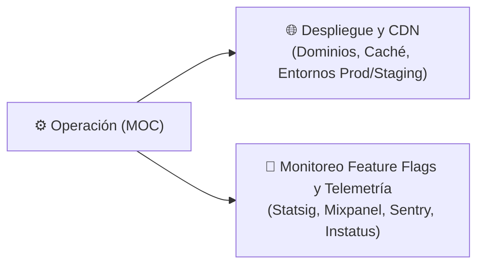

# ⚙️ Operación

> [!abstract] En pocas palabras
> Esta sección documenta cómo opera **OpusClip (`clip.opus.pro/dashboard`)** en producción: su topología de dominios y CDN, sus entornos (`prod` vs. `staging`), y su sistema de observabilidad, telemetría de eventos y gobierno remoto mediante **Statsig**.

El diagrama divide la operación en infraestructura de entrega (dominios, CDN y entornos) y observabilidad/control en caliente (flags, telemetría y estado de servicio).

> [!example] Ejemplo real: Conmutación automática entre Producción y Staging
> En el módulo `122631` (`0bk_j0ng_-uy_.js`, línea 991 de `extracted_revamp_and_worker.txt`) y en `isWorkflowStagingApi` (`404898`), la aplicación distingue dinámicamente si está operando contra producción (`https://api.opus.pro/api`, `https://labs.opus.pro/`) o contra staging (`https://stg-api.opus.pro`, `https://stg-labs.opus.pro/`), ajustando los parámetros `utm_source` (`opus-clip` vs. `opus-clip-nonprod`) y las validaciones de pre-lanzamiento.

---

## 📑 Notas de esta sección

| Nota | Qué encontrarás ahí |
|---|---|
| [[Despliegue y CDN]] | Topología de dominios (`clip.opus.pro`, `api.opus.pro`, `public.cdn.opus.pro`), distribución de activos estáticos, configuración de imágenes (`_next/image`) y controles de acceso/riesgo IP. |
| [[Monitoreo Feature Flags y Telemetría]] | Cómo funcionan `StatsigTracker`, el despacho dual de eventos (`MP` + `SS`), la consulta de incidentes en `opuspro.instatus.com` y la telemetría de errores. |

---

> [!info]- Detalle técnico (para desarrolladores)
> - **Verificación de estado de salud externa**:
>   En cada carga del dashboard, el cliente consulta `GET https://opuspro.instatus.com/summary.json` para informar proactivamente al usuario si existe algún mantenimiento activo o incidente en los clusters de procesamiento de video.

## 🔗 Relacionado
- [[00 - Inicio]] — Portada principal del vault.
- [[Integraciones]] — Proveedores cloud y de monitoreo conectados.
- [[Catálogo de Feature Gates y Experimentos Statsig]] — Referencia exhaustiva de todos los flags evaluados en operación.
