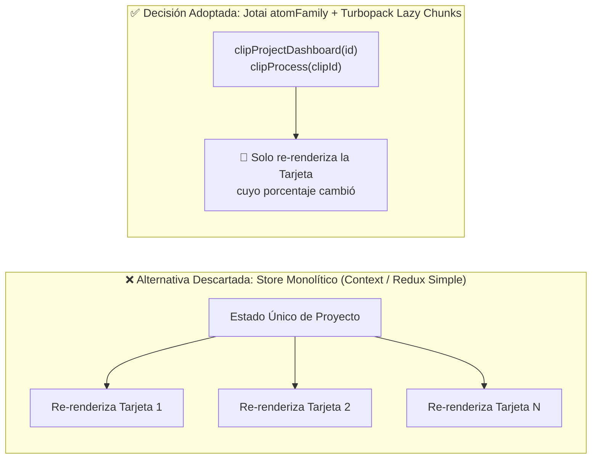

# 📐 ADR-001: Arquitectura Híbrida Next.js con Turbopack y Estado Atómico Jotai

> [!abstract] En pocas palabras
> **OpusClip** adoptó una arquitectura cliente basada en **Next.js (Pages Router compilado con Turbopack)** combinada con **Jotai (`atom` + `atomFamily` + `atomWithPersistence`)** para el estado reactivo de alta frecuencia y **TanStack React Query** para la caché de red, descartando tiendas monolíticas como Redux para evitar cuellos de botella de renderizado en el dashboard y en el editor multipista.

El diagrama contrasta el impacto en rendimiento de una tienda monolítica frente al patrón `atomFamily` utilizado en `clipProjectStore` (`184098`) y `clipStore` (`943249`).

> [!example] Ejemplo real: 161 tiendas modulares cargadas bajo demanda
> Gracias a que cada dominio define su propio `*Store` (ej. `upscaleTaskStore`, `properNounStore`, `editorRenderTimelineStore`) y Turbopack divide el bundle en más de 550 chunks, un usuario que solo visita `/dashboard` no descarga ni instancia en memoria los átomos pesados del motor de renderizado de `/editor-ux` hasta que navega hacia el editor.

---

## 🔍 Contexto y problema

OpusClip es simultáneamente:
1. Un **panel de gestión asíncrono (`/dashboard`, `/projects`)** que recibe actualizaciones de progreso cada `5,000 ms` para múltiples proyectos en paralelo y actualiza en vivo el título de la pestaña del navegador.
2. Un **editor de video no lineal en el navegador (`/editor-ux`)** con línea de tiempo multipista, reproducción sincronizada de subtítulos palabra por palabra sobre HTML5 Canvas y seguimiento facial.

En este escenario, almacenar el estado en React Context o en un árbol único sin granularidad atómica provocaría que cada tick del temporizador de progreso o del cabezal de reproducción (*playhead*) re-renderizara cientos de componentes DOM.

---

## 💡 Alternativas evaluadas

| Alternativa | Ventajas | Desventajas para OpusClip |
|---|---|---|
| **1. React Context API nativo** | Cero dependencias externas. | Cualquier cambio en el contexto fuerza el re-renderizado de todos los consumidores del proveedor. Inviable para polling de alta frecuencia y líneas de tiempo de video. |
| **2. Redux Toolkit (Store único global)** | Herramientas de depuración maduras y flujo predecible. | Requiere selectores memoizados complejos para cada entidad indexada y dificulta el *code-splitting* automático de sub-tiendas pesadas como las del editor. |
| **3. Jotai (`atomFamily`) + TanStack Query + Turbopack *(Elegida)*** | Suscripción atómica directa por ID (`clipItem(id)`), composición reactiva sin *boilerplate*, persistencia declarativa (`atomWithPersistence`) y particionamiento natural por chunks de Turbopack. | Requiere disciplina en el nombramiento de `debugLabel` (161 tiendas distribuidas) y cuidado con fugas de memoria en `atomFamily` si no se limpian IDs eliminados. |

---

## ✅ Decisión y consecuencias verificadas en el código

1. **Granularidad por entidad mediante `atomFamily`**:
   - En `clipProjectStore` (`184098`) y `clipStore` (`943249`), las colecciones se dividen en un átomo de lista de IDs (`projectIdList`, `clipIdList`) y una familia de átomos por ID (`clipProjectDashboard(id)`, `clipItem(id)`, `videoDownload(id)`).
2. **Limpieza transaccional de átomos (`projectDeletionStore`, módulo `382326`)**:
   - Para mitigar la retención de objetos obsoletos en los mapas base, el átomo de escritura `commitDeletedProjects` elimina en bloque las claves de `projectIdList`, `clipProjectDashboardMap` y `clippingCohort`.
3. **División de responsabilidades con TanStack Query (`292625`)**:
   - Las consultas de validación y lectura con semántica de caché temporal (como `useWorkflowSourceCheck` con `staleTime: 30000 ms` o `useWorkflows`) delegan en `useQuery`/`useMutation`, mientras que el estado mutado por la interfaz vive en Jotai.

---

> [!info]- Detalle técnico (para desarrolladores)
> - **Implementación del puente de callbacks atómicos (`useRefAtomCallback`, módulo `257103`)**:
>   En `0bk_j0ng_-uy_.js` (líneas 992–1001 de `extracted_revamp_and_worker.txt`), OpusClip envuelve `useAtomCallback` de `jotai/utils` (`630187`) dentro de una referencia estable (`useRef`) para leer y escribir múltiples átomos de forma imperativa dentro de manejadores de eventos asíncronos sin provocar cierres obsoletos (*stale closures*) ni recrear callbacks en cada render.

## 🔗 Relacionado
- [[Arquitectura general]] — Visión completa de las 4 capas del sistema.
- [[Modelo de datos y Estado Global Jotai]] — Catálogo de las 161 tiendas y sus átomos.
- [[ADR-002 Convivencia de Dashboard Clásico y Workflow Revamp OpusClip 4]] — Cómo se aplica este diseño atómico para alternar entre dos generaciones del dashboard.
