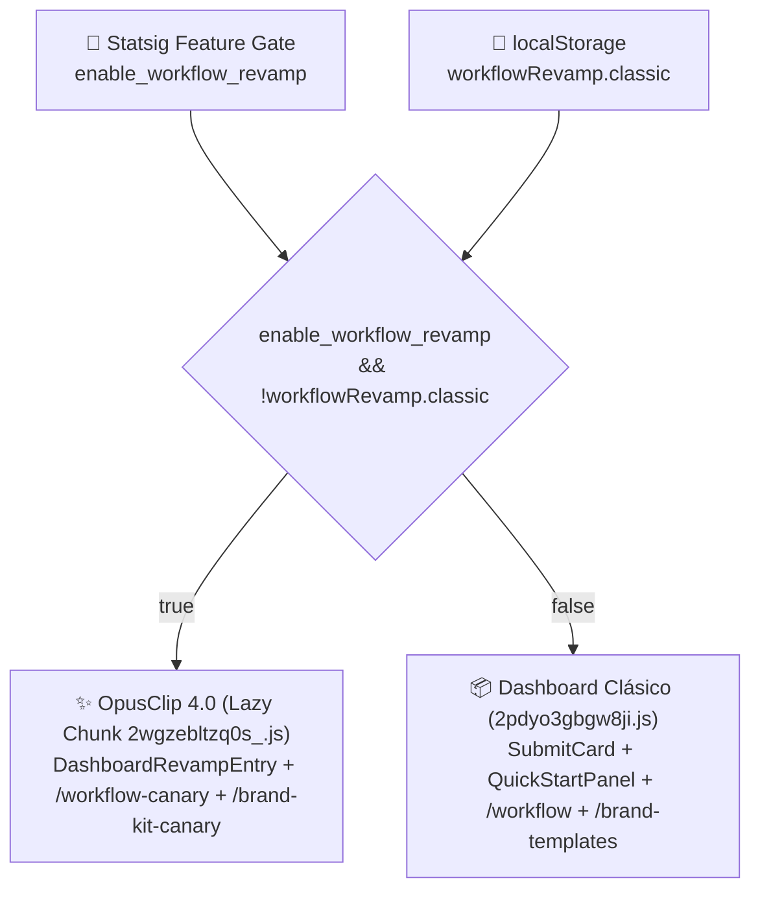

# 🔄 ADR-002: Convivencia de Dashboard Clásico y Workflow Revamp (OpusClip 4.0)

> [!abstract] En pocas palabras
> Para lanzar la nueva generación del producto (**OpusClip 4.0 / Workflow Revamp**) sin interrumpir a millones de usuarios acostumbrados al flujo anterior, el equipo de ingeniería decidió mantener **ambas arquitecturas de interfaz dentro de la misma ruta `/dashboard`**, controladas por la conjunción del [[Glosario#Feature Gate|Feature Gate]] `enable_workflow_revamp` y un átomo booleano en `localStorage` (`workflowRevamp.classic`) que permite al usuario volver al modo clásico en cualquier momento.



El diagrama muestra la compuerta lógica exacta del hook `useWorkflowRevampEnabled()` (módulo `889399`) y cómo conmuta no solo el hero del dashboard, sino también las rutas destino de workflows y plantillas de marca.

> [!example] Ejemplo real: Carga diferida (`React.lazy` / `next/dynamic`) para no penalizar el peso inicial
> En el módulo `575013` (`2pdyo3gbgw8ji-formatted.txt`, línea 173), `DashboardRevampEntry` no está incrustado estáticamente en el chunk principal del dashboard; se declara con carga dinámica `e.A(437097).then(e => e.DashboardRevampEntry)`, que descarga bajo demanda los chunks `2wgzebltzq0s_.js` y `3956_sfin5yo1.js` únicamente cuando `useWorkflowRevampEnabled()` devuelve `true`.

---

## 🔍 Contexto y problema

OpusClip evolucionó desde un modelo centrado en una única acción (*"Pegar enlace → Obtener cortos"* con botones auxiliares en `QuickStartPanel`) hacia un paradigma basado en **Workflows componibles por átomos (`atomsConfig`)** y **Brand Kits unificados** (OpusClip 4.0).

Un reemplazo abrupto (*big-bang deployment*) conllevaba tres riesgos altos:
1. Confusión o rechazo de usuarios avanzados y agencias con flujos operativos ya establecidos.
2. Incompatibilidad temporal de ciertos flujos profundos (`workflowType` como `enhance_speech` o `auto-import`) que aún dependen de diálogos del sistema clásico.
3. Necesidad de comparar métricas de conversión y retención A/B entre el diseño clásico, la variante `v2` del hero (`useQuickstartExperiment`) y el nuevo `DashboardRevampEntry`.

---

## ✅ Decisión arquitectónica implementada

1. **Hook centralizado de decisión (`useWorkflowRevampEnabled`, módulo `889399`)**:
   ```javascript
   let classic = localStorageBoolAtom("workflowRevamp.classic");
   function useWorkflowRevampEnabled() {
     let [gateEnabled] = useFeatureGate("enable_workflow_revamp");
     let forceClassic = useAtomValue(classic);
     return gateEnabled && !forceClassic;
   }
   ```
2. **Ruteo adaptativo de páginas satélite**:
   - **Configuración de proyecto**: `/workflow` (Clásico) vs. `/workflow-canary` (OpusClip 4.0).
   - **Plantillas de marca (`useBrandTemplatePath`, módulo `42296`)**: `/brand-templates` o `/brand-templates-ux` (Clásico) vs. `/brand-kit-canary` (OpusClip 4.0).
3. **Reutilización inteligente de diálogos en modo híbrido (`575013`, línea 222)**:
   - Cuando `x` (`useWorkflowRevampEnabled`) es `true`, el dashboard oculta las píldoras del `QuickStartPanel` (`hideEntries: true`), pero **mantiene montado el contenedor de diálogos de `QuickStartPanel`** para poder seguir abriendo el modal de `AiUpscale` (pasándole `upscaleDialogProps` con estilos `backdrop-blur-2xl` actualizados) y los flujos que aún no migran a `/workflow-canary`.
4. **Banner de conmutación (`z.default` en `575013`)**:
   - Permite al usuario alternar entre la vista nueva y la clásica (`workflowRevampClassicStore`), registrando si ya vio el indicador de novedad (`workflowRevamp.classicRedDotSeen`).

---

> [!info]- Detalle técnico (para desarrolladores)
> - **Módulos donde se implementa esta decisión**:
>   - `889399` y `557304` (`0_hne8424faiu.js`, líneas 957–964): `workflowRevampClassicStore` y `useWorkflowRevampEnabled`.
>   - `851881` (`32bpqgg02remy.js`, líneas 1644–1649): Implementación de `localStorageBoolAtom`.
>   - `437097` (`06ad2h7znbr7t.js`, línea 1885): Loader asíncrono de `2wgzebltzq0s_.js` y `3956_sfin5yo1.js`.

## 🔗 Relacionado
- [[Módulo Dashboard y Enrutamiento de Workflows]] — Código exacto donde conviven ambas ramas de renderizado.
- [[Catálogo de Feature Gates y Experimentos Statsig]] — Flags que controlan la activación de OpusClip 4.0.
- [[ADR-001 Arquitectura Híbrida Next.js con Turbopack y Jotai]] — Cómo el empaquetado de Turbopack evita que esta convivencia infle el bundle inicial.
