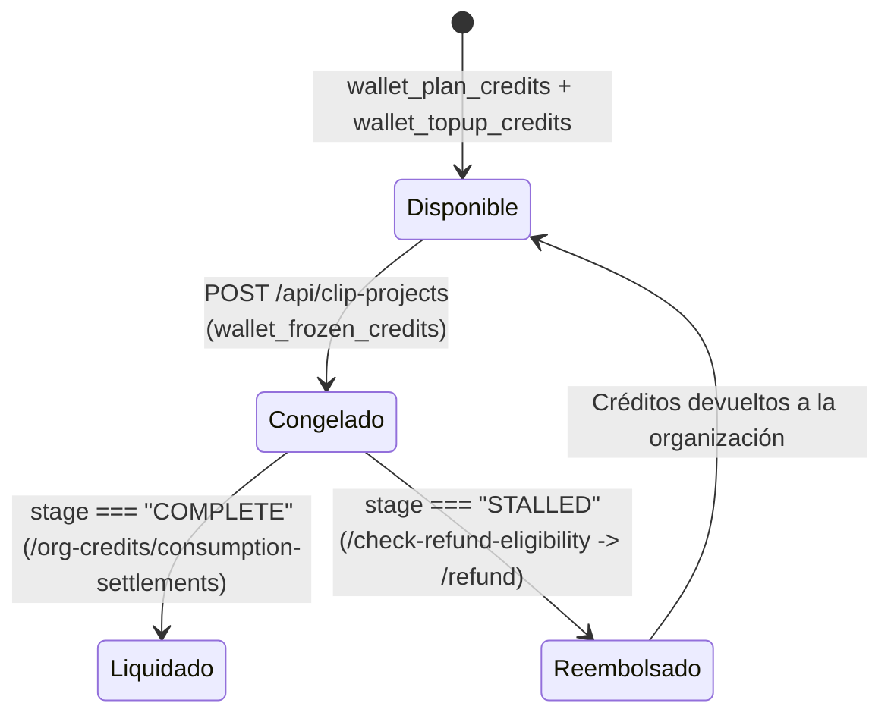

# 💳 ADR-003: Modelo de Billetera con Créditos Congelados y Reembolso Asistido

> [!abstract] En pocas palabras
> Dado que el procesamiento de video con IA es una operación asíncrona pesada que puede tardar varios minutos y ocasionalmente fallar por causas externas (videos corruptos, caídas de YouTube, saturación de GPU), **OpusClip** diseñó una billetera de cuatro cubetas (`wallet_plan_credits`, `wallet_topup_credits`, `credit_source_bonus` y **`wallet_frozen_credits`**) combinada con un protocolo explícito de verificación y reembolso (`/check-refund-eligibility` y `/refund`).

El diagrama de estados muestra cómo el estado intermedio `Congelado` (`wallet_frozen_credits`) actúa como una cuenta de depósito en garantía (*escrow*) durante la ejecución del trabajo en el cluster GPU.

> [!example] Ejemplo real: Protección dual de créditos en servidor y de cuotas en cliente
> Mientras el servidor protege los créditos monetarios mediante `wallet_frozen_credits` y `/refund`, el cliente aplica el mismo principio a las cuotas de uso limitado: en `usePollDashboardFirstPage` (`184098`, líneas 2476–2479), registra en IndexedDB (`"clipping-project-with-vo"`) los proyectos en vuelo que usan Voiceover y, si alguno termina en `"STALLED"`, ejecuta automáticamente `revertUsage()` para restituir el contador local de la función.

---

## 🔍 Contexto y problema

En una plataforma donde un solo proyecto puede consumir desde 10 hasta 350+ créditos y donde los usuarios de agencias lanzan múltiples videos en paralelo:
1. **Si los créditos se descontaran solo al finalizar el trabajo**: Un usuario con 30 créditos podría enviar simultáneamente diez videos de 30 minutos cada uno, provocando un sobregiro de 270 minutos de GPU gratis.
2. **Si los créditos se descontaran irreversiblemente al enviar**: Cualquier fallo en la descarga de la fuente o en el cluster de inferencia (`stage === "STALLED"`) haría que el usuario perdiera dinero real sin recibir ningún clip, generando tickets de soporte y contracargos (*chargebacks*).

---

## ✅ Decisión arquitectónica implementada

1. **Separación de saldos por origen y estado**:
   - `wallet_plan_credits`: Créditos incluidos en la suscripción actual (sujetos a fecha de expiración del ciclo `expireAt`).
   - `wallet_topup_credits`: Créditos comprados en paquetes adicionales (`/api/credit-topups`).
   - `credit_source_bonus` / `credit_source_trial`: Créditos promocionales (`/api/org-credits/add-by-special-link`, `/share-love-bonus`).
   - `wallet_frozen_credits`: Créditos retenidos por trabajos actualmente en ejecución.
2. **Liquidación diferida (`/api/org-credits/consumption-settlements`)**:
   - Los créditos retenidos solo se asientan como consumidos cuando el pipeline de generación concluye satisfactoriamente.
3. **Endpoints dedicados de elegibilidad y reembolso (`642390`)**:
   - `POST /api/clip-projects/{projectId}/check-refund-eligibility`: Evalúa sin efectos secundarios si un proyecto es elegible para devolución de créditos y guarda el resultado en `clipProjectStore.refundCheckResult(projectId)`.
   - `POST /api/clip-projects/{projectId}/refund`: Ejecuta la devolución de los créditos a la billetera de la organización y limpia el proyecto fallido.

---

> [!info]- Detalle técnico (para desarrolladores)
> - **Referencias en los archivos de internacionalización (`locales/en/subscription.json` y `clip.json`)**:
>   Las claves `wallet_plan_credits`, `wallet_topup_credits`, `wallet_frozen_credits`, `credit_source_bonus` y `credit_source_trial` exponen directamente al usuario en el desglose de su billetera cuántos créditos están disponibles y cuántos están temporalmente congelados por tareas activas.

## 🔗 Relacionado
- [[Sistema de Créditos Planes y Facturación]] — Detalle completo del subsistema financiero.
- [[Flujo de Consumo Congelamiento y Reembolso de Créditos]] — Diagrama de secuencia de la operación de reembolso.
- [[Gestor de Proyectos Colecciones y Búsqueda]] — Dónde se almacena `refundCheckResult` dentro de `clipProjectStore`.
