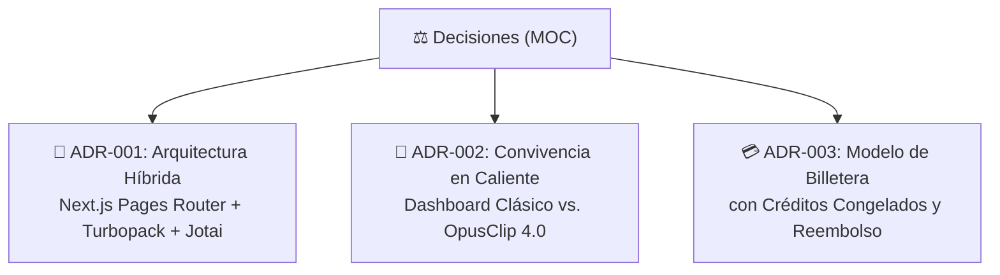

# ⚖️ Decisiones

> [!abstract] En pocas palabras
> Esta sección recopila los **Registros de Decisiones de Arquitectura (ADR)** reconstruidos a partir de la evidencia empírica en el código de **OpusClip Dashboard (`clip.opus.pro/dashboard`)**, explicando el porqué detrás de sus elecciones técnicas más importantes, las alternativas descartadas y sus consecuencias operativas.

El diagrama presenta las tres decisiones arquitectónicas fundamentales que estructuran el frontend, la evolución del producto y el motor financiero de OpusClip.

> [!example] Ejemplo real: Por qué documentar ADRs desde ingeniería inversa
> Entender *qué* hace una línea de código no basta para comprender un sistema complejo; documentar *por qué* existen 161 tiendas Jotai con `atomFamily` ([[ADR-001 Arquitectura Híbrida Next.js con Turbopack y Jotai]]) o por qué coexisten `/workflow` y `/workflow-canary` en el mismo bundle ([[ADR-002 Convivencia de Dashboard Clásico y Workflow Revamp OpusClip 4]]) permite razonar sobre el diseño como lo hacen los propios arquitectos de OpusClip.

---

## 📑 Índice de Decisiones (ADRs)

| ID | Decisión | Estado | Impacto principal |
|---|---|---|---|
| [[ADR-001 Arquitectura Híbrida Next.js con Turbopack y Jotai]] | Uso de Next.js con empaquetado Turbopack y gestión de estado atómica con `Jotai` (`atomFamily`) + `TanStack Query`. | Aprobado (En producción) | Permite actualizar el progreso en vivo de decenas de proyectos y pistas del editor a 60 FPS sin re-renderizados globales. |
| [[ADR-002 Convivencia de Dashboard Clásico y Workflow Revamp OpusClip 4]] | Mantener ambas interfaces en el mismo punto de entrada (`/dashboard`) gobernadas por `enable_workflow_revamp` y un interruptor de reversión en `localStorage`. | Aprobado (En producción) | Despliegue progresivo sin riesgo (*canary*) con capacidad de reversión instantánea por parte del usuario (`workflowRevamp.classic`). |
| [[ADR-003 Modelo de Billetera con Créditos Congelados]] | Separar los créditos en `plan`, `topup` y `frozen`, reteniendo saldo durante trabajos asíncronos y habilitando reembolso automático/asistido ante fallos (`STALLED`). | Aprobado (En producción) | Evita sobregiros concurrentes de GPU y protege al usuario cuando un trabajo falla en la nube. |

---

> [!info]- Detalle técnico (para desarrolladores)
> Cada ADR enlaza directamente a los módulos de Turbopack (`575013`, `889399`, `184098`, `943249`, `579611`, `642390`) que demuestran la implementación real de la decisión en producción.

## 🔗 Relacionado
- [[00 - Inicio]] — Portada principal del vault.
- [[Arquitectura general]] — Visión estructural donde se materializan estos ADRs.
- [[Registro de Evidencia REA]] — Evidencias técnicas que respaldan cada ADR.
