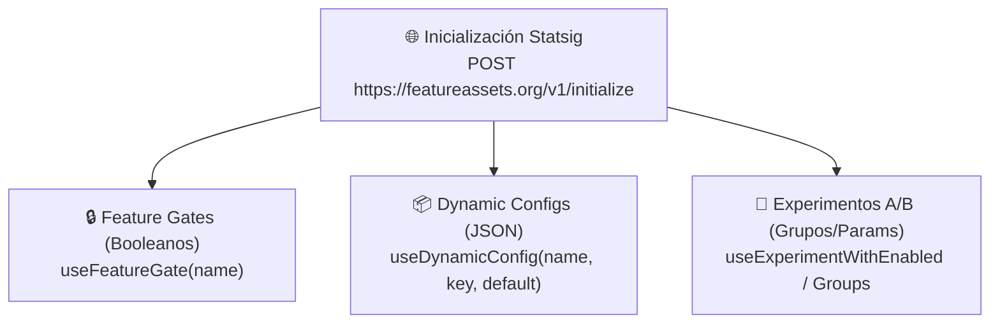

# 🚦 Catálogo de Feature Gates y Experimentos Statsig

> [!abstract] En pocas palabras
> Referencia completa de los **[[Glosario#Feature Gate|Feature Gates]]**, **[[Glosario#Dynamic Config|Dynamic Configs]]** y **Experimentos A/B** evaluados mediante **Statsig** en el código de **OpusClip Dashboard (`clip.opus.pro/dashboard`)**, detallando en qué módulo se leen y cómo alteran el comportamiento de la aplicación.

El diagrama clasifica las tres primitivas de gobierno remoto que descarga el cliente al iniciar sesión.

> [!example] Ejemplo real: Cómo un solo Feature Gate redirige todo el Dashboard hacia `/search`
> En el módulo raíz del dashboard (`575013` en `2pdyo3gbgw8ji-formatted.txt`, línea 217), el código evalúa `const ev = useSearchFeatureGate()`. Si ese gate devuelve `true` para la organización del usuario, un `useAsyncEffect` espera `1,000 ms` y ejecuta `router.replace({ pathname: "/search", query: { ...router.query } })`, convirtiendo la experiencia de inicio en un buscador semántico de clips.

---

## 🔒 1. Feature Gates (`useFeatureGate`)

| Nombre del Feature Gate | Módulo / Archivo | Efecto exacto cuando está en `true` (`ON`) |
|---|---|---|
| `enable_workflow_revamp` | `889399` (`0_hne8424faiu.js`) | Activa **OpusClip 4.0** (`DashboardRevampEntry`, `/workflow-canary` y `/brand-kit-canary`), siempre que `workflowRevamp.classic` sea `false`. |
| `quickstart_deeplink_enabled` | `575013` (`2pdyo3gbgw8ji.js`) | Habilita el enrutamiento automático de parámetros `/dashboard/[workflowType]` (`caption`, `reframe`, `broll`, `upscale`, `clip-anything`, `auto-import`) y `?usecase=auto-edit`. |
| `dashboard_recent_projects_enabled` | `575013` (`2pdyo3gbgw8ji.js`) | Renderiza la fila de proyectos recientes (`ProjectListPanel` con `recentProjects: true`) en `/dashboard`. Cuando está en `false`, activa un poller de respaldo cada `5,000 ms`. |
| `enable_dynamic_tab_project_progress` (`DYNAMIC_TAB_PROJECT_PROGRESS_GATE`) | `219991` / `524235` (`2sx5shs8nlm61.js`) | Actualiza en vivo `document.title` con el porcentaje de generación o escalado de los proyectos activos en la cohorte (`composeClipTabTitle`). |
| `clip_anything_ban` | `626971` / `252547` | Si está activo (`true`), oculta el selector de modelo para impedir nuevas selecciones de `ClipAnything` (salvo que el usuario ya lo tuviera activo). |
| `enable_upscaling` | `536571` / `561806` | Habilita la píldora, tarjeta y diálogo de **AI Upscale** (escalado de video a HD/4K) en el Dashboard Clásico y en OpusClip 4.0. |
| `enable_sound_effect` | `536571` (`3nthk87c1t44i.js`) | Habilita la opción **AI sound effect / Auto SFX** (`sound_effect`) dentro del `QuickStartPanel`. |
| `enable_auto_sfx_usage_tracking` (`AUTO_SFX_USAGE_TRACKING_GATE`) | `36078` (`0tcbvu1sf_t3q.js`) | Activa la contabilización de cuota y seguimiento de uso de efectos de sonido automáticos. |
| `quick_start_11labs_ban` | `536571` (`3nthk87c1t44i.js`) | Desactiva o restringe las opciones de síntesis de voz de ElevenLabs en el panel de inicio rápido. |
| `editor_ai_video_broll` | `536571` (`3nthk87c1t44i.js`) | Habilita la generación de **AI Video B-Roll** en las opciones de QuickStart y en el editor. |
| `enable_auto_hook` | `42296` (`0_hne8424faiu.js`) | Habilita la generación automática de titulares/ganchos visuales (**[[Glosario#Auto-Hook|Auto-Hook]]**). |
| `enable_export_4k` | `42296` (`0_hne8424faiu.js`) | Permite exportar clips directamente en resolución **4K** cuando el video fuente tiene resolución $\ge 3840 \times 2160$. |

---

## 📦 2. Dynamic Configs (`useDynamicConfig`)

| Nombre del Dynamic Config | Clave leída | Módulo | Propósito y estructura de datos |
|---|---|---|---|
| `dashboard_whats_new_banner` | `"items"` (default `[]`) | `575013` (`2pdyo3gbgw8ji.js`) | Alimenta el carrusel **"What's New"**. Cada ítem contiene `id`, `title`, `subtitle`, `tag` (`new_features`, `programs`, `webinars`, `announcements`, `beta`), `themeColor`, `imageUrl`, `ctaText`, `ctaUrl`, `expanded` (`description`, `mediaUrl`, `posterUrl`, `ctaUrl`), `locales` y filtro de `plans`. |
| `dashboard_videos` | `"videos"` (default `[]`) | `575013` / `811849` | Alimenta el carrusel de tutoriales **"Master OpusClip"** (`[{ title, link, thumbnail, key }]`), extrayendo el ID de YouTube del parámetro `?v=`. |
| `curation_api_config` | `"genres"` | `528182` (`2pdyo3gbgw8ji.js`) | Define los géneros de video disponibles en el selector de curación (`genres.ready` y `genres.beta`). |
| Configuración de orden QuickStart (`useQuickstartConfig`) | `"order"`, `"new"` | `755299` (`0bk_j0ng_-uy_.js`) | Reordena dinámicamente las píldoras del `QuickStartPanel` y controla hasta qué fecha (`until`) muestran la insignia `"New"`. |

---

## 🧪 3. Experimentos A/B (`useExperimentWithEnabled` / `useExperimentWithGroups`)

| Nombre del Experimento | Módulo | Qué controla |
|---|---|---|
| `ao_quickstart_button_oc_dashboard` | `536571` (`3nthk87c1t44i.js`) | Muestra el botón beta **"Script to video"** (que promociona y redirige a **Agent Opus** en `labs.opus.pro`) dentro del `QuickStartPanel`. Puede forzarse con `debugStore.debugQuickstartScriptToVideo`. |
| `send_survey_email_exp` | `575013` (`2pdyo3gbgw8ji.js`) | Cuando está activo, al terminar la encuesta de onboarding (`UserSurveyDialog`) envía automáticamente el correo de caso de estudio (`case-study-agency`, `case-study-marketer` o `case-study-podcaster`). |
| `brand_template_ux` | `42296` (`0_hne8424faiu.js`) | En el modo clásico, redirige el menú de plantillas hacia la nueva interfaz `/brand-templates-ux` en lugar de `/brand-templates`. |
| `broll_credits` / `broll_credits_2` | `42296` (`0_hne8424faiu.js`) | Conmuta el modelo de cobro de B-Roll entre cuota gratuita fija y cobro directo por créditos (`useBrollCreditsExperiment`). |
| `broll_stock_vendor` | `460319` (`0tcbvu1sf_t3q.js`) | Asigna el proveedor de videos de archivo para B-Roll según el grupo numérico: `"0"` → **Pexels (`Pls`)**, `"1"` → **Storyblocks (`Sbs`)**, `"2"` → **Shutterstock (`Ssk`)**. |
| `editor_quick_operation` | `42296` (`0_hne8424faiu.js`) | Habilita la barra de operaciones rápidas en las tarjetas de clips y en el editor. |
| `scheduler_thumbnail` | `42296` (`0_hne8424faiu.js`) | Permite subir miniaturas personalizadas al programar publicaciones en el calendario social. |

---

> [!info]- Detalle técnico (para desarrolladores)
> - **Orden predeterminado de las 10 píldoras de QuickStart (`755299`, línea 1016 de `extracted_revamp_and_worker.txt`)**:
>   `["quick_normal", "quick_editor", "caption", "broll", "reframe", "sound_effect", "upscale", "video_dubbing", "enhance_speech", "voiceover"]`.
>   La función `withAiProducerPill` inserta `"ai_producer"` en el índice `3` (cuarta posición), justo después de las tres primeras píldoras.

## 🔗 Relacionado
- [[Monitoreo Feature Flags y Telemetría]] — Cómo funciona `StatsigTracker` y cómo se despachan los eventos de exposición.
- [[Módulo Dashboard y Enrutamiento de Workflows]] — Cómo impactan estos flags en el renderizado del dashboard.
- [[ADR-002 Convivencia de Dashboard Clásico y Workflow Revamp OpusClip 4]] — Uso arquitectónico de `enable_workflow_revamp`.
