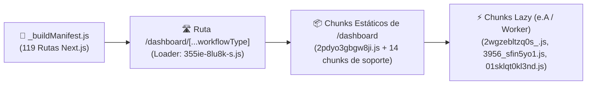

# 🗺️ Catálogo de Rutas y Chunks de Turbopack

> [!abstract] En pocas palabras
> Inventario técnico de los **[[Glosario#Chunk de Turbopack|Chunks de Turbopack]]** que conforman la ruta `/dashboard/[...workflowType]` (tanto estáticos como cargados bajo demanda) y clasificación de las **119 rutas de Next.js** registradas en `_next/static/tw0-OiEO15o4q3nmL5clA/_buildManifest.js`.

El diagrama muestra cómo el manifiesto de compilación de Next.js conecta la ruta dinámica `/dashboard/[...workflowType]` con su cargador de página, sus chunks estáticos y sus paquetes diferidos.

> [!example] Ejemplo real: Cómo registra `355ie-8lu8k-s.js` la página del Dashboard
> El archivo `_next/static/chunks/355ie-8lu8k-s.js` contiene el registro de ruta de Next.js (`window.__NEXT_P.push(["/dashboard/[...workflowType]", () => e.r(575013)])`), que instruye al runtime de Turbopack a instanciar el módulo `575013` definido dentro de `2pdyo3gbgw8ji.js`.

---

## 📦 1. Chunks Principales de `/dashboard/[...workflowType]`

| Archivo Chunk (`_next/static/chunks/`) | Tamaño aprox. | Módulos clave | Responsabilidad principal |
|---|---|---|---|
| `355ie-8lu8k-s.js` | ~1 KB | Loader de `575013` | Punto de montaje de `/dashboard/[...workflowType]` en `__NEXT_P`. |
| `2pdyo3gbgw8ji.js` | ~88 KB | `575013`, `528182`, `105675`, `336871`, `681368`, `371553`, `704849` | Componente raíz del Dashboard (`tA`), título dinámico de pestaña (`Y`/`W`), carruseles (`What's New`, `Demo Projects`, `Master OpusClip`), encuesta de onboarding (`UserSurveyDialog`), `AutoImportDialog`, `useClipLen`, `SubmitSettings` y campañas. |
| `2wgzebltzq0s_.js` *(Lazy via `437097`)* | ~13 KB | `561806` (`22917`), `289931`, `411369`, `888248`, `404898` | `DashboardRevampEntry` (OpusClip 4.0), `pinnedWorkflows`, tarjeta de comparación de Upscale y filtro de átomos QRR (`WORKFLOW_QRR_FEATURES`). |
| `3956_sfin5yo1.js` *(Lazy via `437097`)* | ~25 KB | `818420`, `404748`, `882239`, `255374`, `682284`, `161113`, `912485` | `WorkflowSourcePicker`, `DashboardSubmitCard`, `useWorkflowSubmission`, `useWorkflowSourceCheck` y `uploadHandoffAtom`. |
| `01sklqt0kl3nd.js` *(Worker via `681368`)* | ~0.7 KB | `91488` | Web Worker de benchmark de CPU (`integerTime`, `floatTime`, `memoryTime`, `branchTime`). |
| `3nthk87c1t44i.js` | ~112 KB | `536571`, `252547`, `498999`, `892714`, `960083`, `958296`, `603609`, `946167` | `QuickStartPanel`, `SubmitPanel`, `QuickStartDialog`, diálogo de `AiUpscale` e historial (`useStandaloneHistory`), `Dubbing` y `Voiceover`. |
| `1893pdbw_xy45.js` | ~45 KB | `626971` | Contenedor hero del `SubmitCard` clásico. |
| `40f7nxhbahq2_.js` / `0my09scm440pt.js` | ~95 KB | `811849`, `420350`, `383241` | `ProjectListPanel`, agrupación temporal de proyectos, tarjetas de proyecto (`buildProjectCardMeta`) y `DEMO_PROJECTS`. |
| `2sx5shs8nlm61.js` | ~68 KB | `524235`, `837606`, `382326`, `612196`, `737381` | `generatingProgressStore`, serialización de snapshot, `projectDeletionStore`, `InsufficientCreditError` y `MultipartUploader`. |
| `0v5vcdwkoo-9r.js` | ~38 KB | `642390` | Hook `useClipProjectApi` (CRUD de proyectos, preflight, reembolsos, auto-importación, copilot e historial del editor). |
| `0_hne8424faiu.js` | ~52 KB | `943249`, `42296`, `48711`, `889399`, `557304` | `clipStore`, hooks de experimentos Statsig, `upscaleCredits` y `useWorkflowRevampEnabled`. |
| `0p9u92dpxgm13.js` / `1_shcqomv7f9c.js` | ~42 KB | `847027`, `986231`, `766705`, `377864` | `authStore`, `apiStore`, `baseContext` (deviceId/UTM) y generador `nanoid`. |
| `2n0-aub-2j085.js` | ~34 KB | `579611` | `assetStore` y `useUserPlanBoot`. |
| `0t5v9hztvwr7u.js` | ~28 KB | `311846` | `submitStore` (31 átomos de envío y preflight). |
| `00ycdg_js-ita.js` | ~36 KB | `184098` | `clipProjectStore` y `usePollDashboardFirstPage`. |
| `0-cw8uppghurd.js` / `38s3ojsu7_uko.js` | ~64 KB | `265539` | `DEFAULT_WORKFLOW_ID`, `createBuiltinWorkflows` y esquemas Zod de `BrandKit`. |
| `3wal4--8x480j.js` & `2mrjp4bqj0l04.js` | 3.21 MB / 1.76 MB | Vendor & Runtime Core | React, Next.js runtime, Jotai core, TanStack Query, Radix UI, i18next, Statsig SDK, Iconoir/Lucide icons. |

---

## 🛣️ 2. Familias de Rutas de la Aplicación (119 Rutas en `_buildManifest.js`)

| Familia Funcional | Rutas Principales verificadas en `route_chunks_map.json` |
|---|---|
| **Dashboard y Creación de Workflows** | `/dashboard/[...workflowType]`, `/workflow`, `/workflow-canary`, `/omni`, `/omni/[projectId]` |
| **Proyectos, Resultados y Búsqueda** | `/projects`, `/collections`, `/collections/[collectionId]`, `/clip/[id]`, `/search` |
| **Editor Web Multipista** | `/editor-start`, `/editor-ux/[clipId]`, `/editor/[clipId]` |
| **Identidad de Marca (`Brand Templates` / `Brand Kit`)** | `/brand-templates`, `/brand-templates-ux`, `/brand-kit-canary` |
| **Publicación Social y Calendario** | `/calendar`, `/social-accounts`, `/tiktok-callback` |
| **Campañas y Marketplace** | `/campaigns`, `/campaigns/[campaignId]` |
| **Autenticación, Equipos y SSO** | `/auth/oauth/login`, `/auth/callback`, `/join-team`, `/sso` |
| **Planes, Suscripciones y Facturación** | `/subscription`, `/pricing`, `/payment/redirect`, `/dlocal-payment` |
| **Herramientas Gratuitas SEO (`Free Tools`)** | `/free-tool/[toolName]`, `/free-tool/project/[id]` |

---

> [!info]- Detalle técnico (para desarrolladores)
> El archivo JSON completo con las 119 rutas y la lista exacta de chunks asociados a cada una se encuentra almacenado localmente en:
> `d:\rea-projects\projects\02-clippers-ippers\route_chunks_map.json`.

## 🔗 Relacionado
- [[Referencia de Endpoints API Backend]] — Qué endpoints HTTP invocan estos chunks.
- [[Modelo de datos y Estado Global Jotai]] — Qué tiendas Jotai exportan estos módulos.
- [[Cómo reproducir y auditar el bundle con REA]] — Cómo se descargaron y analizaron estos chunks.
