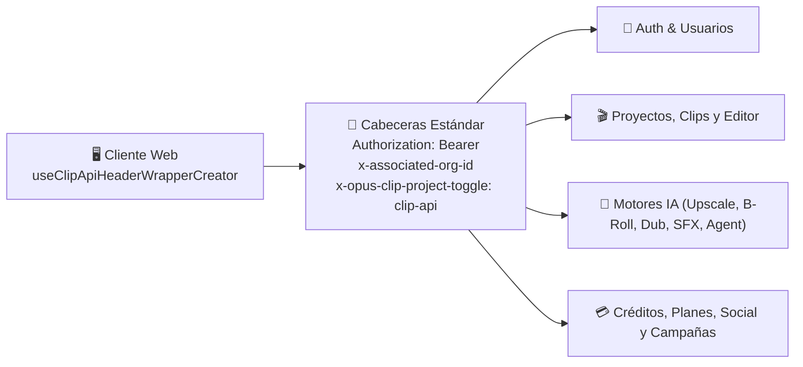

# 🔌 Referencia de Endpoints API Backend

> [!abstract] En pocas palabras
> Catálogo clasificado por dominio funcional de los endpoints HTTP/REST que el cliente web de **OpusClip (`clip.opus.pro`)** invoca contra `https://api.opus.pro/api` (extraídos de las 505 rutas de plantilla halladas en el bundle de producción).

El diagrama muestra cómo el wrapper de red inyecta las cabeceras de autenticación, organización y ruteo antes de comunicarse con los cuatro grandes grupos de endpoints en `api.opus.pro`.

> [!example] Ejemplo real: Cómo distingue el backend entre una llamada normal de proyecto y un re-procesamiento (`rerun`)
> En `useClipProjectApi.rerunProject` (`642390`, líneas 2146–2159 de `extracted_core_modules.txt`), el cliente envía `POST /api/clip-projects/{projectId}/rerun` adjuntando opcionalmente un nuevo `videoLanguage` y un `whisperModel` específico, junto con las cabeceras `"x-opus-clip-project-toggle": "clip-api"` y `"x-associated-org-id": orgId`.

---

## 🔐 1. Autenticación, Usuarios, Organizaciones y Seguridad

| Método | Ruta (`/api/...`) | Propósito |
|---|---|---|
| `POST` | `/auth/session-profile` | Bootstrap de sesión (`{ appName: "OpusClip", device: "Web" }`). |
| `GET` / `POST` | `/login-users?q=mine`, `/login-users/update-mine`, `/update-my-basic-info` | Lectura y actualización del perfil del usuario autenticado. |
| `POST` | `/login-users/check-lang`, `/login-users/update-lang` | Detección y actualización del idioma de interfaz del usuario. |
| `POST` | `/login-users/ensure-onboarded` | Marca al usuario como inicializado tras el flujo de bienvenida. |
| `POST` | `/login-users/check-disposable-domain`, `/check-multi-accounts`, `/login-identify-frozen` | Controles antifraude de correos desechables, multicuentas y bloqueo. |
| `GET` | `/login-users/intercom-tokens?platform=web` | Emite el JWT firmado para autenticar el widget de soporte de Intercom. |
| `POST` | `/update-login-user-brevo-contact` | Sincroniza atributos `PERSONA_*` del usuario con Brevo CRM tras la encuesta inicial. |
| `GET` / `POST` | `/orgs`, `/org-members`, `/org-invitations`, `/sso-admins`, `/api-keys` | Gestión de organizaciones, miembros de equipo, invitaciones, SSO y llaves de API. |
| `GET` | `/client-access-control?q=ipRisk`, `/client-access-control?q=project`, `/domain-whitelists` | Control de acceso por riesgo de IP y dominios autorizados. |

---

## 🎬 2. Ingesta, Proyectos de Clipping, Colecciones y Búsqueda

| Método | Ruta (`/api/...`) | Propósito |
|---|---|---|
| `POST` | `/source-videos` | Preflight de URL o archivo: devuelve duración, resolución, miniatura e idioma (`videoLanguage`). |
| `GET` | `/source-videos?videoUrl={url}`, `/source-videos/{id}/preview-frames` | Obtiene miniatura y fotogramas de vista previa del video fuente. |
| `GET` / `POST` | `/signed-urls`, `/upload-links` | Genera URLs firmadas para subida directa (simple o multiparte) a Google Cloud Storage. |
| `POST` | `/clip-projects` | Crea un nuevo proyecto de clipping o edición (`startClipProject` / `useWorkflowSubmission`). |
| `GET` | `/clip-projects?q=mine&page={p}&pageSize={s}` | Lista paginada de proyectos de la organización activa. |
| `POST` | `/clip-projects/count` | Devuelve el conteo total (`total`) y guardado (`saved`) de proyectos del usuario. |
| `GET` / `PUT` / `DELETE` | `/clip-projects/{projectId}` | Obtiene detalle, renombra/actualiza (`useRenameProject`) o elimina un proyecto. |
| `POST` | `/clip-projects/batch-delete` | Elimina múltiples proyectos en lote (`{ projectIds: [...] }`). |
| `POST` | `/clip-projects/{id}/view` | Registra que el proyecto fue abierto por el usuario. |
| `POST` | `/clip-projects/{id}/rerun` | Re-ejecuta el procesamiento del proyecto (permitiendo cambiar `videoLanguage` y `whisperModel`). |
| `POST` | `/clip-projects/{id}/restore` | Restaura un proyecto archivado o expirado (`{ storageStatus }`). |
| `POST` | `/clip-projects/{id}/make-public`, `/make-private`, `/update-visibility` | Cambia los permisos de visibilidad y enlace compartido del proyecto. |
| `POST` | `/clip-projects/{id}/check-refund-eligibility`, `/clip-projects/{id}/refund` | Verifica elegibilidad y ejecuta el reembolso de créditos de un proyecto fallido. |
| `GET` | `/cluster-jobs/{id}/progress?ms={ms}` | Polling en tiempo real del progreso de procesamiento en el cluster GPU. |
| `POST` | `/collection-contents/batch-add`, `/collection-contents/sync-collection-contents` | Añade proyectos en lote o sincroniza el contenido de las colecciones. |
| `GET` | `/searchable-clips?pageSize={s}&page={p}&q=findByQuery`, `/search-phrases` | Búsqueda semántica de fragmentos dentro de todos los videos de la organización. |
| `GET` / `POST` | `/workflows`, `/narratives`, `/prompts/director`, `/prompts/global-rules` | Catálogo de workflows personalizados (OpusClip 4.0), grupos narrativos y reglas de prompts. |

---

## ✂️ 3. Clips Exportables, Editor Multipista y Mejoras IA

| Método | Ruta (`/api/...`) | Propósito |
|---|---|---|
| `GET` | `/exportable-clips?projectId={id}` | Lista todos los clips generados para un proyecto. |
| `GET` | `/exportable-clips/{projectId}.{clipId}?include=editingScript` | Carga el clip junto con su guion completo de edición para `/editor-ux`. |
| `POST` | `/exportable-clips/{p}.{c}/eye-contact`, `/auto-zoom`, `/auto-color`, `/preview-loop` | Mejoras visuales de IA en 1 clic sobre un clip específico. |
| `POST` | `/exportable-clips/{p}.{c}/regenerate-auto-hook`, `/regenerate-captions`, `/duplicate` | Regenera el titular inicial, los subtítulos o duplica el clip. |
| `POST` | `/curated-clips/{p}.{c}/feedback`, `GET /curated-clips/feedback?q=findByProjectId` | Registra y consulta calificaciones (*Like* / *Dislike*) sobre los clips curados. |
| `POST` | `/engine-clips/{p}.{c}/save-and-render`, `/render`, `/refine` | Guarda los cambios del editor multipista y lanza el trabajo de renderizado final. |
| `GET` / `POST` | `/editor-history-records`, `/editor-history-records/query-file-names` | Guarda y recupera instantáneas del historial de deshacer/versiones del editor. |
| `GET` | `/transcripts?q=findByProjectIdAndSourceId`, `/screenplays?q=findByProjectIdAndSourceId` | Obtiene la transcripción sincronizada y el guion de detección de escenas/cámaras. |
| `POST` / `GET` | `/brolls/plan`, `/brolls/generate`, `/brolls?q=findBySearchText`, `/broll/check-quota`, `/broll-free-quota` | Planificación, generación con IA, búsqueda en stock (`Pexels`/`Storyblocks`/`Shutterstock`) y cuota de B-Roll. |
| `POST` / `GET` | `/video-upscaling-tasks/standalone`, `/video-upscaling-tasks/probe-youtube`, `/video-upscaling-tasks?q=listByOrg` | Sondeo de YouTube, creación y listado de historial (7 días) de tareas de **AI Upscale** (HD y 4K). |
| `POST` | `/dub-clip-tasks` | Inicia tareas de traducción y doblaje de voz con IA (**AI Dubbing**). |
| `POST` / `GET` | `/voice-enhancement`, `/voice-overs`, `/auto-sound-effect-tasks`, `/sound-effects` | Mejora de voz (*Speech Enhancement*), generación de *Voiceover* y efectos de sonido automáticos (*Auto SFX*). |
| `POST` / `GET` | `/bad-takes/{id}/detect`, `/bad-takes/quota` | Detección automática de tomas falsas y muletillas en la grabación. |
| `POST` / `GET` | `/clip-copilot-tasks`, `/curate/chats/{id}/messages`, `/stream`, `/undo`, `/agent-sessions` | Sesiones conversacionales con el copiloto de curación y **Agent Opus**. |

---

## 🎨 4. Brand Kits, Auto-Importación, Redes Sociales, Campañas y Facturación

| Subsistema | Endpoints principales (`/api/...`) |
|---|---|
| **Brand Templates & Brand Kits** | `/brand-templates?q=mine`, `/brand-templates/{id}`, `/brand-templates/{id}/versions`, `/brand-templates/{id}/restore`, `/brand-template-migrations`, `/brand-kits`, `/proper-nouns?q=self`, `/proper-nouns/add-self`, `/word-libraries`, `/org-assets/custom-lottie-animations` |
| **Auto-Importación de YouTube** | `/auto-import?platform=YOUTUBE&needPopupFlag={0\|1}`, `POST /auto-import`, `POST /auto-import/set-config`, `DELETE /auto-import`, `POST /auto-import/check-youtube-owner`, `POST /auto-import/add-playlist-from-url`, `/importable-youtube-playlists`, `/auto-import-collections`, `POST /auto-import-collections/displace` |
| **Publicación Social y Calendario** | `/social-accounts`, `/social-accounts/generate-oauth-url`, `/social-accounts/select-sub-accounts`, `/tiktok-auth-links`, `/tiktok-auth-tokens`, `/tiktok-invisible-watermarks`, `/social-copy`, `/plan-social-upload-links`, `/post-tasks`, `/publish-schedules` |
| **Campañas y Clippers** | `/campaigns`, `/campaigns/{id}`, `POST /campaigns/{id}/close`, `/campaigns/{id}/sources`, `/campaigns/{id}/brand-templates`, `/campaign-sources/{id}/external-source-url`, `/campaign-sources/{id}/imports` |
| **Créditos, Suscripciones y Pagos** | `/org-credits?q=mine`, `/org-credits/consumptions`, `/org-credits/consumption-settlements`, `/org-credit-txns?q=mine`, `/org-credit-consumption-records?q=mine&grouped=true`, `/credit-topup-skus`, `/credit-topups`, `/subscription-plans`, `/subscriptions?q=mine`, `/subscriptions/estimate-amount`, `/subscriptions/confirm-payment`, `/subscriptions/cancel`, `/subscriptions/withdraw-cancel`, `/dlocal-payments/latest`, `/affiliates/bind` |

---

> [!info]- Detalle técnico (para desarrolladores)
> La lista alfabética íntegra de las 505 plantillas de ruta extraídas de los chunks de Turbopack se encuentra en las líneas 1 a 507 del artefacto local:
> `d:\rea-projects\projects\02-clippers-ippers\extracted_core_modules.txt`.

## 🔗 Relacionado
- [[Arquitectura general]] — Cómo se enrutan estas peticiones mediante `apiStore` y `useClipApiHeaderWrapperCreator`.
- [[Flujos y procesos]] — Diagramas de secuencia que muestran en qué orden exacto se invocan estos endpoints.
- [[Catálogo de Rutas y Chunks de Turbopack]] — Archivos JS donde están declaradas estas llamadas.
