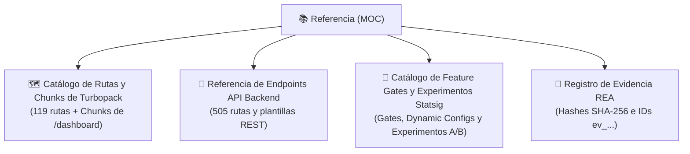

# 📚 Referencia

> [!abstract] En pocas palabras
> Esta sección contiene los diccionarios y catálogos técnicos completos extraídos de **OpusClip (`clip.opus.pro/dashboard`)**: el inventario de rutas y [[Glosario#Chunk de Turbopack|Chunks de Turbopack]], la referencia de los endpoints REST hacia `api.opus.pro/api`, el catálogo de [[Glosario#Feature Gate|Feature Gates]] y experimentos de Statsig, y el registro verificable de evidencias **REA**.

El diagrama muestra los cuatro catálogos de consulta rápida que componen la sección de Referencia.

> [!example] Ejemplo real: Consultar qué chunk contiene una ruta o qué flag activa una función
> Si necesitas saber qué archivo `.js` implementa la página `/workflow-canary` o qué Dynamic Config alimenta los videos tutoriales del dashboard, puedes consultar directamente [[Catálogo de Rutas y Chunks de Turbopack]] y [[Catálogo de Feature Gates y Experimentos Statsig]].

---

## 📑 Notas de referencia

| Nota | Contenido principal |
|---|---|
| [[Catálogo de Rutas y Chunks de Turbopack]] | Desglose de los chunks principales de `/dashboard/[...workflowType]`, chunks perezosos (*lazy*) y mapa de las 119 rutas del `_buildManifest.js`. |
| [[Referencia de Endpoints API Backend]] | Diccionario clasificado por dominio de los endpoints de `https://api.opus.pro/api` extraídos del bundle. |
| [[Catálogo de Feature Gates y Experimentos Statsig]] | Tabla de Feature Gates, Dynamic Configs y Experimentos A/B con los módulos que los consumen y su efecto exacto. |
| [[Registro de Evidencia REA]] | Cadena de custodia completa con identificadores `ev_...`, herramientas MCP invocadas y rutas locales de artefactos. |

---

> [!info]- Detalle técnico (para desarrolladores)
> Todos los datos de esta sección provienen de la extracción automatizada sobre el build `tw0-OiEO15o4q3nmL5clA` almacenada en `d:\rea-projects\projects\02-clippers-ippers\`.

## 🔗 Relacionado
- [[00 - Inicio]] — Portada principal del vault.
- [[Arquitectura]] — Cómo se utilizan estos recursos dentro de los componentes del sistema.
- [[Cómo reproducir y auditar el bundle con REA]] — Cómo regenerar estos catálogos ante una nueva versión.
