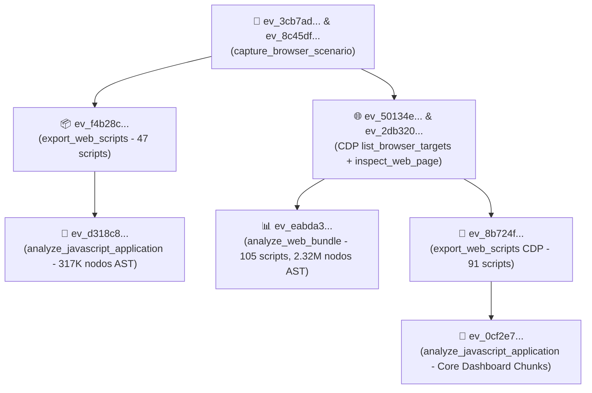

# 🧾 Registro de Evidencia REA

> [!abstract] En pocas palabras
> Esta nota documenta la **cadena de custodia técnica** de la investigación de ingeniería inversa realizada con **REA (`rea-agents@6.5.0`)** sobre `https://clip.opus.pro/dashboard`, listando cada identificador criptográfico de evidencia (`ev_...`), la herramienta MCP utilizada y la ubicación exacta de los artefactos extraídos en disco.

El diagrama traza el linaje completo de los registros de evidencia generados durante la sesión de auditoría con REA.

> [!example] Ejemplo real: Verificación independiente del bundle de evidencia exportado
> Toda la sesión de evidencia REA fue volcada mediante `rea:export_evidence_bundle` al archivo local `d:\rea-projects\projects\02-clippers-ippers\session-evidence.json` (13.38 MB, 8 registros completos), el cual puede re-importarse en cualquier sesión futura de REA mediante `rea:import_evidence_bundle` para auditar cada respuesta de red y cada script capturado sin necesidad de conexión a internet.

---

## 📋 1. Tabla de Evidencias Empíricas REA (`ev_...`)

| Evidence ID (`ev_...`) | Herramienta MCP (`rea`) | Alcance y hallazgos verificados |
|---|---|---|
| `ev_3cb7ad22e7cb764df8b41558e5301d68c26f608c4068885d4105118b5a20cf98` | `capture_browser_scenario` | Sondeo inicial de `https://clip.opus.pro/dashboard` (`HTTP 200 OK`), detección de redirección de autenticación y carga de scripts iniciales. |
| `ev_8c45dfb28c1004e705f4f438aa8606b2c0c11d6a15aa0b4926cb1dd9853d4445` | `capture_browser_scenario` (`request_body: true, response_body: true`) | Captura completa con cuerpos JSON de `POST https://api.opus.pro/api/auth/session-profile` (`401`), `POST https://featureassets.org/v1/initialize` (Statsig) y `GET https://opuspro.instatus.com/summary.json` (`200 OK`). |
| `ev_f4b28ce8ece923b58d06da50e6d9da257349664f0af76f12b55ed1812190ab09` | `export_web_scripts` | Extracción de los primeros 47 scripts cargados en el escenario hacia `d:\rea-projects\projects\02-clippers-ippers\exported-scripts\files`. |
| `ev_d318c82cd57c5cf9b9e0af899086536f0fcc150ce39e67f6b03b3330fd52684f` *(Vista resumen: `ev_4c7402037058a9be23e560ca244e7b729359a5af37e027951cfbdc2bcd72e6a2`)* | `analyze_javascript_application` | Análisis estático AST sobre los 47 scripts iniciales (`317,036` nodos AST, `0` fallos de parseo). |
| `ev_50134e212a1ee92fe60e5fb95cea1e37c3aec24dbe9adfe72da7795eaf050f14` | `list_browser_targets` | Descubrimiento del target CDP activo (`2716B308335449BFDF14BD402C604D7B`) en el puerto loopback `9222`. |
| `ev_eabda32c0aba5f22950c300e92982292974ea91a97812f5cdf7804e562b88d69` | `analyze_web_bundle` | Análisis estático en vivo vía CDP de **105 scripts** (`2,327,441` nodos AST analizados, `0` errores de sintaxis). |
| `ev_2db3203af160dbbbb47fdbe1a9d4c20597a8474a3db98d8b689eaff36f252f09` | `inspect_web_page` (`include_script_sources: true`) | Captura integral del código fuente desde el dominio `Debugger` de CDP, incluyendo los bundles pesados (`3wal4--8x480j.js` de 3.21 MB y `2mrjp4bqj0l04.js` de 1.76 MB). |
| `ev_8b724f9f4c3a96641e7fc0cee2b091a2920aab93576a5c495114e3c9ea286cd8` | `export_web_scripts` | Exportación de los **91 scripts del mismo origen (`clip.opus.pro`)** hacia `d:\rea-projects\projects\02-clippers-ippers\cdp-exported-scripts\files`. |
| `ev_0cf2e7273815b78501f62b085468996da6c7a4f1e6a0a0e5864a393004bb28b1` *(Vista resumen: `ev_9dc42974c78b281e2eb75422c87a265a5fcdece0eba9237fd2a92c80ba55f7e5`)* | `analyze_javascript_application` | Análisis AST profundo focalizado en los 15 chunks principales de `/dashboard/[...workflowType]` (`518,325` nodos AST, extracción de símbolos, hooks y llamadas de red). |

---

## 🗂️ 2. Inventario de Artefactos Locales (`d:\rea-projects\projects\02-clippers-ippers\`)

| Ruta local | Descripción |
|---|---|
| `session-evidence.json` | Paquete de evidencia REA exportado con `export_evidence_bundle`. |
| `inspect-web-page.json` | Volcado directo de la inspección CDP `ev_2db3203af160dbbbb47fdbe1a9d4c20597a8474a3db98d8b689eaff36f252f09`. |
| `dashboard-complete/_next/static/chunks/*.js` | Más de 550 chunks de Turbopack descargados a partir de `_buildManifest.js` + chunks lazy (`2wgzebltzq0s_.js`, `3956_sfin5yo1.js`, `01sklqt0kl3nd.js`). |
| `dashboard-complete/locales/en/*.json` | Los 6 diccionarios i18n oficiales (`common.json`, `auth.json`, `subscription.json`, `plansocial.json`, `clip.json`, `editor.json`). |
| `route_chunks_map.json` | Mapa JSON de las 119 rutas de Next.js hacia sus archivos chunk. |
| `2pdyo3gbgw8ji-formatted.txt` | Código formateado y numerado del chunk principal del dashboard (`2pdyo3gbgw8ji.js`, módulo `575013`). |
| `extracted_core_modules.txt` | Volcado formateado de las 505 rutas de API backend y 13 módulos troncales (`626971`, `536571`, `642390`, `311846`, `184098`, `943249`, `524235`, `579611`, `847027`, `383241`, `265539`, `737381`). |
| `extracted_revamp_and_worker.txt` | Volcado formateado de `DashboardRevampEntry` (`2wgzebltzq0s_.js`, `3956_sfin5yo1.js`), `CPU Benchmark Worker` (`01sklqt0kl3nd.js`), `useWorkflowRevampEnabled` (`889399`), `apiStore` (`986231`) y `upscaleCredits` (`48711`). |

---

> [!info]- Detalle técnico (para desarrolladores)
> Para consultar cualquiera de las vistas de análisis desde la sesión MCP de REA, utiliza `rea:inspect_analysis_view` pasando el `evidence_id` padre (`ev_0cf2e7273815b78501f62b085468996da6c7a4f1e6a0a0e5864a393004bb28b1`) y `view_kind: "modules"` o `"routes_and_capabilities"`.

## 🔗 Relacionado
- [[Alcance y objetivos]] — Qué cubren estas evidencias y qué permanece en el backend privado.
- [[Cómo reproducir y auditar el bundle con REA]] — Paso a paso para volver a generar estas evidencias.
- [[Catálogo de Rutas y Chunks de Turbopack]] — Detalle de los archivos contenidos en `dashboard-complete`.
