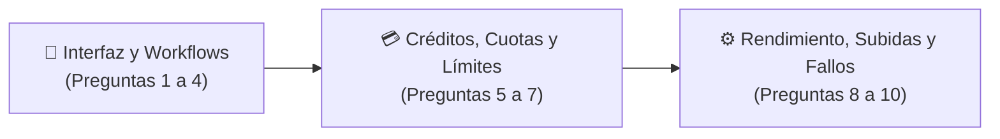

# ❓ FAQ — Preguntas frecuentes sobre OpusClip Dashboard

> [!abstract] En pocas palabras
> Respuestas directas, respaldadas por el código fuente extraído con **REA**, a las preguntas más comunes sobre cómo funciona por dentro `https://clip.opus.pro/dashboard`, sus reglas ocultas, sus fórmulas de cobro y sus mecanismos de recuperación de fallos.

El diagrama organiza las diez preguntas frecuentes en tres bloques: interfaz/workflows, economía de créditos y comportamiento técnico ante subidas o fallos.

> [!example] Ejemplo real: Cómo alternar manualmente entre OpusClip 4.0 y el Dashboard Clásico desde la consola del navegador
> Como el hook `useWorkflowRevampEnabled()` (módulo `889399`) lee la clave `"workflowRevamp.classic"` desde `window.localStorage`, basta con ejecutar `localStorage.setItem("workflowRevamp.classic", "true")` y recargar `/dashboard` para forzar la interfaz clásica, o `"false"` para volver a OpusClip 4.0.

---

## 🎨 1. Interfaz y Workflows

### 1. ¿Cómo decide OpusClip si mostrarme el nuevo Dashboard 4.0 o el Clásico?
A través del hook `useWorkflowRevampEnabled()` (módulo `889399` en `0_hne8424faiu.js`). Evalúa dos condiciones simultáneas:
1. Que el [[Glosario#Feature Gate|Feature Gate]] `enable_workflow_revamp` en Statsig esté en `true` para tu organización.
2. Que la clave local `localStorage.getItem("workflowRevamp.classic")` no sea `"true"`.
Ver más en [[ADR-002 Convivencia de Dashboard Clásico y Workflow Revamp OpusClip 4]].

### 2. ¿Por qué el Dashboard se ve diferente para un usuario recién registrado que para uno con proyectos?
El componente raíz `tA` (`575013` en `2pdyo3gbgw8ji.js`) consulta `POST /api/clip-projects/count`. Si `total === 0`, asigna la audiencia `"new-user"`, activa el carrusel de proyectos de demostración (`demo-danny`, `demo-basketball`, `demo-podcast`) y mueve el banner *"What's New"* debajo de los proyectos (`below-projects`). Si `total > 0`, asigna `"existing-user"`, oculta los demos y sube *"What's New"* arriba de los proyectos (`above-projects`).

### 3. ¿Qué diferencia real hay entre `ClipBasic` y `ClipAnything` en el código?
- **`ClipBasic`**: Optimizado para videos guiados por habla/transcripción; su rango de duración `Auto` es de **`0m a 3m`** y se guía por género (`preferenceGenre`) y palabras clave (`preferenceKeywords`).
- **`ClipAnything`**: Modelo multimodal visual y de audio; su rango de duración `Auto` es **`<90s`** y permite buscar escenas mediante prompts abiertos (`preferencePrompt`). Además, puede ser restringido remotamente mediante el gate `clip_anything_ban`.
Ver más en [[Motor de Curación IA y Configuración de Clips]].

### 4. ¿Cómo se eligen los 4 Workflows que aparecen fijados debajo de la barra de enlace en OpusClip 4.0?
La función `pinnedWorkflows` (módulo `289931` en `2wgzebltzq0s_.js`) toma todos los workflows del usuario, excluye los dos principales (`builtin:long-to-shorts` y `builtin:auto-edits` porque ya están en las pestañas superiores), coloca en primera posición el último workflow personalizado usado (`lastUsedWorkflowId`) y selecciona hasta **2 workflows personalizados (`custom`)** y **2 integrados (`builtin`)** para completar una fila de 4 píldoras.

---

## 💳 2. Créditos, Cuotas y Límites

### 5. ¿Cómo se calcula exactamente cuántos créditos cuesta escalar un video con AI Upscale?
El módulo `48711` aplica la fórmula:
$$\text{upscaleCredits}(70, \text{durationSeconds}) = \text{Math.round}\left(\frac{70}{6} \times \lceil \frac{\text{durationSeconds}}{10} \rceil\right)$$
Se cobra en bloques redondeados hacia arriba cada 10 segundos (por ejemplo, 12 créditos por 10s, 35 créditos por 30s, 70 créditos por 60s). Ver más en [[Indicadores y métricas]].

### 6. ¿Qué pasa con mis créditos y cuotas si un proyecto falla (`STALLED`)?
1. Los créditos quedan inicialmente en `wallet_frozen_credits` al enviar el proyecto. Si falla, el cliente verifica elegibilidad con `POST /api/clip-projects/{id}/check-refund-eligibility` y permite ejecutar el reembolso con `POST /api/clip-projects/{id}/refund`.
2. Si el proyecto usaba **Voiceover**, el poller `usePollDashboardFirstPage` (`184098`) detecta que el proyecto en `"clipping-project-with-vo"` (IndexedDB) pasó a `"STALLED"` y llama automáticamente a `revertUsage()` para devolverte el uso en tu cuota local.
Ver más en [[Flujo de Consumo Congelamiento y Reembolso de Créditos]].

### 7. ¿Por cuánto tiempo se guardan los videos escalados en la pestaña History de AI Upscale?
Exactamente **7 días (`604,800,000 ms`)**. En el módulo `536571` (línea 646 de `extracted_core_modules.txt`), el componente filtra la lista con `Date.now() - task.startedAt <= 6048e5`.

---

## ⚙️ 3. Rendimiento, Subidas y Fallos

### 8. ¿Por qué el Dashboard ejecuta un Web Worker de prueba de CPU al abrir la página?
Después del evento `largest-contentful-paint` (o tras 10 segundos), el módulo `575013` lanza el worker `01sklqt0kl3nd.js` (módulo `91488`), que ejecuta tres bucles de $10^8$ iteraciones y llena un arreglo de $10^7$ números aleatorios, guardando `{ integerTime, floatTime, memoryTime, branchTime }` en `debugStore.debugCpuBenchmark`. Esto permite perfilar la capacidad de cómputo del navegador del usuario sin congelar la interfaz.

### 9. ¿Cómo logra OpusClip subir archivos de varios gigabytes sin que se corte al cambiar de `/dashboard` a `/workflow-canary`?
Combinando dos mecanismos:
1. **`MultipartUploader` (`737381`)**: Divide el archivo en partes, sube con concurrencia progresiva (`2` → `4` → `8` hilos) directo a Google Cloud Storage y reintenta cada fragmento hasta 100 veces (`withHighToleranceRetry`).
2. **`uploadHandoffAtom` (`682284`)**: Guarda la referencia de la subida activa en memoria global Jotai antes de hacer `router.push("/workflow-canary")`, de modo que la nueva vista adopta el mismo proceso `XHR` en vuelo sin reiniciarlo.

### 10. ¿Qué ocurre si un proyecto se queda "colgado" en estado `RUNNING` en el servidor?
El módulo `generatingProgressStore` (`524235`) define `MAX_PROGRESS_POLL_AGE_MS = 7,200,000 ms` (**2 horas**). Si un proyecto lleva más de 2 horas en estado `RUNNING`, la función `wedgedRunningIds` lo mueve a la lista `wedgedIds` y `shouldPollProgress` detiene las peticiones de polling para ese proyecto.

---

> [!info]- Detalle técnico (para desarrolladores)
> Todas las respuestas de este FAQ pueden verificarse línea por línea en los archivos locales `2pdyo3gbgw8ji-formatted.txt`, `extracted_core_modules.txt` y `extracted_revamp_and_worker.txt` dentro de `d:\rea-projects\projects\02-clippers-ippers\`.

## 🔗 Relacionado
- [[Resumen ejecutivo]] — Visión integral de la lógica del dashboard.
- [[Indicadores y métricas]] — Todas las fórmulas y constantes de tiempo en una sola tabla.
- [[Historial de cambios]] — Registro de creación y actualización de este vault.
