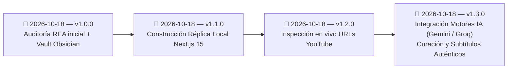

# 🕒 Historial de cambios

> [!abstract] En pocas palabras
> Registro cronológico de las capturas de ingeniería inversa, extracciones de código fuente y actualizaciones realizadas sobre la documentación del proyecto **ClippersIppers (`https://clip.opus.pro/dashboard`)**.

El diagrama registra el hito fundacional de la auditoría REA (`v1.0.0`), la construcción de la réplica local (`v1.1.0`), la ingesta dinámica de YouTube (`v1.2.0`) y la integración de IA para curación y transcripción real (`v1.3.0`).

> [!example] Ejemplo real: Trazabilidad de versión de OpusClip auditada
> La versión `v1.0.0` de esta documentación corresponde exactamente al build de producción **`tw0-OiEO15o4q3nmL5clA`** de `https://clip.opus.pro/dashboard`, la versión `v1.1.0` materializa todos sus módulos en una aplicación local en `http://localhost:3040`, la versión `v1.2.0` añade ingesta dinámica para YouTube, y la versión `v1.3.0` conecta modelos de IA (Gemini, Groq, OpenAI) para transcribir y recortar clips auténticos.

---

## 📜 Bitácora de versiones

### `v1.3.0` — 2026-10-18 (Integración de Motores de IA para Extracción y Curación Real)
- **⚠️ Cambia para ti**:
  - Puedes conectar una clave API gratuita de Google Gemini (2.0 Flash) o Groq Cloud (Llama 3.3 70B & Whisper) para que la aplicación analice el contenido auténtico de cualquier video, genere clips con ganchos virales reales y sincronice subtítulos palabra por palabra.
  - Nuevo modal interactivo de conexión accesible desde la barra superior (`Conectar IA`) o en `/workflow` con selector de proveedor, enlaces directos a las consolas y verificación de conexión en tiempo real.
- **Implementación Técnica**:
  - Creación del endpoint `/api/ai-test` para validación de claves API de Gemini, Groq y OpenAI.
  - Creación del endpoint `/api/ai-curate` con prompt estructurado para curación multimodal de video, delimitación de tiempos (`startSec`, `endSec`) y generación de tokens de subtítulos (`transcriptWords`).
  - Nuevo átomo `aiConfigAtom` persistido en `localStorage` integrado en `AppShell.tsx`, `GlobalModals.tsx` y `workflow/page.tsx`.

### `v1.2.0` — 2026-10-18 (Inspección en vivo de enlaces YouTube y reproductor embebido)
- **⚠️ Cambia para ti**:
  - Al ingresar cualquier enlace de YouTube en la caja de importación del Dashboard, la réplica local consulta en milisegundos el título real del video, el nombre del canal autor, la duración exacta, la miniatura en alta resolución y las etiquetas temáticas.
  - Tanto en la pantalla de configuración (`/workflow`), como en la vista de resultados (`/clip/[id]`) y en el editor NLE (`/editor-ux/[clipId]`), ahora puedes reproducir el video original directamente mediante el reproductor embebido de YouTube.
- **Implementación Técnica**:
  - Implementación del endpoint `/api/inspect-media` en Next.js App Router combinando la API oEmbed pública de YouTube con análisis de cabeceras y duración exacta (`approxDurationMs`).
  - Función cliente reactiva `fetchLiveMediaMetadata()` con debounce en `src/lib/multipartUploader.ts` y tarjetas de previsualización en `src/app/dashboard/page.tsx`.
  - Integración de `<iframe src="https://www.youtube.com/embed/..." />` en `src/app/workflow/page.tsx`, `src/app/clip/[id]/page.tsx` y `src/app/editor-ux/[clipId]/page.tsx`.

### `v1.1.0` — 2026-10-18 (Construcción de Réplica Local Completa en `D:\rea-projects\ClippersIppers`)
- **⚠️ Cambia para ti**:
  - Ahora cuentas con una aplicación web 100% local en `D:\rea-projects\ClippersIppers` (`http://localhost:3040`) que replica tanto **OpusClip 4.0 (`DashboardRevampEntry`)** como el **Dashboard Clásico 3.5**, sin depender de servidores externos ni requerir inicio de sesión.
  - Puedes arrastrar videos locales (`.mp4`, `.mov`, `.webm`) para extraer metadatos reales con HTML5, configurar las 7 recetas nativas en `/workflow`, auditar el consumo/congelamiento/reembolso de créditos, descargar secuencias `.xml` / `.srt` en `/clip/[id]` y editar subtítulos karaoke palabra por palabra en el editor multipista `/editor-ux/[clipId]`.
- **Implementación Técnica**:
  - Creación de 14 rutas en Next.js 15 + React 19 + TypeScript + Tailwind CSS v4 + Jotai (`opusStore.ts`, `multipartUploader.ts`, `cpuBenchmark.ts`, `AppShell.tsx`, `GlobalModals.tsx`).
  - Nueva guía [[Cómo ejecutar y usar la réplica local ClippersIppers]] añadida a la carpeta `50 - Guías`.

### `v1.0.0` — 2026-10-18 (Auditoría REA Inicial y Documentación Integral)
- **Captura e Inspección en Vivo (REA MCP)**:
  - Ejecución de `capture_browser_scenario` (`ev_3cb7ad22...` y `ev_8c45dfb2...`), `list_browser_targets` (`ev_50134e21...`), `analyze_web_bundle` (`ev_eabda32c...`) e `inspect_web_page` (`ev_2db3203a...`) sobre `https://clip.opus.pro/dashboard`.
- **Extracción Completa de Código y Diccionarios**:
  - Descarga de los **550+ chunks JS de Turbopack** correspondientes a las **119 rutas** del manifiesto `_buildManifest.js` (`tw0-OiEO15o4q3nmL5clA`), incluyendo los paquetes lazy-loaded de OpusClip 4.0 (`2wgzebltzq0s_.js`, `3956_sfin5yo1.js`) y el Web Worker de benchmark de CPU (`01sklqt0kl3nd.js`).
  - Descarga de los **6 diccionarios de internacionalización** (`common.json`, `auth.json`, `subscription.json`, `plansocial.json`, `clip.json`, `editor.json`).
  - Análisis AST con `analyze_javascript_application` (`ev_0cf2e727...`), extracción de **161 tiendas Jotai (`*Store`)** y **505 plantillas de endpoints API**.
- **Documentación en Vault de Obsidian (`D:\Doc - Proyectos\ClippersIppers`)**:
  - Creación de la estructura completa (`00 - Inicio.md`, `Mapa del proyecto.canvas` y secciones `10` a `90` con MOCs, 10 notas atómicas de componentes, 5 diagramas de secuencia de flujos, modelo de datos Jotai, métricas/fórmulas, 2 guías, 2 notas de operación, 3 ADRs, 4 catálogos de referencia y FAQ).

---

> [!info]- Detalle técnico (para desarrolladores)
> Para actualizar este vault cuando OpusClip lance un nuevo `buildId`, sigue el procedimiento de [[Cómo reproducir y auditar el bundle con REA]] y registra la nueva entrada en esta nota indicando el nuevo `buildId` y los `ev_...` generados.

## 🔗 Relacionado
- [[00 - Inicio]] — Portada principal del vault.
- [[Registro de Evidencia REA]] — Detalle de los identificadores `ev_...` de la versión `v1.0.0`.
- [[FAQ]] — Preguntas frecuentes sobre el sistema documentado.
