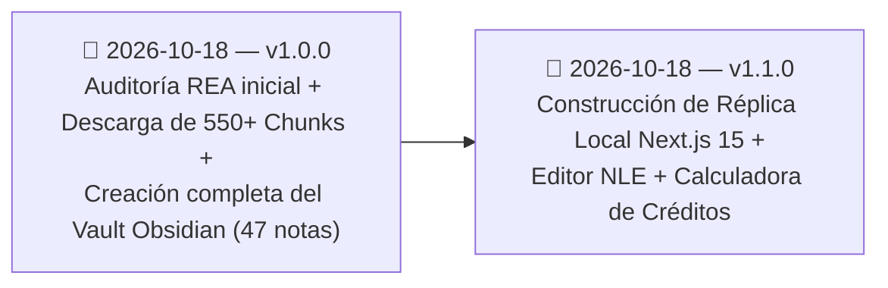

# 🕒 Historial de cambios

> [!abstract] En pocas palabras
> Registro cronológico de las capturas de ingeniería inversa, extracciones de código fuente y actualizaciones realizadas sobre la documentación del proyecto **ClippersIppers (`https://clip.opus.pro/dashboard`)**.

El diagrama registra el hito fundacional de la auditoría REA (`v1.0.0`) y la construcción de la réplica funcional local en `D:\rea-projects\ClippersIppers` (`v1.1.0`).

> [!example] Ejemplo real: Trazabilidad de versión de OpusClip auditada
> La versión `v1.0.0` de esta documentación corresponde exactamente al build de producción **`tw0-OiEO15o4q3nmL5clA`** de `https://clip.opus.pro/dashboard`, y la versión `v1.1.0` materializa todos sus módulos en una aplicación local ejecutable en `http://localhost:3040`.

---

## 📜 Bitácora de versiones

### `v1.1.0` — 2026-10-18 (Construcción de Réplica Local Completa en `D:\rea-projects\ClippersIppers`)
- **⚠️ Cambia para ti**:
  - Ahora cuentas con una aplicación web 100% local en `D:\rea-projects\ClippersIppers` (`http://localhost:3040`) que replica tanto **OpusClip 4.0 (`DashboardRevampEntry`)** como el **Dashboard Clásico 3.5**, sin depender de servidores externos ni requerir inicio de sesión.
  - Puedes arrastrar videos locales (`.mp4`, `.mov`, `.webm`) para extraer metadatos reales con HTML5, configurar las 7 recetas nativas en `/workflow`, auditar el consumo/congelamiento/reembolso de créditos, descargar secuencias `.xml` / `.srt` en `/clip/[id]` y editar subtítulos karaoke palabra por palabra en el editor multipista `/editor-ux/[clipId]`.
- **Implementación Técnica**:
  - Creación de 14 rutas en Next.js 15 + React 19 + TypeScript + Tailwind CSS v4 + Jotai (`opusStore.ts`, `multipartUploader.ts`, `cpuBenchmark.ts`, `AppShell.tsx`, `GlobalModals.tsx`).
  - Nueva guía [[Cómo ejecutar y usar la réplica local ClippersIppers]] añadida a la carpeta `50 - Guías`.

### `v1.0.0` — 2026-10-18 (Auditoría REA Inicial y Documentación Integral)
- **Captura e Inspección en Vivo (REA MCP)**:
  - Ejecución de `capture_browser_scenario` (`ev_3cb7ad22...` y `ev_8c45dfb2...`), `list_browser_targets` (`ev_50134e21...`), `analyze_web_bundle` (`ev_eabda32c...`) e `inspect_web_page` (`ev_2db3203a...`) sobre `https://clip.opus.pro/dashboard`.
- **Extracción Completa de Código y Diccionarios**:
  - Descarga de los **550+ chunks JS de Turbopack** correspondientes a las **119 rutas** del manifiesto `_buildManifest.js` (`tw0-OiEO15o4q3nmL5clA`), incluyendo los paquetes lazy-loaded de OpusClip 4.0 (`2wgzebltzq0s_.js`, `3956_sfin5yo1.js`) y el Web Worker de benchmark de CPU (`01sklqt0kl3nd.js`).
  - Descarga de los **6 diccionarios de internacionalización** (`common.json`, `auth.json`, `subscription.json`, `plansocial.json`, `clip.json`, `editor.json`).
  - Análisis AST con `analyze_javascript_application` (`ev_0cf2e727...`), extracción de **161 tiendas Jotai (`*Store`)** y **505 plantillas de endpoints API**.
- **Documentación en Vault de Obsidian (`D:\Doc - Proyectos\ClippersIppers`)**:
  - Creación de la estructura completa (`00 - Inicio.md`, `Mapa del proyecto.canvas` y secciones `10` a `90` con MOCs, 10 notas atómicas de componentes, 5 diagramas de secuencia de flujos, modelo de datos Jotai, métricas/fórmulas, 2 guías, 2 notas de operación, 3 ADRs, 4 catálogos de referencia y FAQ).

---

> [!info]- Detalle técnico (para desarrolladores)
> Para actualizar este vault cuando OpusClip lance un nuevo `buildId`, sigue el procedimiento de [[Cómo reproducir y auditar el bundle con REA]] y registra la nueva entrada en esta nota indicando el nuevo `buildId` y los `ev_...` generados.

## 🔗 Relacionado
- [[00 - Inicio]] — Portada principal del vault.
- [[Registro de Evidencia REA]] — Detalle de los identificadores `ev_...` de la versión `v1.0.0`.
- [[FAQ]] — Preguntas frecuentes sobre el sistema documentado.
