# 🕒 Historial de cambios

> [!abstract] En pocas palabras
> Registro cronológico de las capturas de ingeniería inversa, extracciones de código fuente y actualizaciones realizadas sobre la documentación del proyecto **ClippersIppers (`https://clip.opus.pro/dashboard`)**.

```mermaid
flowchart LR
    V1["📅 2026-10-18 — v1.0.0<br/>Auditoría REA inicial"] --> V2["📅 2026-10-18 — v1.1.0<br/>Réplica Local Next.js 15"] --> V3["📅 2026-10-18 — v1.2.0<br/>Inspección URLs YouTube"] --> V4["📅 2026-10-18 — v1.3.0<br/>Motores IA (Gemini / Groq)"] --> V5["📅 2026-10-18 — v1.4.0<br/>Stream MP4 + Subtítulos ASR"] --> V6["📅 2026-10-18 — v1.5.0<br/>Rediseño Minimalista Creativo"] --> V7["📅 2026-10-18 — v1.6.0<br/>Depuración de Pausas/Ruido<br/>+ Fuente Josefin Sans"] --> V8["📅 2026-10-18 — v1.7.0<br/>Optimización Tokens API<br/>+ Auto-Zoom y Encuadre"] --> V9["📅 2026-10-18 — v1.8.0<br/>Descarga de Clip Real<br/>+ Subtítulos Coherentes"]
```

El diagrama registra el hito fundacional de la auditoría REA (`v1.0.0`), la construcción de la réplica local (`v1.1.0`), la ingesta dinámica de YouTube (`v1.2.0`), la integración de IA (`v1.3.0`), la sincronización de flujo MP4 nativo (`v1.4.0`), el rediseño integral minimalista creativo (`v1.5.0`), la depuración de transcripción con tipografía editorial Josefin Sans (`v1.6.0`), la optimización de llamadas API (`v1.7.0`) y la descarga directa de clips recortados con subtítulos naturales sin desfaces temporales (`v1.8.0`).

> [!example] Ejemplo real: Trazabilidad de versión de OpusClip auditada
> La versión `v1.0.0` de esta documentación corresponde al build de producción **`tw0-OiEO15o4q3nmL5clA`** de `https://clip.opus.pro/dashboard`, la versión `v1.1.0` materializó la aplicación local en `http://localhost:3040`, la versión `v1.5.0` transformó la experiencia en un estudio de IA minimalista y premium, la versión `v1.6.0` perfeccionó la visualización de texto con Josefin Sans, la versión `v1.7.0` maximizó el rendimiento de tokens y auto-edición, y la versión `v1.8.0` materializa la descarga efectiva del clip 9:16 y el fraseo natural de subtítulos sin saltos al futuro.

---

## 📜 Bitácora de versiones

### `v1.8.0` — 2026-10-18 (Descarga Real del Clip Recortado y Subtítulos Naturales Coherentes)
- **⚠️ Cambia para ti**:
  - **Descarga directa del clip (no del video completo)**: Se implementó la opción de **«Descargar Clip»** tanto en la vista previa del clip (`/clip/[id]`) como en el editor NLE (`/editor-ux/[clipId]`). Permite descargar el segmento exacto (ej. 35s–50s) en formato vertical 9:16 con los subtítulos en Josefin Sans quemados y audio sincronizado, visualizando una barra flotante de progreso en tiempo real. También se mantiene el botón **«Video Completo»** si deseas descargar la fuente íntegra.
  - **Subtítulos con fraseo natural y sin palabras del futuro**: Se eliminó la división rígida por grupos de 4 palabras por índice. El nuevo algoritmo `getNaturalSubtitlePhrase` agrupa las palabras por proximidad temporal (pausas máximas de `0.45s`) y delimitación por puntuación (`.`, `!`, `?`). Si el orador dice «¡Uf!» y hace una pausa de 5 segundos, el subtítulo muestra únicamente «¡Uf!» y desaparece en el silencio, sin pegarle la frase de 5 segundos después.
- **Implementación Técnica**:
  - `src/lib/transcriptUtils.ts`: Creación de la función `getNaturalSubtitlePhrase` con límites de pausa de 450ms, corte en signos de puntuación y supresión de palabras con desfase mayor a 850ms del cabezal de reproducción.
  - `src/lib/clipExporter.ts`: Módulo de renderizado y exportación en Canvas 2D + `MediaRecorder` a 720x1280 (9:16) con velocidad acelerada (2x) y soporte para descarga de streams directos.
  - `src/app/api/export-clip/route.ts`: Endpoint de recorte rápido con `-c copy` para descarga instantánea en servidor cuando FFmpeg está presente.
  - `src/app/clip/[id]/page.tsx` y `src/app/editor-ux/[clipId]/page.tsx`: Reemplazo del botón único por «Descargar Clip» y «Video Completo», barra flotante de porcentaje y adopción de `getNaturalSubtitlePhrase`.

### `v1.7.0` — 2026-10-18 (Optimización de Tokens API, Centrado de Play, Subtítulos en Silencio y Auto-Edición Reactiva)
- **⚠️ Cambia para ti**:
  - **Ahorro masivo de tokens y cero llamadas innecesarias a Gemini/Groq**: Al navegar entre el editor NLE (`/editor-ux/[clipId]`) y el visor de clips (`/clip/[id]`) o el workflow, ya no se dispara la sincronización ni el análisis automático en segundo plano. Además, las respuestas de curación IA se preservan en una caché en memoria de 45 minutos.
  - **Botón de Play/Pausa centrado y accesible**: El botón de reproducción ahora flota en el centro exacto del contenedor de video 9:16 (`top-1/2 left-1/2`), con fondo translúcido y desenfoque. También es posible reproducir o pausar haciendo clic directo sobre cualquier punto del video.
  - **Subtítulos ocultos automáticamente durante silencios**: Cuando el locutor deja de hablar o existe una pausa en el discurso, los subtítulos de karaoke desaparecen limpiamente de la pantalla en vez de dejar clavada la primera frase del clip.
  - **Auto-Zoom Dinámico y Auto-Encuadre Inteligente**: Se implementaron controles interactivos con botones tipo píldora (`⚡ Auto-Zoom: ON/OFF` y `🎯 Auto-Encuadre: ON/OFF`). En los primeros 3.2 segundos del video (hook viral) y en palabras clave destacadas, el encuadre aplica punch-in de zoom dinámico (`1.12x`–`1.18x`) y reencuadre adaptativo horizontal con transiciones suaves en CSS.
- **Implementación Técnica**:
  - `src/app/api/ai-curate/route.ts`: Implementación de `curateResponseCache` con TTL de 45 minutos y corrección de alcance de variables de rango temporal.
  - `src/app/clip/[id]/page.tsx`: Retiro del hook reactivo redundante que forzaba peticiones HTTP a `/api/ai-curate` en cada navegación; centrado absoluto del botón play; ocultamiento de subtítulos cuando `activeWordIndex === -1`; y cálculo dinámico de `dynamicZoom` y `dynamicCropX`.
  - `src/app/editor-ux/[clipId]/page.tsx`: Adición de conmutadores de auto-edición en la barra de herramientas de lienzo y supresión de subtítulos en pausas.

### `v1.6.0` — 2026-10-18 (Depuración de Transcripción sin Pausas/Ruido y Tipografía Josefin Sans)
- **⚠️ Cambia para ti**:
  - **Transcripción y subtítulos limpios de ruido técnico**: Ya no se muestran etiquetas de silencio o censura como `[1.5s paused]`, `[0.8s pause]`, `[____]`, `[___]`, `[Música]`, etc. El visor de palabras, el reproductor de video y los archivos exportados (`.srt`, `.xml`) contienen exclusivamente las palabras habladas reales.
  - **Tipografía Josefin Sans integrada**: Se incorporó la fuente geométrica y elegante **Josefin Sans** de Google Fonts para los subtítulos karaoke superpuestos en el video, los títulos de gancho (Auto-Hook), las píldoras interactivas de transcripción y el editor de Brand Kits (`/brand-template`).
  - **Selector de fuentes en Brand Kit Studio**: Ahora puedes alternar entre Josefin Sans, Inter, Montserrat y Geist Sans en la vista de personalización de plantillas de marca.
- **Implementación Técnica**:
  - Creación del módulo de saneamiento `src/lib/transcriptUtils.ts` con funciones de filtrado `isNoiseOrPauseWord`, `getCleanVisibleWords` y `cleanAllTranscriptWords`.
  - Eliminación de la inyección artificial de pausas en `src/lib/youtubeInnertube.ts` y exclusión de tokens censurados durante el parseo de eventos `json3`.
  - Inclusión de la fuente Google Font en `<head>` (`src/app/layout.tsx`) y variables CSS en `src/app/globals.css` (`--font-josefin`).
  - Actualización de `src/app/clip/[id]/page.tsx`, `src/app/editor-ux/[clipId]/page.tsx`, `src/app/brand-template/page.tsx` y `src/data/seedData.ts`.

### `v1.5.0` — 2026-10-18 (Rediseño Frontend Minimalista, Creativo y Premium — Sin Tiers ni Créditos)
- **⚠️ Cambia para ti**:
  - **Experiencia 100% personal y sin límites**: Se eliminaron completamente todos los componentes de cobro, planes de suscripción (`Free`, `Pro`, `Enterprise`), billeteras de créditos, balances congelados, calculadoras de sobrecostos y modales de pago. Ahora la generación y edición de clips es ilimitada y local.
  - **Estética Minimalista Creativa (macOS + Creator IA + Linear)**: Se implementó un nuevo sistema de diseño con paleta predominantemente clara (`#FAFAFC` de fondo, superficies `#FFFFFF` y `#F4F4F7`, bordes sutiles `#E8E8ED` y acento púrpura creativo `#7652E8`), tipografía de alta jerarquía y micro-sombras limpias.
  - **Studio Simplificado y Enfocado**: El dashboard se simplificó en un cuadro de generación amplio y elegante con autodetección de video, selector directo de formato vertical/horizontal y biblioteca visual de proyectos locales. En `/workflow`, la configuración se redujo a dos columnas con previsualizador, selector de duración y controles esenciales sin saturar la pantalla.
- **Implementación Técnica**:
  - Actualización de tokens de color y micro-sombras en `src/app/globals.css`.
  - Reescritura minimalista de `src/components/layout/AppShell.tsx` y `src/components/layout/GlobalModals.tsx`.
  - Simplificación del Studio en `src/app/dashboard/page.tsx`, `src/app/workflow/page.tsx`, `src/app/projects/page.tsx` y `src/app/clip/[id]/page.tsx`.

### `v1.4.0` — 2026-10-18 (Flujo MP4 Nativo 9:16, Subtítulos Reales Innertube y Editor NLE Jump-Cut)
- **⚠️ Cambia para ti**:
  - **Adiós al iframe de YouTube deformado**: Tanto en la vista de resultados (`/clip/[id]`) como en el editor NLE (`/editor-ux/[clipId]`), los clips se reproducen mediante un elemento `<video>` HTML5 nativo recortado limpiamente a formato vertical `9:16` (`object-cover`), sin barras negras ni controles superpuestos de YouTube, e incluyen botón de **«Descargar MP4»**.
  - **Subtítulos 100% reales y sincronizados con el audio**: Se eliminó el temporizador en bucle (`setInterval`) que hacía avanzar la transcripción sola. Ahora el sistema extrae la transcripción real palabra por palabra del video de YouTube con tiempos exactos en milisegundos y sincroniza el karaoke exclusivamente con el evento `onTimeUpdate` del reproductor de video.
  - **Editor NLE con corte real por texto (Jump-Cut) y reencuadre interactivo**: Al recortar cualquier palabra o muletilla en `/editor-ux/[clipId]`, el reproductor salta automáticamente ese fragmento durante la reproducción. Además, puedes arrastrar el lienzo o usar los deslizadores de **Encuadre 9:16 (`cropX` 0%–100%)**, **Zoom (`1.0x`–`2.2x`)** y **Rango (`startSec` / `endSec`)**.
- **Implementación Técnica**:
  - Creación de `src/lib/youtubeInnertube.ts` utilizando los clientes Innertube `ANDROID` (`20.03.32`) e `IOS` (`20.03.02`) para extraer el stream `video/mp4` directo (`itag 18`) y la pista `json3` con offsets por palabra (`tStartMs` + `tOffsetMs`).
  - Creación del proxy de streaming `/api/video-stream` con soporte `HTTP 206 Partial Content` (`Range` bytes) para salto instantáneo (`#t=start,end`) y descarga directa.
  - Actualización de `/api/ai-curate`, `src/app/clip/[id]/page.tsx` (con auto-actualización de proyectos existentes en `localStorage`) y `src/app/editor-ux/[clipId]/page.tsx`.
  - Actualización de prioridad de modelos Gemini a `gemini-3.8-flash` / `gemini-2.5-flash` en `/api/ai-test` y `/api/ai-curate`.

### `v1.3.0` — 2026-10-18 (Integración de Motores de IA para Extracción y Curación Real)
- **⚠️ Cambia para ti**:
  - Puedes conectar una clave API gratuita de Google Gemini (2.0 Flash) o Groq Cloud (Llama 3.3 70B & Whisper) para que la aplicación analice el contenido auténtico de cualquier video, genere clips con ganchos virales reales y sincronice subtítulos palabra por palabra.
  - Nuevo modal interactivo de conexión accesible desde la barra superior (`Conectar IA`) o en `/workflow` con selector de proveedor, enlaces directos a las consolas y verificación de conexión en tiempo real.
- **Implementación Técnica**:
  - Creación del endpoint `/api/ai-test` para validación de claves API de Gemini, Groq y OpenAI.
  - Creación del endpoint `/api/ai-curate` con prompt estructurado para curación multimodal de video, delimitación de tiempos (`startSec`, `endSec`) y generación de tokens de subtítulos (`transcriptWords`).
  - Nuevo átomo `aiConfigAtom` persistido en `localStorage` integrado en `AppShell.tsx`, `GlobalModals.tsx` y `workflow/page.tsx`.

### `v1.2.0` — 2026-10-18 (Inspección en vivo de enlaces YouTube y reproductor embebido)
- **⚠️ Cambia para ti**:
  - Al ingresar cualquier enlace de YouTube en la caja de importación del Dashboard, la réplica local consulta en milisegundos el título real del video, el nombre del canal autor, la duración exacta, la miniatura en alta resolución y las etiquetas temáticas.
  - Tanto en la pantalla de configuración (`/workflow`), como en la vista de resultados (`/clip/[id]`) y en el editor NLE (`/editor-ux/[clipId]`), ahora puedes reproducir el video original directamente mediante el reproductor embebido de YouTube.
- **Implementación Técnica**:
  - Implementación del endpoint `/api/inspect-media` en Next.js App Router combinando la API oEmbed pública de YouTube con análisis de cabeceras y duración exacta (`approxDurationMs`).
  - Función cliente reactiva `fetchLiveMediaMetadata()` con debounce en `src/lib/multipartUploader.ts` y tarjetas de previsualización en `src/app/dashboard/page.tsx`.
  - Integración de `<iframe src="https://www.youtube.com/embed/..." />` en `src/app/workflow/page.tsx`, `src/app/clip/[id]/page.tsx` y `src/app/editor-ux/[clipId]/page.tsx`.

### `v1.1.0` — 2026-10-18 (Construcción de Réplica Local Completa en `D:\rea-projects\ClippersIppers`)
- **⚠️ Cambia para ti**:
  - Ahora cuentas con una aplicación web 100% local en `D:\rea-projects\ClippersIppers` (`http://localhost:3040`) que replica tanto **OpusClip 4.0 (`DashboardRevampEntry`)** como el **Dashboard Clásico 3.5**, sin depender de servidores externos ni requerir inicio de sesión.
  - Puedes arrastrar videos locales (`.mp4`, `.mov`, `.webm`) para extraer metadatos reales con HTML5, configurar las 7 recetas nativas en `/workflow`, auditar el consumo/congelamiento/reembolso de créditos, descargar secuencias `.xml` / `.srt` en `/clip/[id]` y editar subtítulos karaoke palabra por palabra en el editor multipista `/editor-ux/[clipId]`.
- **Implementación Técnica**:
  - Creación de 14 rutas en Next.js 15 + React 19 + TypeScript + Tailwind CSS v4 + Jotai (`opusStore.ts`, `multipartUploader.ts`, `cpuBenchmark.ts`, `AppShell.tsx`, `GlobalModals.tsx`).
  - Nueva guía [[Cómo ejecutar y usar la réplica local ClippersIppers]] añadida a la carpeta `50 - Guías`.

### `v1.0.0` — 2026-10-18 (Auditoría REA Inicial y Documentación Integral)
- **Captura e Inspección en Vivo (REA MCP)**:
  - Ejecución de `capture_browser_scenario` (`ev_3cb7ad22...` y `ev_8c45dfb2...`), `list_browser_targets` (`ev_50134e21...`), `analyze_web_bundle` (`ev_eabda32c...`) e `inspect_web_page` (`ev_2db3203a...`) sobre `https://clip.opus.pro/dashboard`.
- **Extracción Completa de Código y Diccionarios**:
  - Descarga de los **550+ chunks JS de Turbopack** correspondientes a las **119 rutas** del manifiesto `_buildManifest.js` (`tw0-OiEO15o4q3nmL5clA`), incluyendo los paquetes lazy-loaded de OpusClip 4.0 (`2wgzebltzq0s_.js`, `3956_sfin5yo1.js`) y el Web Worker de benchmark de CPU (`01sklqt0kl3nd.js`).
  - Descarga de los **6 diccionarios de internacionalización** (`common.json`, `auth.json`, `subscription.json`, `plansocial.json`, `clip.json`, `editor.json`).
  - Análisis AST con `analyze_javascript_application` (`ev_0cf2e727...`), extracción de **161 tiendas Jotai (`*Store`)** y **505 plantillas de endpoints API**.
- **Documentación en Vault de Obsidian (`D:\Doc - Proyectos\ClippersIppers`)**:
  - Creación de la estructura completa (`00 - Inicio.md`, `Mapa del proyecto.canvas` y secciones `10` a `90` con MOCs, 10 notas atómicas de componentes, 5 diagramas de secuencia de flujos, modelo de datos Jotai, métricas/fórmulas, 2 guías, 2 notas de operación, 3 ADRs, 4 catálogos de referencia y FAQ).

---

> [!info]- Detalle técnico (para desarrolladores)
> Para actualizar este vault cuando OpusClip lance un nuevo `buildId`, sigue el procedimiento de [[Cómo reproducir y auditar el bundle con REA]] y registra la nueva entrada en esta nota indicando el nuevo `buildId` y los `ev_...` generados.

## 🔗 Relacionado
- [[00 - Inicio]] — Portada principal del vault.
- [[Registro de Evidencia REA]] — Detalle de los identificadores `ev_...` de la versión `v1.0.0`.
- [[FAQ]] — Preguntas frecuentes sobre el sistema documentado.
